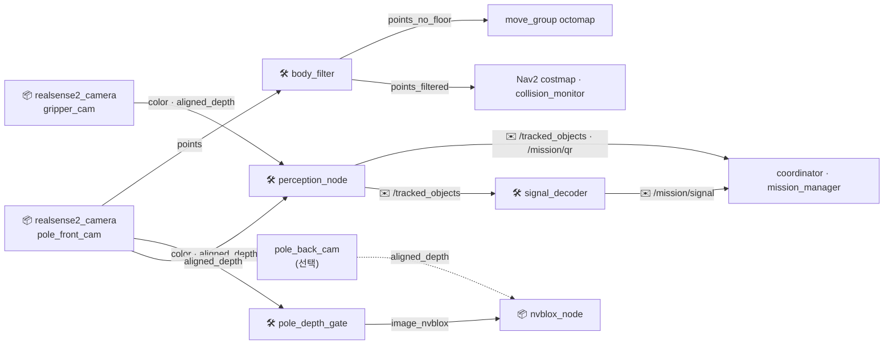

[목차](README.md) · [◀ 전체 아키텍처](01-arch.md) · [2 계획·임무 ▶](03-plan.md)

## 1 센서·인지

카메라 영상은 두 갈래로 갑니다. **인지**(perception_node → `/tracked_objects`)는 퍽·상자·신호등·바코드를 찾아 계획 쪽에 주고, **주행용 depth**(depth_gate·body_filter)는 자기 몸을 지운 뒤 nvblox·Nav2·MoveIt에 줍니다. 코드는 [perception 패키지](../../../lv2_module6/ros2_ws/src/perception/), 카메라 드라이버는 [ros_system.launch.py](../../../lv2_module6/ros2_ws/src/ros_system/launch/ros_system.launch.py)의 `camera()`입니다.

> 인터페이스 명세: [토픽](../../API.md#api-topics) · [TrackedObject 필드](../../API.md#api-msg-trackedobject)

## 카메라

| 카메라 | 장착 (URDF) | 쓰임 |
| --- | --- | --- |
| pole_front_cam | `base_link` 기준 (−0.138, 0.0002, 0.437) m, 피치 0.33 rad | 인지 · cuVSLAM · nvblox · body_filter 점구름 |
| gripper_cam | `gripper_link` 기준 (0.082, 0, 0.040) m, 피치 0.36 rad | 인지 · hand_relative (학습 보정 관측) |
| pole_back_cam | `base_link` 기준 (−0.281, 0, 0.437) m, yaw π (urdf/default만) | 주행 전용 — nvblox camera_1 · body_filter 차체 링크. 인지는 안 씀 |

- 위치는 [urdf/default/urdf.xacro](../../../lv2_module6/urdf/default/urdf.xacro). launch `urdf:=` 기본값이 `default`입니다 (bringup · ros_system 모두).
- RealSense 노드는 카메라마다 하나: `serial_no`, `640x360x15`, `align_depth.enable: true`, 적외선 끔, `publish_tf: false`(프레임은 URDF가 냄), `respawn`. 기본 QoS는 reliable이라 `color_qos`·`depth_qos`·`pointcloud_qos`를 `SENSOR_DATA`로 바꿉니다.
- `use_gripper_cam`·`use_pole_back_cam`은 bringup에서 `auto` — serial 장치가 USB에서 보일 때만 켭니다 ([bringup.launch.py](../../../lv2_module6/ros2_ws/src/bringup/launch/bringup.launch.py)). pole_back_cam은 serial이 비면 꺼집니다.
- depth는 decimation 필터(기본 켬, 배율 2)로 점군을 1/4로 줄입니다. 점구름(PointCloud2)은 pole_front_cam만 기본 켬, gripper_cam·pole_back_cam은 기본 끔.

주요 토픽 (카메라 이름 = 노드 이름, namespace 없음):

| 토픽 | 용도 |
| --- | --- |
| `/<cam>/color/image_raw`, `/<cam>/aligned_depth_to_color/image_raw`, `/<cam>/color/camera_info` | perception_node 입력 (두 카메라) |
| `/pole_front_cam/depth/color/points` | body_filter 입력 |
| `/pole_front_cam/aligned_depth_to_color/image_nvblox` | depth_gate 출력 → nvblox |

## depth_gate · body_filter

| 노드 | 하는 일 | 핵심 파라미터 |
| --- | --- | --- |
| pole_depth_gate (`depth_gate.cpp`) | 카메라에서 `depth_min_range`(0.5 m) 안 depth를 0으로 — 앞으로 뻗은 자기 팔·폴대가 지도에 안 들어가게. 파이썬판은 ros_system `scan_cam_gate` (`depth_gate_cpp:=false`) | `depth_in`, `depth_out`, `depth_min_range` |
| body_filter (`body_filter.cpp`, CUDA판 `body_filter_cuda.cu`) | `/robot_description`의 충돌 상자에 든 점(팔·차체)을 제거 → `points_filtered`, 거기서 바닥(`floor_z` 0.02 m 이하)까지 뺀 `points_no_floor`. 현재 팔 자세는 TF로 | `padding` 0.10 (팔), `base_padding` 0.02 (차체), `base_links`, `stride` 4, `use_gpu` |

- `points_filtered`는 Nav2 costmap·collision_monitor, `points_no_floor`는 MoveIt octomap([sensors_3d.yaml](../../../lv2_module6/ros2_ws/src/ros_system/config/moveit/sensors_3d.yaml))이 봅니다. body_filter는 Nav2용이라 인지를 꺼도 늘 뜹니다.
- `padding`을 0.12보다 키우면 그리퍼 앞 진짜 장애물까지 지워진다고 [perception.yaml](../../../lv2_module6/ros2_ws/src/perception/config/perception.yaml)에 적혀 있습니다 (실기 2026-11-09 측정).

## perception_node

[perception_node.cpp](../../../lv2_module6/ros2_ws/src/perception/src/perception_node.cpp) (C++, 예전 파이썬판 `perception_node_py`). 두 카메라의 컬러·정렬 depth를 시각이 맞는 쌍(`sync_slop` 0.05 s)으로만 묶어 카메라당 최대 4 Hz로 추론하고, 10 Hz로 `/tracked_objects`를 냅니다.

| 단계 | 내용 (코드·yaml 기준) |
| --- | --- |
| YOLO | `model_path: bee_yolo11n_v6.onnx` (퍽 + 상자 한 모델, 입력 384×640 고정), `confidence` 0.4. `tensorrt: true`면 `~/.cache/beebot/trt/<모델>_fp16.engine`이 있을 때 TensorRT(+`tensorrt_cuda_graph`), 없으면 ONNX Runtime — `device` 기본 cuda, 안 되면 CPU |
| 3D 위치 | 박스 가운데 depth → `track_frame: odom`에서 추적 → 발행 순간의 map←odom으로 map 기준 변환. 퍽은 `puck_center_offset` 0.015 m로 표면 → 중심 보정 |
| 융합 추적 | 같은 클래스는 `match_dist` 0.4 m 안에서 마할라노비스 거리로 1:1 매칭, 퍽·구역은 안 보여도 기억, 2초 안 보인 트랙은 삭제 |
| 자기 몸 거르기 | `self_filter`: 팔 링크 선분 `self_radius` 0.06 m, 차체 `body_box`, 영상 속 팔 투영 점 `self_arm_hits` |
| 퍽 판단 | 색 `puck_colors: [red, green]` (HSV `hue_tol` 10 + YOLO 색), 자세 `stand_ratio` 0.8, 크기 상·하한 |
| AprilTag | `tag_backend: auto` (GPU cuAprilTags 빌드면 GPU, 아니면 OpenCV aruco), 퍽 0~11 · 장소 상자 12~14, `tag_roi`·`tag_gamma`·`tag_half` |
| 바코드 | zxing-cpp 1D, `/cmd/mission`의 `start` 뒤 `barcode_window_s` 180 s 동안만 읽음, 실패 시 보조 읽기(`barcode_fallback.hpp`). 읽으면 `barcode` 물체 + `/mission/qr` |
| 신호등 | YOLO 클래스 `traffic_light_<상태>` → `class_name: traffic_light` + `color`/`details.state` |

`class_name`은 `puck` · `puck_lying` · `traffic_light` · `person` · `obstacle` · `location_box` · `start_box` · `barcode` 8가지만 나갑니다 ([API.md](../../API.md#api-msg-trackedobject)). `details`는 클래스별 키(`tag`·`shape`·`yaw_period`·`content`·`state`·`distance`)이고 값이 없으면 키가 없습니다. 메시지: [TrackedObject.msg](../../../lv2_module6/ros2_ws/src/perception/msg/TrackedObject.msg).

## signal_decoder

`/tracked_objects`의 신호등 상태를 시간축으로 읽어 12번 점멸 사이클마다 결과를 냅니다 ([signal_decoder.cpp](../../../lv2_module6/ros2_ws/src/perception/src/signal_decoder.cpp), [MissionSignal.msg](../../../lv2_module6/ros2_ws/src/perception/msg/MissionSignal.msg)).

| 파라미터 | 값 | 뜻 |
| --- | --- | --- |
| `blinks` | 12 | 사이클당 점멸 수 (아니면 `error: count`) |
| `min_count` · `max_count` | 1 · 6 | 색별 횟수 범위 (벗어나면 `range`) |
| `min_on_s` · `min_off_s` | 0.3 · 0.3 | 이보다 짧은 켜짐은 잡음, 짧은 꺼짐은 켜진 구간에 포함 |
| `gap_s` | 2.5 | 꺼짐이 이만큼 이어지면 사이클 끝 |
| `confirm` | 1 | 같은 답이 연속 이 횟수 나와야 `ok` |

## 토픽·QoS 요약

| 토픽 | 방향 | QoS (코드) |
| --- | --- | --- |
| `/tracked_objects` | perception_node → coordinator 등 | 발행 depth 5 (reliable) |
| `/perception/<cam>/detections`, `…/debug_image` | perception_node → 확인용 | 5 · SensorData 계열(best_effort, depth 5) |
| `/mission/qr` | perception_node → mission_manager | reliable + transient_local, depth 1 |
| `/mission/dice_image`, `/mission/dice_image_raw` | perception_node → mission_manager | transient_local (`/mission/capture_dice` Int32 요청) |
| `/mission/signal` | signal_decoder → mission_manager | reliable + transient_local, depth 1 (새 답이 확정될 때만) |
| `/mission/signal_status` | signal_decoder | reliable, depth 10 (사이클마다) |
| depth_gate · body_filter 입출력 | — | `SensorDataQoS` (body_filter는 keep_last 1) |

## 확인 못 한 것

- 학습 모델 정확도 수치(yaml 주석의 시험 결과)는 재현하지 않고 옮기지도 않았다.
- `use_sim_time` 아래 카메라 입력(Isaac `camera_adapter`)의 토픽 이름은 이 패키지 코드로는 확인하지 못함.
- 바코드 `P2-0[1-4]` 고정(`barcode_once_pattern`)과 `/mission/qr` 재발행 주기 세부는 API.md 서술만 보고 코드 동작은 따라가지 않았다.
- `hand_relative`·`static_esdf_slice` 내부는 이 문서에서 다루지 않았다 ([09-nodes.md](09-nodes.md) 참고).
