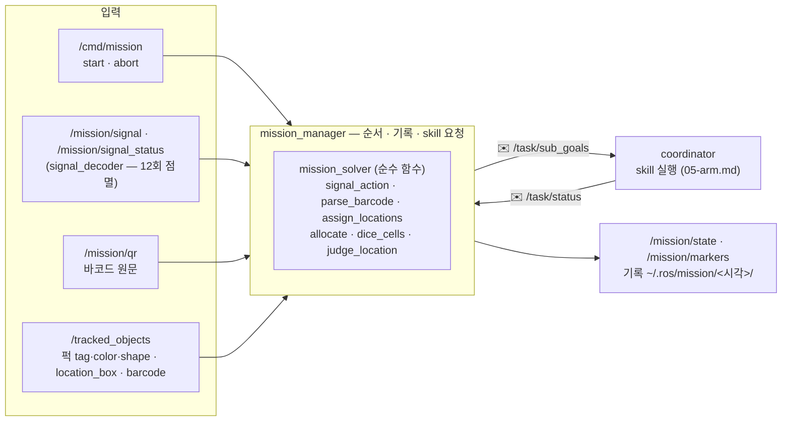
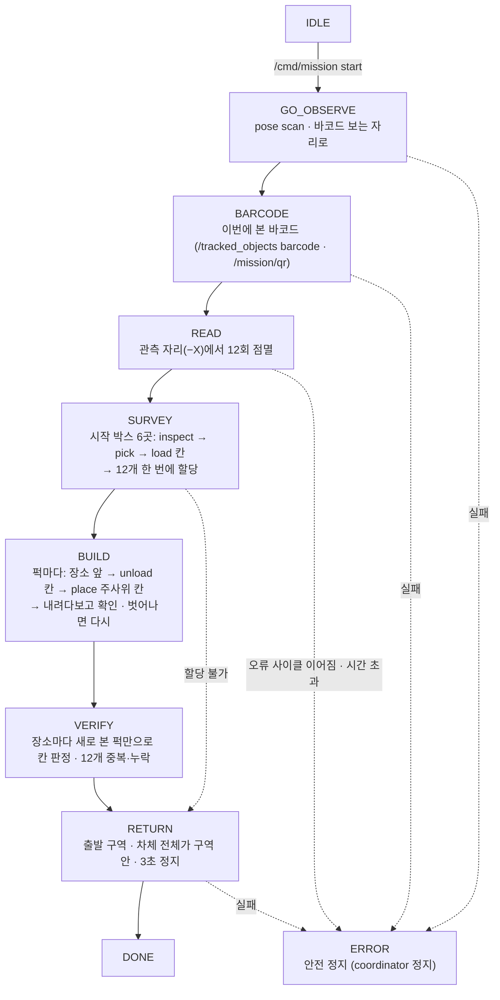
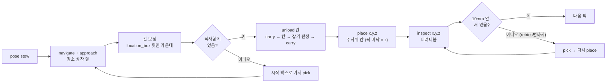
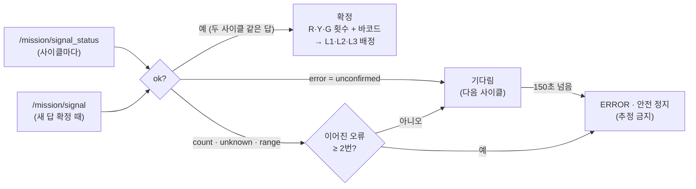

# 2 계획·임무 — 주사위 미션 흐름 (mission_manager)

주사위 기억 미션([mission/README.md](../../mission/README.md))을 처음부터 끝까지 진행하는 노드가 **mission_manager**입니다. 하는 일은 세 가지입니다.

- **순서**: 미션 단계를 차례로 진행합니다.
- **기록**: 단계마다 결과를 파일로 남깁니다.
- **skill 요청**: 각 단계에서 coordinator에 skill 계획을 보냅니다.

판단(정렬, 배정, 할당, 칸, 판정)은 순수 함수 모음인 **mission_solver**가 합니다. skill 실행은 **coordinator**([05-arm.md](05-arm.md))가 합니다.

- 구현: [mission_manager.cpp](../../../lv2_module6/ros2_ws/src/plan/src/mission_manager.cpp) · [mission_solver.cpp](../../../lv2_module6/ros2_ws/src/plan/src/mission_solver.cpp)
- 파라미터: [plan.yaml](../../../lv2_module6/ros2_ws/src/plan/config/plan.yaml) `mission_manager`

## 한눈에 보기





## 시작·정지

```bash
ros2 topic pub --once /cmd/mission std_msgs/msg/String "{data: start}"   # 시작 (IDLE일 때만)
ros2 topic pub --once /cmd/mission std_msgs/msg/String "{data: abort}"   # 멈춤 — coordinator 정지 (plan_id 0 + 빈 목록)
ros2 topic echo /mission/state                                           # 단계 · 지금 하는 일 · 횟수 · 배정 · 적재함 · 결과
```

- 로봇을 켤 때 놓는 자리가 정해져 있습니다. 출발 관측 위치(734, 950)에서 **−X를 보고** 켭니다.
- map 원점은 켠 자리이고, 경기장 좌표는 `start_pose_arena` 하나로 map 좌표로 바꿉니다.
- 다른 자리에서 켰다면 launch 인자 `start_pose:=[x, y, yaw]`로 알려 줍니다.
- 퍽 바닥과 상자 윗면 등 높이 기준은 바닥 Z=0입니다.

## 단계별

| 단계 | 하는 일 | skill (coordinator) | 실패하면 |
|---|---|---|---|
| GO_OBSERVE | 팔을 scan 자세로 접고(pole_front_cam 시야를 가리지 않게), 바코드가 화면에 들어오는 자리로 | `pose scan` · `navigate x,y,yaw` | ERROR |
| BARCODE | 이 단계 시작 뒤에 본 바코드만 씀: `/tracked_objects` barcode의 `content`, 또는 `/mission/qr`. 읽으면 관측 자리(−X)로 | `navigate x,y,yaw` | ERROR (`barcode_missing`) |
| READ | 12회 점멸을 기다림 (아래 [신호](#신호-read)) | — | ERROR (`signal_<error>` · `signal_timeout`) |
| SURVEY | 시작 박스 6곳마다 다가가 퍽 두 자리를 내려다봄(tag·색·모양) → 읽은 퍽을 집어 적재함 칸에 → 12개를 한 번에 그룹(R·Y·G)에 할당 | `pose stow` · `navigate` · `approach` · `inspect x,y,z` · `pick <id>` · `load <칸>` | 박스·퍽 단위로 결과에 남기고 계속. 할당 불가면 RETURN |
| BUILD | 퍽마다 장소 상자 앞으로 → 인지 `location_box`로 칸 위치 보정 → 적재함에서 꺼냄(못 실은 퍽은 시작 박스에서 직접) → 주사위 칸에 놓기 → 내려다보고 10mm 밖이거나 누웠으면 다시 집어 놓기(`retries`번) | `approach` · `unload <칸>` · `place x,y,z` · `inspect x,y,z` · `pick <id>` | 퍽 단위로 결과에 남기고 다음 퍽 |
| VERIFY | 장소마다 **이번에 새로 본 퍽만**으로 칸별 판정(10mm, 2초 안정은 운영 판정) + 12개 중복·누락 | `approach` · `inspect x,y,z` | 결과에만 남김 |
| RETURN | 출발 구역 가운데로 → 차체 외곽(`footprint`)이 구역 안인지 확인, 밖이면 한 번 보정 → `home_hold_s`(3초) 정지 | `pose stow` · `navigate` / `approach` | ERROR |

- **주행 전에는 팔을 접습니다.** 박스에 다가가기·물러나기·복귀 계획 맨 앞에 `pose stow`를 넣습니다. 놓기·보기 뒤에는 팔이 박스 위에 나가 있기 때문입니다.
- **박스에 다가가기**: Nav2로 박스 변 바깥 `standoff`(0.25m)까지 간 뒤, `approach`로 `approach_gap`(0.085m)까지 저속 직선으로 붙습니다. Nav2는 로봇을 원 0.18m로 봐서 더 붙지 못합니다.
  - 점에서 가까운 변부터 시도하고, 실패하면 다음 변으로 넘어갑니다(`approach_tries`).
  - 다음 주행 전에는 붙었던 자리에서 standoff까지 먼저 똑바로 물러납니다.
- **적재함 12칸**: 조사하면서 `pick` → `load next`로 싣습니다. **장부(칸 → 퍽 tag)는 coordinator 하나만 씁니다**(`/coordinator/basket`, 파일 저장). mission_manager는 그 장부를 읽어 "그 tag가 실린 칸"을 찾아 `unload <칸>`을 보냅니다. 쓰는 칸은 coordinator `basket_use`. 칸이 다 차면 나머지 퍽은 BUILD 때 시작 박스에서 직접 집어 옵니다.
- **할당**: 먼저 집은 퍽 때문에 Y(한 모양)를 못 만드는 일이 없도록 12개를 한 번에 정합니다.
  - Y의 모양을 정하면, Y에 들어갈 빨강 수(빨강 수 − R)와 초록 수(초록 수 − G)가 정해집니다.
  - 원기둥 → 직육면체 순으로, 그 수만큼 같은 모양 퍽이 있는지만 보면 됩니다(`allocate`).
- **칸 보정**: 놓기 직전 인지 `location_box`(장소 상자 윗면 가운데, 태그 12~14)가 예상 상자 중심에서 어긋난 만큼 칸을 옮깁니다. `tag_correction_max`(0.05m)를 넘으면 잘못 본 것으로 보고 보정하지 않습니다(태그만 보고 윗면을 못 찾은 경우 등).

### 퍽 하나 놓기 (BUILD)

**퍽 하나 놓기 (BUILD)** — 주행 전에는 항상 `pose stow`. 박스 앞은 Nav2로 0.25m까지 간 뒤 `approach`로 0.085m까지 직선으로 붙습니다 (Nav2는 로봇을 원 0.18m로 봐서 더 못 붙음).



- **칸 보정**: 인지 `location_box`(상자 윗면 가운데)가 예상 상자 중심에서 어긋난 만큼 칸을 옮김. 0.05m를 넘으면 잘못 본 것으로 보고 안 옮김.
- **놓기**: `place x,y,z` — 손 안 퍽 바닥이 z(상자 윗면)가 되게. 위 0.08m → 내려가 0.02m 위에서 벌림 → 다시 위.
- **확인**: 놓은 뒤 이번에 본 퍽만으로 칸 중심에서 10mm 안인지, 누웠는지. 아니면 `retries`(2)번까지 다시 집어 놓기.
- 적재함에 못 실은 퍽은 시작 박스로 가서 직접 집어 옴. 장소에 못 가면 손에 든 퍽을 적재함 빈 칸에 두고 다음 퍽으로.

## 신호 (READ)

signal_decoder가 두 토픽을 냅니다([API.md MissionSignal](../../API.md#api-msg-missionsignal)).
- `/mission/signal`: 새 답이 확정될 때만 나옵니다.
- `/mission/signal_status`: 사이클마다 나옵니다.

READ가 시작된 **뒤에 끝난 사이클만** 봅니다. 판정은 mission_solver `signal_action`이 합니다.



| 사이클 결과 | 할 일 |
|---|---|
| `ok` (두 사이클 같은 답으로 확정) | 확정 — R·Y·G 횟수와 바코드로 L1·L2·L3 배정 (`valid_counts` · `parse_barcode` · `assign_locations`, 동률이면 R → Y → G) |
| `error = unconfirmed` (아직 한 사이클) | 기다림 |
| `error = count · unknown · range` | 이어진 오류 수를 셈 — `signal_error_cycles`(2)번 이어지면 **ERROR** (발제: 추정 금지 → 오류 기록·안전 정지). 그 전엔 다음 사이클을 봄 (한 번은 잡음일 수 있음) |
| `signal_timeout_s`(150초) 안에 확정 없음 | ERROR (`signal_timeout`) |

`/mission/signal_status`의 `ok`도 확정으로 봅니다. `/mission/signal`은 같은 답이면 다시 나오지 않아서, 지난 회차와 같은 신호면 새 회차에 받을 수 없기 때문입니다.

## 실패 정책

- 관측 실패(바코드, 신호)와 복귀 이동 실패만 **ERROR**로 멈춥니다. coordinator에 정지(plan_id 0 + 빈 목록)를 보냅니다.
- 나머지(다가가기, 집기, 놓기, 확인)는 skill마다 `retries`번 다시 시도합니다. 그래도 안 되면 **그 퍽·장소만 실패로 결과에 남기고** 다음으로 갑니다. 그때까지의 점수는 유효하므로 복귀까지 진행합니다.
- `/cmd/mission abort`는 어느 단계에서든 ERROR(`aborted`)로 멈춥니다.

## 기록

`log_dir`(기본 `~/.ros/mission`)/<시작 시각>/에 남깁니다.

| 파일 | 내용 |
|---|---|
| `signal.json` | 바코드 · 오름/내림 · 색 순서 12개 · `raw` · 확정 사이클 수 · R·Y·G 횟수 · L1·L2·L3 그룹 (오류면 오류 이유) |
| `allocation.json` | 조사한 퍽(tag · 색 · 모양 · 시작 박스 · 적재함 칸) · 할당 결과 · 장소별 퍽과 칸 |
| `build.json` | 퍽마다 놓은 장소·칸 · 성공 여부 · 이유(오차 mm 등) |
| `verify.json` | 장소마다 칸별 판정 · 본 퍽 · 빈 칸 퍽 · 12개 중복·누락 |
| `return.json` | 출발 구역 안인지 · 보정 여부 · 마지막 자세 |
| `error.json` | ERROR 이유와 그때까지의 결과 |
| `photos/` | 단계 사진 (`photo_topic` — 찍을 때만 잠깐 구독) |

## 아직 안 된 것

- **실기·시뮬레이터 실행 확인**: 경기장 좌표, 바코드 보는 자리(`barcode_pose_arena`), 다가가기 거리, 칸 보정은 실물로 맞춰야 합니다.
- **운영자 CLI 버튼**: 지금은 `/cmd/mission`을 직접 발행합니다.
- **누운 퍽**: `stand`·`stand_pick`(05-arm.md)이 생기면 SURVEY와 BUILD에서 씁니다. 지금은 누운 퍽을 그대로 `pick`합니다.
