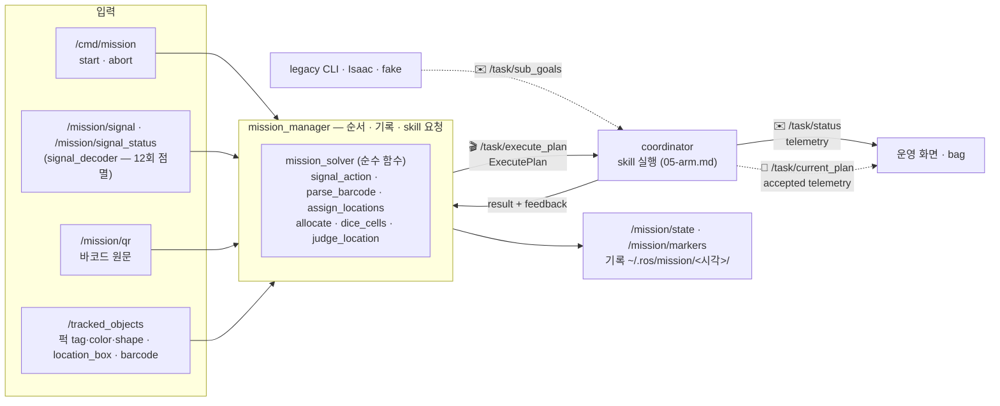
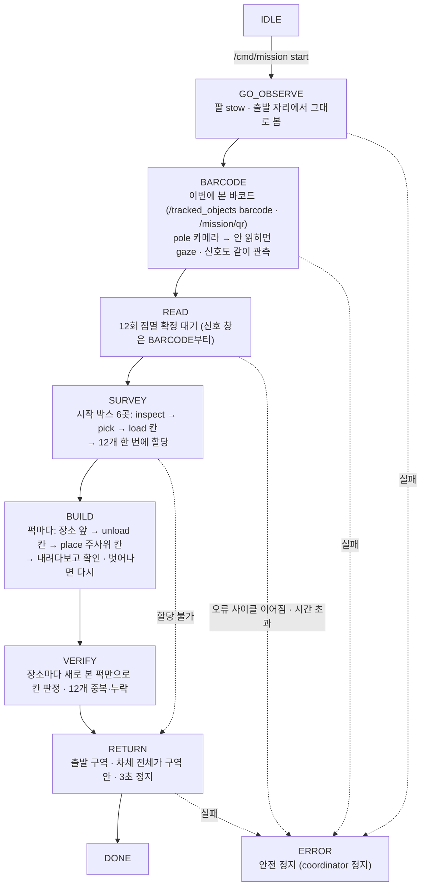
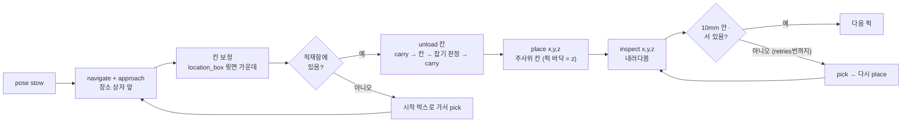
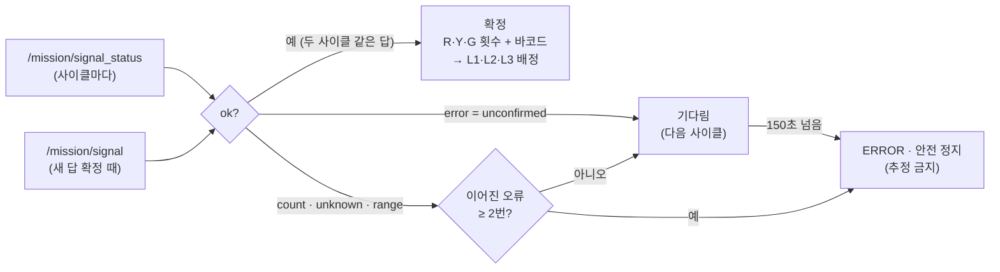

# 2 계획·임무 — 주사위 미션 흐름 (mission_manager)

주사위 기억 미션([mission/README.md](../../mission/README.md))을 처음부터 끝까지 진행하는 노드가 **mission_manager**입니다. 하는 일은 세 가지입니다.

- **순서**: 미션 단계를 차례로 진행합니다.
- **기록**: 단계마다 결과를 파일로 남깁니다.
- **skill 요청**: 각 단계에서 coordinator에 `ExecutePlan` Action으로 skill 계획을 보냅니다.

판단(정렬, 배정, 할당, 칸, 판정)은 순수 함수 모음인 **mission_solver**가 합니다. skill 실행은 **coordinator**([05-arm.md](05-arm.md))가 합니다.

- 구현: [mission_manager.cpp](../../../lv2_module6/ros2_ws/src/plan/src/mission_manager.cpp) · [mission_solver.cpp](../../../lv2_module6/ros2_ws/src/plan/src/mission_solver.cpp)
- 파라미터: [plan.yaml](../../../lv2_module6/ros2_ws/src/plan/config/plan.yaml) `mission_manager`

## 한눈에 보기





## 시작·정지

```bash
ros2 topic pub --once /cmd/mission std_msgs/msg/String "{data: start}"   # 시작 (IDLE일 때만)
ros2 topic pub --once /cmd/mission std_msgs/msg/String "{data: abort}"   # 멈춤 — MissionManager가 ExecutePlan cancel 요청
ros2 topic pub --once /cmd/mission std_msgs/msg/String "{data: 'start:DIAG'}" # 현장 진단 실행 (아래 [실패 정책](#실패-정책))
ros2 topic echo /mission/state                                           # 단계 · 지금 하는 일 · 횟수 · 배정 · 적재함 · 결과
```

- 로봇을 켤 때 놓는 자리가 정해져 있습니다. 출발 관측 위치(734, 950)에서 **−X를 보고** 켭니다.
- map 원점은 켠 자리이고, 경기장 좌표는 `start_pose_arena` 하나로 map 좌표로 바꿉니다.
- 다른 자리에서 켰다면 launch 인자 `start_pose:=[x, y, yaw]`로 알려 줍니다.
- 퍽 바닥과 상자 윗면 등 높이 기준은 바닥 Z=0입니다.
- **시작 명령 변형** (`mission_solver parse_start`): `start:BARCODE`·`start:READ`·`start:SURVEY`·`start:RETURN`(그 단계만), `start:GOTO:S1,L2,…`(관측·조사 없이 상자에 다가가기만 하고 복귀), `start:DIAG[:<바코드>:<신호>]`, `start:FROM_SURVEY:<바코드>:<신호>`·`start:DIAG_FROM_SURVEY:…`(관측을 건너뛰고 준 바코드·신호로 SURVEY부터). 실기 구간 시험용입니다.
- **시작할 때 적재함 장부가 비어 있어야 합니다.** `/coordinator/basket`에 실린 퍽이나 손에 든 퍽이 있으면 시작을 거부합니다. 지난 미션의 장부 파일이 남아 있으면 이렇게 됩니다. `/mission/state` note에 이유가 나옵니다. 적재함이 정말 비었는지 눈으로 본 뒤 비웁니다.

  ```bash
  ros2 service call /coordinator/basket_clear std_srvs/srv/Trigger
  ```

## 단계별

| 단계 | 하는 일 | skill (coordinator) | 실패하면 |
|---|---|---|---|
| GO_OBSERVE | 팔은 **stow 그대로**(scan 자세는 없앰 — 팔을 뻗은 채 돌면 밀리고 무게중심이 쏠림. stow에서도 pole_front_cam에 신호등이 보임). `barcode_pose_arena`를 안 주면(기본) 출발 자리에서 이동 없이 봄 | (`barcode_pose_arena`를 줬을 때만) `navigate x,y,yaw` | ERROR |
| BARCODE | 이 단계 시작 뒤에 본 바코드만 씀: `/tracked_objects` barcode의 `content`, 또는 `/mission/qr`. 신호도 이때부터 같이 관측. 먼저 pole_front_cam으로 `barcode_pole_s`(3초) 보고, 안 읽히면 `pose gaze`로 손 카메라(gripper_cam)를 씀 — 신호가 확정되기 전에는 팔을 접은 채 기다림(`barcode_gaze_after_signal`). gaze에서 `barcode_gaze_wait_s`(3초) 안 읽히면 `barcode_advance_step_m`(0.06m)씩 직선으로 다가감(손 카메라 정면 `barcode_min_gap_m` 0.13m까지 · 최대 `barcode_advance_max_m` 0.30m). 읽으면 팔을 접음 | `pose gaze` · `approach drive_straight` · `pose stow` | ERROR (`barcode_missing` · `unknown_barcode:<원문>` · `arm_sag:<관절>` · `signal_<error>`) |
| READ | 12회 점멸을 기다림 (아래 [신호](#신호-read)). 이미 BARCODE 중에 확정됐으면 바로 다음 | — | ERROR (`signal_<error>` · `signal_timeout`) |
| SURVEY | 시작 박스 6곳(`survey_order` 4·5·3·6·2·1)마다 다가가 상자 윗면 안의 퍽(태그를 읽은 것, 가운데에 가까운 순 최대 `survey_pucks_per_box` 2개)을 한 번에 내려다봄(tag·색·모양) → 읽은 퍽을 집어 적재함 칸에(선 퍽 먼저, 누운 퍽은 나중) → 12개를 한 번에 그룹(R·Y·G)에 할당 | `pose stow` · `navigate` · `approach` · `inspect x,y,z box` (look 자세 → 모자라면 본 퍽을 담는 자세로 다시) · `pick <id>` (누우면 `stand <id>` → `stand_pick`) · `load <칸>` | 박스·퍽 단위로 결과에 남기고 계속. 할당 불가면 RETURN |
| BUILD | 퍽마다 장소 상자 앞으로 → 인지 `location_box`로 칸 위치 보정 → 적재함에서 꺼냄(못 실은 퍽은 시작 박스에서 직접) → 주사위 칸에 놓기 → 내려다보고 10mm 밖이거나 누웠으면 다시 집어 놓기(`retries`번) | `approach` · `unload <칸>` · `place x,y,z` · `inspect x,y,z` · `pick <id>` · `stand`·`stand_pick` | 퍽 단위로 결과에 남기고 다음 퍽 |
| VERIFY | 장소마다 **이번에 새로 본 퍽만**으로 칸별 판정(10mm, 2초 안정은 운영 판정) + 12개 중복·누락. 놓은 순서의 거꾸로(L3 → L2 → L1) 돌고, 마지막에 놓은 장소는 선 자리에서 바로 봄 | `approach` · `inspect x,y,z` | 결과에만 남김 |
| RETURN | 출발 구역 가운데로(`navigate`는 `retries`번까지) → 차체 외곽(`footprint`)이 구역 안인지 확인, 밖이면 한 번 보정 → `home_hold_s`(3초) 정지. `navigate`가 끝내 실패해도 구역 가운데가 `return_direct_m`(1.0m) 안이면 직선(`approach park_home`)으로 마저 감 | `pose stow` · `navigate` / `approach park_home` | ERROR (`return_nav:<이유>` · 구역에서 1.0m 넘게 멀 때) |

- **주행 전에는 팔을 접습니다.** 박스에 다가가기·물러나기·복귀 계획 맨 앞에 `pose stow`를 넣습니다. 놓기·보기 뒤에는 팔이 박스 위에 나가 있기 때문입니다.
- **박스에 다가가기**: Nav2로 박스 변 바깥(박스 가운데에서 `nav_turn_m` 0.55m까지 물린 자리 — 몸이 박스에 안 걸려 돌 수 있게)까지 간 뒤, `approach`(`dock_box`)로 **인지한 상자** 기준 `approach_gap`(0.099m)까지 저속 직선으로 붙습니다. Nav2는 로봇을 원 0.18m로 봐서 더 붙지 못합니다.
  - 박스마다 지정한 변(`start_box_sides` · `location_box_sides`, 첫 면이 진입 면이고 `"-y@0.44"`처럼 변 앞 거리도 줄 수 있음)을 순서대로 시도하고, 실패하면 다음 변으로 넘어갑니다(`approach_tries`). 지정이 없으면 점에서 가까운 변부터입니다. 벽에서 `wall_clearance`(0.22m) 안인 변은 처음부터 뺍니다.
  - 다음 주행 전에는 붙었던 자리에서 먼저 똑바로 물러납니다(`approach exit`, 박스마다 `start_box_retreat`·`exit_turn_clear`로 회전 공간 확보).
- **적재함 12칸**: 조사하면서 `pick` → `load next`로 싣습니다. **장부(칸 → 퍽 tag)는 coordinator 하나만 씁니다**(`/coordinator/basket`, 파일 저장). mission_manager는 그 장부를 읽어 "그 tag가 실린 칸"을 찾아 `unload <칸>`을 보냅니다. 쓰는 칸은 coordinator `basket_use`. 칸이 다 차면 나머지 퍽은 BUILD 때 시작 박스에서 직접 집어 옵니다.
- **누운 퍽은 세워서 집습니다** (`grab` → `stand_up`): `pick` 대신 `stand <id>` → `stand_check_s`(1초) 뒤 인지로 섰는지 봄 → 섰으면 `stand_pick` → (조사 때) `load next`.
  - 아직 누워 있으면 같은 퍽으로 `stand`를 다시 합니다(`retries`번). 그래도 누우면 `stand_still_lying`으로 그 퍽만 실패로 남깁니다.
  - 손 그늘 등으로 퍽을 못 보면 그대로 `stand_pick`을 보냅니다. 잡기 판정이 빈손을 가려냅니다.
  - SURVEY에서 싣지 못한 누운 퍽은 BUILD 때 시작 박스에서 같은 방법으로 집습니다. 조사 뒤에 넘어진 퍽도 집기 직전에 다시 보고 세웁니다.
  - 놓은 뒤 확인에서 칸 안 퍽이 누워 있으면(`place_lying`) 그 자리에서 세워 다시 집고 다시 놓습니다.
- **주사위 칸 순서**: 가운데 칸(4)이 있는 3·5는 **가운데부터** 놓습니다(`dice_cells` 3 = 4,0,8 · 5 = 4,0,2,6,8). 이웃 칸이 먼저 놓이면 가운데 놓기 성공률이 81~83%로 떨어졌기 때문입니다(isaac-pick 시험).
- **할당**: 먼저 집은 퍽 때문에 Y(한 모양)를 못 만드는 일이 없도록 12개를 한 번에 정합니다.
  - Y의 모양을 정하면, Y에 들어갈 빨강 수(빨강 수 − R)와 초록 수(초록 수 − G)가 정해집니다.
  - 원기둥 → 직육면체 순으로, 그 수만큼 같은 모양 퍽이 있는지만 보면 됩니다(`allocate`).
- **도면 보정**: 경기장이 도면과 100% 같지 않고 출발 자세도 대충이라, 달리며 본 벽(nvblox 격자를 `arena_walls`에 맞춤)과 상자 위치로 arena → map 변환에 (dx, dy, dθ)를 더합니다(`arena_correction` · `arena_corr_wall_fit`, 회차 시작마다 0부터). 다가설 자리·장소·복귀에 쓰이고 `/arena/correction`으로 나갑니다. 충분한 근거면 로봇 위치(map→odom)로도 넘깁니다(`arena_corr_to_localization`). `/arena/walls`로 Nav2가 도면 벽을 처음부터 압니다. 값은 plan.yaml 주석 참고.
- **BUILD 순서**: 기본 `planner: rule`(배정 순서대로). `plan_next`로 바꾸면 학습된 플래너(`plan_model`)가 다음 퍽·복귀 시점을 고릅니다(퍽 12개·박스마다 2개일 때만, 아니면 rule).
- **칸 보정**: 놓기 직전 인지 `location_box`(장소 상자 윗면 가운데, 태그 12~14)가 예상 상자 중심에서 어긋난 만큼 칸을 옮깁니다. `tag_correction_max`(0.05m)를 넘으면 잘못 본 것으로 보고 보정하지 않습니다(태그만 보고 윗면을 못 찾은 경우 등).

### 퍽 하나 놓기 (BUILD)

**퍽 하나 놓기 (BUILD)** — 주행 전에는 항상 `pose stow`. 박스 앞은 Nav2로 간 뒤 `approach`로 0.099m(`approach_gap`)까지 직선으로 붙습니다 (Nav2는 로봇을 원 0.18m로 봐서 더 못 붙음).



- **칸 보정**: 인지 `location_box`(상자 윗면 가운데)가 예상 상자 중심에서 어긋난 만큼 칸을 옮김. 0.05m를 넘으면 잘못 본 것으로 보고 안 옮김.
- **놓기**: `place x,y,z` — 손 안 퍽 바닥이 z(상자 윗면)가 되게. 위 0.08m → 내려가 0.02m 위에서 벌림 → 다시 위.
- **확인**: 놓은 뒤 이번에 본 퍽만으로 칸 중심에서 10mm 안인지, 누웠는지. 아니면 `retries`(2)번까지 다시 집어 놓기.
- 적재함에 못 실은 퍽은 시작 박스로 가서 직접 집어 옴. 장소에 못 가면 손에 든 퍽을 적재함 빈 칸에 두고 다음 퍽으로.

## 신호 (READ)

signal_decoder가 두 토픽을 냅니다([API.md MissionSignal](../../API.md#api-msg-missionsignal)).
- `/mission/signal`: 새 답이 확정될 때만 나옵니다.
- `/mission/signal_status`: 사이클마다 나옵니다.

신호 창은 BARCODE 시작 때 열려서 바코드를 찾는 동안에도 사이클을 받습니다. 시작된 **뒤에 끝난 사이클만** 봅니다. 판정은 mission_solver `signal_action`이 합니다.



| 사이클 결과 | 할 일 |
|---|---|
| `ok` (두 사이클 같은 답으로 확정) | 확정 — R·Y·G 횟수와 바코드로 L1·L2·L3 배정 (`valid_counts` · `parse_barcode` · `assign_locations`, 동률이면 R → Y → G) |
| `error = unconfirmed` (아직 한 사이클) | 기다림 |
| `error = count · unknown · range` | 이어진 오류 수를 셈 — `signal_error_cycles`(2)번 이어지면 **ERROR** (발제: 추정 금지 → 오류 기록·안전 정지). 그 전엔 다음 사이클을 봄 (한 번은 잡음일 수 있음) |
| `signal_timeout_s`(150초, 관측 시작부터) 안에 확정 없음 | ERROR (`signal_timeout`) — 바코드에 시간을 다 써도 READ에서 최소 `signal_read_min_s`(60초)는 봄 |

`/mission/signal_status`의 `ok`도 확정으로 봅니다. `/mission/signal`은 같은 답이면 다시 나오지 않아서, 지난 회차와 같은 신호면 새 회차에 받을 수 없기 때문입니다.

## 실패 정책

- 관측 실패(바코드, 신호)와 복귀 이동 실패만 **ERROR**로 멈춥니다. coordinator에 정지(plan_id 0 + 빈 목록)를 보냅니다. 관측 중 팔을 뻗은 채(gaze) 멈추면 접기(`pose stow`)만 따로 보냅니다.
- **현장 진단 실행** (`start:DIAG` 또는 `continue_on_fail: true`, 기본 끔): 관측(바코드·신호) 실패도 결과에 남기고 다음 단계로 가며, 끝에 실패 목록과 RETURN까지 갑니다. 관측이 실패하면 시작 명령으로 준 바코드·신호를 대신 씁니다. 치명 이유(`estop`·`manual`·`explore`·`cancelled`·`preempted`·`aborted`·`arm_contact`·`collision`·`overcurrent`·`coordinator_unavailable`·`motor_error`·`arm_sag`, 주행 갇힘 `nav_no_progress`·`nav_failed`이 `diag_stuck_limit`(3)번 이어짐)이면 지금처럼 바로 정지합니다. 퍽이 12개가 아니면 가진 퍽으로 부분 할당합니다.
- 팔 처짐(`arm_sag_rad` 0.25rad 넘게 gaze에서 벗어남)·OpenCR 모터 에러(`motor_error_stop`)가 보이면 미션을 바로 멈춥니다.
- 나머지(다가가기, 집기, 놓기, 확인)는 skill마다 `retries`번 다시 시도합니다. 그래도 안 되면 **그 퍽·장소만 실패로 결과에 남기고** 다음으로 갑니다. 그때까지의 점수는 유효하므로 복귀까지 진행합니다.
- `/cmd/mission abort`는 어느 단계에서든 ERROR(`aborted`)로 멈춥니다.
- **사람·안전 때문에 멈춘 skill은 다시 시도하지 않습니다.** coordinator Action 결과/telemetry 이유가 `estop*` · `manual*` · `explore*` · `cancelled` · `preempted`이면 ERROR(`interrupted: <이유>`)로 미션을 멈춥니다. 비상정지, 수동·탐사 모드 전환, 다른 계획이 끼어든 경우입니다. 이어서 하려면 상태를 확인하고 `/cmd/mission start`로 다시 시작합니다(적재함 장부 확인 포함).

## 기록

`log_dir`(기본 `~/.ros/mission`)/<시작 시각>/에 남깁니다.

| 파일 | 내용 |
|---|---|
| `signal.json` | 바코드 · 오름/내림 · 색 순서 12개 · `raw` · 확정 사이클 수 · R·Y·G 횟수 · L1·L2·L3 그룹 (오류면 오류 이유) |
| `allocation.json` | 조사한 퍽(tag · 색 · 모양 · 시작 박스 · 적재함 칸) · 할당 결과 · 장소별 퍽과 칸 |
| `build.json` | 퍽마다 놓은 장소·칸 · 성공 여부 · 이유(오차 mm 등) |
| `verify.json` | 장소마다 칸별 판정 · 본 퍽 · 빈 칸 퍽 · 12개 중복·누락 |
| `return.json` | 출발 구역 안인지 · 보정 여부 · 마지막 자세 |
| `error.json` | ERROR 이유와 그때까지의 결과 |
| `steps.jsonl` · `phases.jsonl` | skill 단계·미션 단계별 시작·끝 시각과 성공 여부 (`tools/plan/step_stats.py`가 skill별 시도·성공률·시간으로 모음) |
| `photos/` | 단계 사진 (`photo_topic` — 찍을 때만 잠깐 구독) |

## 아직 안 된 것

- **실기·시뮬레이터 실행 확인**: 경기장 좌표, 바코드 보는 자리(`barcode_pose_arena`), 다가가기 거리, 칸 보정은 실물로 맞춰야 합니다.
- **운영자 CLI 버튼**: 지금은 `/cmd/mission`을 직접 발행합니다.
- **세우기 실행 확인**: `stand`·`stand_pick`(05-arm.md 6-1)은 경유점 계산까지 팀원 계획과 대조했지만, Isaac·실기 성공률과 0.4N 쥐기 전류는 아직 확인하지 않았습니다.
