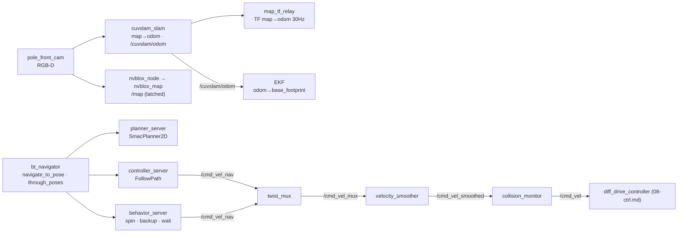

# 3 Nav2·SLAM — 주행 계획·위치추정·지도

mission_manager·coordinator가 보낸 목표를 Nav2가 받아 경로를 만들고 따라가며, 위치(`map→odom`)와 지도(`/map`)는 cuVSLAM + nvblox가 냅니다. 모두 [ros_system 패키지](../../../lv2_module6/ros2_ws/src/ros_system/)에 있고 설정은 `config/`, 띄우는 곳은 [ros_system.launch.py](../../../lv2_module6/ros2_ws/src/ros_system/launch/ros_system.launch.py)입니다. 토픽·액션 이름은 [API.md](../API.md), 전체 흐름은 [01-arch.md](01-arch.md).

근거: [nav2_params.yaml](../../../lv2_module6/ros2_ws/src/ros_system/config/nav2_params.yaml) · [navigate_to_pose.xml](../../../lv2_module6/ros2_ws/src/ros_system/config/navigate_to_pose.xml) · [navigate_through_poses.xml](../../../lv2_module6/ros2_ws/src/ros_system/config/navigate_through_poses.xml) · [nvblox.yaml](../../../lv2_module6/ros2_ws/src/ros_system/config/nvblox.yaml) · [twist_mux.yaml](../../../lv2_module6/ros2_ws/src/ros_system/config/twist_mux.yaml) · [ekf.yaml](../../../lv2_module6/ros2_ws/src/ros_system/config/ekf.yaml) · [CUVSLAM.md](../../jetson-orin-nano/CUVSLAM.md)

## 한눈에 보기

Nav2 서버는 `nav2_composition:=true`(기본)이면 컴포넌트 컨테이너 한 프로세스로 뜨고, 노드 이름은 `nav2_params.yaml` 최상위 키와 같습니다 (launch 주석). lifecycle_manager는 둘로 나뉩니다 — `lifecycle_manager_base`(velocity_smoother·collision_monitor, odom만 있으면 뜸)와 `lifecycle_manager_navigation`(planner·controller·behavior·bt_navigator, map→odom 필요).

## 서버별 설정

| 서버 | 플러그인·핵심 값 | yaml 키 |
| --- | --- | --- |
| planner_server | `nav2_smac_planner::SmacPlanner2D` (`GridBased`) · tolerance 0.20 · allow_unknown true · cost_travel_multiplier 5.0 | `planner_server` |
| controller_server | 20 Hz · `FollowPath` = `ml::RlNavController` · failure_tolerance 0.3 | `controller_server` |
| bt_navigator | navigators `navigate_to_pose` · `navigate_through_poses` · odom `/odometry/filtered` | `bt_navigator` |
| behavior_server | spin · backup · wait · drive_on_heading | `behavior_server` |
| velocity_smoother | 최대 [0.26, 0, 1.82] · 가감속 2.5 / 3.2 · OPEN_LOOP | `velocity_smoother` |
| collision_monitor | 입력 `/cmd_vel_smoothed` → 출력 `/cmd_vel` | `collision_monitor` |

### 컨트롤러 (FollowPath)

- `ml::RlNavController`(ONNX 정책)가 **기본값으로 `enable: false`** 입니다. 꺼져 있으면 정책을 쓰지 않고 `fallback_controller: "dwb"`가 `inner_dwb` 설정으로 주행합니다 (yaml 주석: 11-16 시뮬에서 정책은 회전 반경이 커 통로 끝·골목 벽에 부딪혀 DWB가 나았음).
- 정책 입력은 nvblox 2D ESDF 점구름(`/nvblox_node/combined_esdf_pointcloud`)으로 만든 가상 스캔(`scan_source: points`, 360 rays, 3.5 m)과 웨이포인트 5개(0.30 m 간격). `cloud_timeout` 1.5 s를 넘기면 바이패스합니다.
- 같은 yaml에 `inner_mppi`(MPPI, 800 샘플 · 40 스텝 · 후진 없음 `vx_min: 0.0`), `inner_rpp`, `inner_rotation_shim`도 들어 있습니다. 어느 것이 실제 내부 컨트롤러로 선택되는지는 `ml` 패키지 코드에서 확인하지 못했습니다.
- DWB 최대 속도 0.26 m/s · 회전 0.91 rad/s(11-16에 절반으로 줄임), 후진 안 함 (pole_front_cam이 뒤를 못 봄).

### 도달·진행 판정

| 항목 | 값 |
| --- | --- |
| progress_checker | `SimpleProgressChecker` · 0.15 m 이동 · 허용 6 s |
| goal_checker (단일 목표) | `SimpleGoalChecker` · `stateful: true` · xy 0.06 m · yaw 0.5 rad |
| general_goal_checker (경유 통과) | `stateful: true` · xy 0.20 m · yaw 0.2 rad |

`goal_checker`가 둘이 되면서 빈 이름이 통하지 않아, 두 BT 모두 `FollowPath`에 `goal_checker_id`·`progress_checker_id`·`path_handler_id`를 블랙보드 값으로 넘깁니다 (XML 주석 ③).

### 코스트맵

| | local_costmap | global_costmap |
| --- | --- | --- |
| 프레임 | `odom` 롤링 3×3 m · 0.05 m · 10 Hz | `map` · 0.05 m · 1 Hz |
| 레이어 | static · voxel · inflation | static · inflation (`obstacle_layer` 블록은 있으나 `plugins`에 없음) |
| 정적 지도 | `/arena/walls` (nvblox `/map` 아님) | `/arena/walls` |
| 장애물 센서 | `/pole_front_cam/depth/color/points_filtered` (몸 뺀 점구름, 0.2~1.5 m) | — |
| 크기 | footprint 직사각형 −0.245~0.069 × ±0.151 m · inflation 0.33 | `robot_radius` 0.15 · inflation 0.4 · `track_unknown_space: false` |

### BT (행동 트리)

Nav2 기본 트리의 복사본이며 bt_navigator에 파일 경로로 넘깁니다 (`default_nav_to_pose_bt_xml`, `default_nav_through_poses_bt_xml`). 바꾼 곳은 각 XML 머리 주석에 이유와 실측 날짜가 있습니다.
- 계획 1 Hz(`RateController`) · 복구 순서: 코스트맵 지우기 + 제자리 회전 1.57 rad → 지우기 + 0.10 m 후진(0.05 m/s) → 대기 2 s (RoundRobin). 복구 Spin·BackUp은 `disable_collision_checks=true`.
- 최상위 재시도 3회 후 ABORTED. 이때 ros_system의 `rewind` 노드가 주행 궤적을 0.4 m 되감습니다 (XML 주석 ⑤). 실기 검증 전이라고 주석에 적혀 있습니다.
- through_poses: `RemovePassedGoals` 반경 0.10 m (11-16 시뮬 결과).

### 속도 체인과 충돌 감시

`controller·behavior → /cmd_vel_nav → twist_mux → /cmd_vel_mux → velocity_smoother → /cmd_vel_smoothed → collision_monitor → /cmd_vel` (launch 머리 주석). twist_mux 우선순위는 자동 `/cmd_vel_nav` 10 · 수동 `/cmd_vel_manual` 100 · 잠금 `/state/emergency` 255 (twist_mux.yaml).

collision_monitor는 `polygons: ["Approach", "SlowZone"]` 두 개를 씁니다. `Approach`는 몸체 직사각형 + 0.02 m, `time_before_collision` 0.6 s로 속도를 줄이는 `approach` 동작, `SlowZone`은 앞 0.30 m × ±0.22 m에서 `slowdown_ratio` 0.7. 센서는 `pole_front_cam` 점구름과 `/arena/walls_cloud`(도면 벽, grid_obstacle_cloud 노드)입니다.

## 위치추정·지도 (cuVSLAM + nvblox)

| 노드 | 하는 일 | 위치 |
| --- | --- | --- |
| cuvslam_slam | pole_front_cam RGB-D → `map→odom`(`/cuvslam/map_to_odom`) + `/cuvslam/odom` | `src/cuvslam_slam.cpp` (`cuvslam_impl:=auto`, 없으면 `scripts/cuvslam_slam.py`) |
| map_tf_relay | `/cuvslam/map_to_odom`을 30 Hz TF로 이어 냄 (파이썬 노드가 멈춰도 TF가 안 끊기게) · `future_s` 0.1 | `src/map_tf_relay.cpp` |
| EKF | `/odom`(속도) + `/cuvslam/odom`(속도) + `/imu`(yaw rate) → `/odometry/filtered` · odom→base_footprint TF | `config/ekf.yaml` (30 Hz) |
| nvblox_node | depth → TSDF → 2D ESDF · voxel 0.05 m · slice 0.08~0.3 m · 적분 거리 2.5 m | `config/nvblox.yaml` |
| nvblox_map | `~/static_occupancy_grid` → `/map` latched 1 Hz · 위치추정이면 시작 때 저장 지도 로드 | `src/nvblox_map.cpp` |

- 지도 모드는 `map:=slam`(매핑) · `map:=saved`(위치추정) · `map:=none`입니다. 실습은 [04b-mapping.md](04b-mapping.md).
- `map_backend:=static_2d`는 저장한 2D 지도 + cuVSLAM(nvblox 없음)입니다 (launch 인자). 이때 RL 입력 점구름은 `static_esdf_slice`가 대신 냅니다.
- 저장 지도로 위치추정하면 cuVSLAM은 원점부터 새로 시작하므로 **출발 자리·방향이 저장 때와 같아야** 합니다 (CUVSLAM.md).
- 주행용 costmap의 정적층은 `/arena/walls`이고 nvblox `/map`은 쓰지 않습니다 (nav2_params.yaml 주석, 11-15).

## 확인 못 한 것

- 요청에 있던 `velocity_polygon`은 현재 `collision_monitor` 설정에 없습니다 (위 두 polygon만 확인).
- MPPI·RPP·rotation_shim 중 `RlNavController`가 실제로 쓰는 내부 컨트롤러 선택 로직 (`ml` 패키지 코드는 읽지 않음). yaml의 `inner_*` 이름으로만 추정했습니다.
- `/arena/walls`를 내는 노드와 도면 데이터의 출처.
- 실기에서 이 BT 복구 순서가 검증됐는지 (XML 주석은 "실기 검증 전").
