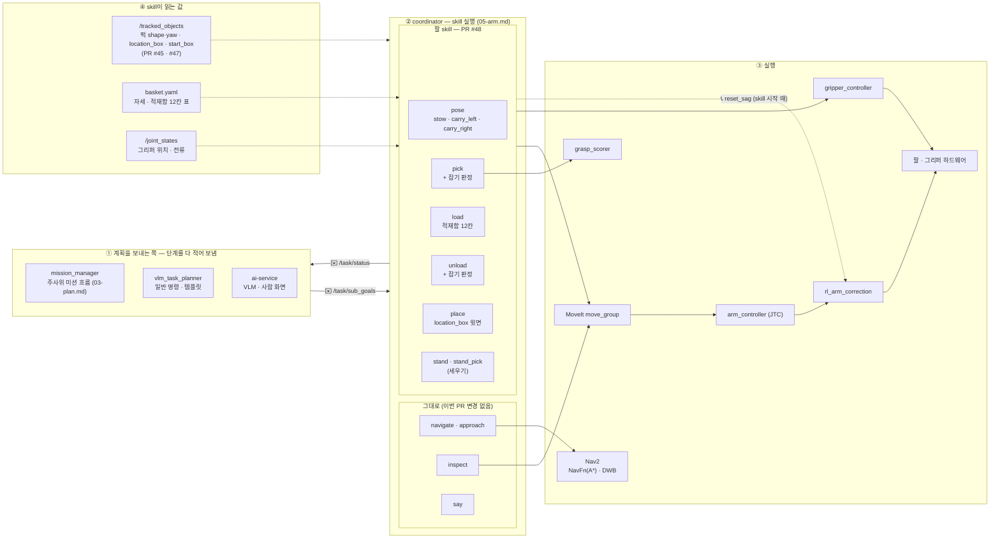
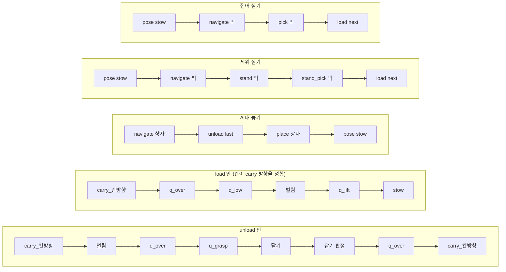
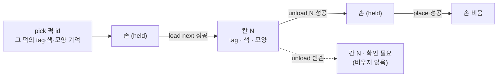
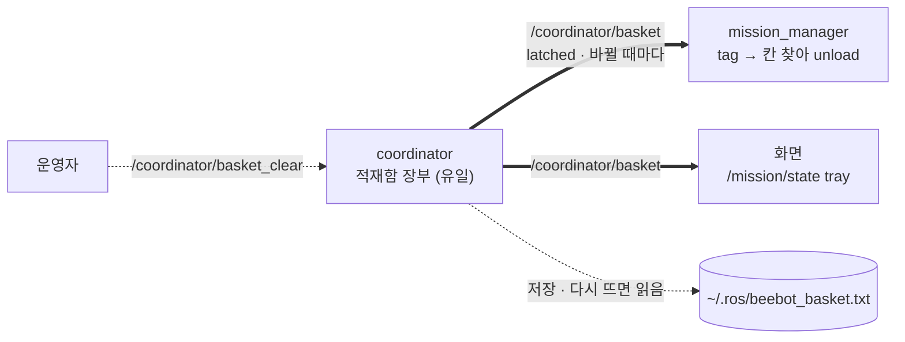
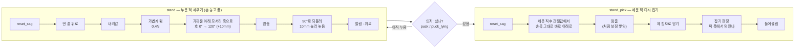
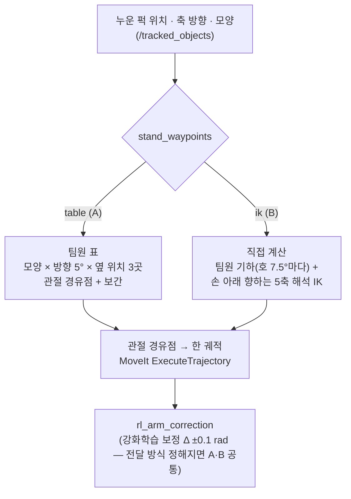

# 4 팔·MoveIt — skill 정의 (skill 노드)

coordinator가 계획 단계(`SubGoal.skill`)를 skill 노드에 맡기고, skill 노드가 실행합니다 (2026-11-04 skill마다 노드 하나로 나눔). 구현은 [skills 패키지](../../../lv2_module6/ros2_ws/src/skills/) — 액션 `/skills/<skill>` · 노드 skill_<skill> · 팔 공통 [arm_io.cpp](../../../lv2_module6/ros2_ws/src/skills/src/arm_io.cpp) · 세우기 경유점 [stand_plan.cpp](../../../lv2_module6/ros2_ws/src/skills/src/stand_plan.cpp). 순서·적재함 장부는 [coordinator.cpp](../../../lv2_module6/ros2_ws/src/plan/src/coordinator.cpp). 학습 정책은 skill마다 `models/skills/<skill>/` ([API.md 3장](../../API.md#3-액션-목록)).

근거:
- 팀원 팔 스펙 (2026-11-02): 자세 stow·carry, skill 6개, reset_sag, 성공 판정
- 적재함 자세표: [skills/params/basket.yaml](../../../lv2_module6/ros2_ws/src/skills/params/basket.yaml). feature/isaac-lab의 `isaac/lab/slot_table.yaml` 값을 옮긴 것으로, 원본은 `slot_table.py`가 URDF로 오프라인 계산합니다.
- 인지 출력: [API.md TrackedObject](../../API.md#api-msg-trackedobject) (PR #45 — 퍽 `shape`·`yaw`, `location_box`·`start_box`)

## 한눈에 보기

skill은 coordinator가 실행하는 `SubGoal` 한 단계입니다. 세 부분으로 나뉩니다.
- **skill을 조합해 보내는 쪽**: 미션 흐름(mission_manager — [03-plan.md](03-plan.md)), vlm_task_planner, ai-service
- **skill을 실행하는 coordinator**: 이 문서의 대상
- **skill이 읽는 값**: 인지, 적재함 표, 그리퍼 상태



흐름(계획 쪽이 보내는 단계)과 `load`·`unload` 안의 관절 자세 순서:



## 1. 원칙

1. **팔 동작은 전부 MoveIt을 거칩니다.** coordinator → move_group(계획, pick_ik) → ExecuteTrajectory → `arm_controller`(표준 joint_trajectory_controller) → `rl_arm_correction`(학습 Δ 보정, ±0.05 rad) → 하드웨어.
   - 정해진 관절 자세(stow, carry, 적재함 칸)는 **관절 목표**로 계획합니다.
   - 물체를 기준으로 한 목표(집기, 놓기, 보기)는 **손끝 자세 목표**(end_effector_link, 위에서 아래로)로 계획합니다.
   - JTC 토픽으로 바로 보내는 예외는 두 가지뿐입니다: 기동 때 `initial_pose`, 사람이 조작하는 `manual_control`.
   - "경로표 + JTC 직접"은 보류입니다. 속도나 반복성이 문제가 되면 표를 move_group ExecuteTrajectory로 실행하거나 Pilz planner를 씁니다.
2. **skill 하나는 한 가지 일만 합니다.** 단계 순서(흐름)는 계획을 보내는 쪽이 정합니다. 다만 적재함 싣기·꺼내기는 칸마다 carry 방향이 정해져 있어서, 그 경유를 skill 안에 넣었습니다([5절](#5-흐름)).
3. **판단은 인지 값으로 합니다.** 퍽 위치·모양·방향과 상자 윗면·크기·방향은 실행하는 순간 `/tracked_objects`에서 다시 읽습니다. 계획을 세운 당시의 값은 쓰지 않습니다.
4. **실패하면 이유를 붙여 바로 끝냅니다.** `/task/status`에 FAILED와 `reason`을 냅니다. 다시 할지는 계획 쪽이 정합니다. coordinator는 같은 단계를 `max_step_failures`번까지만 다시 받습니다.

## 2. 자세

| 이름 | 관절값 joint1..5 [rad] | 쓰임 | 값 |
|---|---|---|---|
| `stow` | `[0, -1.9024, 1.344, 0.9023, 0]` | 기본·주행 자세. 기동 때 `initial_pose`도 이 값 | basket.yaml `pose_stow`, SRDF `stow`, skills.yaml `initial_pose` |
| `carry_left` | `[1.5708, -0.4650, 0.1023, 1.9334, 1.5708]` | 퍽을 들고 적재함 왼쪽 칸으로 가는 경유 | basket.yaml `pose_carry_left` |
| `carry_right` | `[-1.5708, -0.4650, 0.1023, 1.9334, -1.5708]` | 퍽을 들고 적재함 오른쪽 칸으로 가는 경유 | basket.yaml `pose_carry_right` |
| `scan` | `[2.618, 0.681, -1.414, 1.082, 0]` | 지도 만들 때 gripper_cam을 두 번째 카메라로 씀. coordinator가 알아서 감 | `ros_system/config/scan_pose.yaml` |

carry 방향은 **칸이 정합니다**. basket.yaml `basket_carry`에서 칸 0·1·4·5·8·9는 right, 2·3·6·7·10·11은 left입니다.

## 3. skill 목록

`SubGoal {step, skill, target, relation, offset_m}`의 `target`은 문자열입니다.

| skill | target | 하는 일 | 끝 자세 |
|---|---|---|---|
| `navigate` | 물체 id · `"x,y[,yaw]"` | Nav2로 이동 (`relation front`와 `offset_m`을 주면 물체 앞으로, 좌표면 그 자세로) | — |
| `approach` | `"x,y,yaw"` (map) | 박스 앞 마지막 몇 cm를 `/cmd_vel_nav`로 저속 직선. 목표 뒤 `approach_pre_m` 자리에서 돌고 직선으로 들어감 (박스 바로 앞 제자리 회전 안 함). 4초 동안 진행 없으면 `approach_blocked` | — |
| `inspect` | 퍽 id · `"x,y,z"` | 손끝을 퍽 윗면(또는 그 점) `inspect_height_m`(0.15m) 위로 옮겨 gripper_cam이 16mm 태그를 읽게 함. 좌표면 손 방향 = 로봇 → 점. 집지 않음 | 그 자리 |
| `say` | 말할 내용 | `/robot/say` | — |
| `pose` | `stow` · `carry_left` · `carry_right` · `scan` | 이름 있는 관절 자세로 이동 | 그 자세 |
| `pick` | 퍽 id | 위에서 집기: 접근 → 벌림 → 내려감 → 닫기 → **잡기 판정** → 들어올림. 파지 후보는 grasp_scorer가 냄 | 들어올린 자리 |
| `load` | 칸 `0`~`11` · `next` | 손에 든 퍽을 적재함 칸에 싣기: **carry(칸 방향) → q_over → q_low → 벌림 → q_lift → stow** | `stow` |
| `unload` | 칸 `0`~`11` · `last` | 적재함 칸의 퍽 꺼내기: **carry(칸 방향) → 벌림 → q_over → q_grasp → 닫기 → 잡기 판정 → q_over → carry** | `carry_<칸 방향>` |
| `place` | `location_box` id (다른 물체도 됨) · `"x,y,z"` | 손에 든 퍽을 상자 윗면에 놓기 ([4절](#place--상자-값)). 좌표면 **손 안 퍽 바닥이 z**가 되게: 위 `place_approach_m` → 내려가 `place_release_m`에서 벌림 → 다시 위 (주사위 칸) | 상자 위 · 그 점 위 |
| `stand` | 퍽 id (`puck_lying`) | 누운 퍽을 세워 놓음 — 먼 끝을 가볍게(0.4N) 쥐고 가까운 아래 모서리를 축으로 돌려 세운 뒤 벌리고 위로 (팀원 `right_env` tilt 방식). 경유점 `stand_waypoints`: `ik`(기본) · `table` | 있음 ([6-1](#6-1-세우기--stand--stand_pick)) |
| `stand_pick` | 아무 값 (직전 `stand`의 퍽 — 기록용으로 퍽 id) | 세운 퍽을 다시 집기 — 직전 `stand` 계획의 같은 손목으로 선 퍽 위 → 바로 아래로 → 제 힘으로 쥐고 잡기 판정 → 들어올림. 성공하면 그 퍽(tag·색·모양)을 손에 든 것으로 장부에 | 있음 |

- **적재함 12칸**: 칸 위치는 URDF 링크 `basket_slot_0`~`11`(3줄 × 4칸)입니다. `load`·`unload`는 basket.yaml에서 칸과 퍽 모양(`box`·`cyl`)에 맞는 `q_over`·`q_low`·`q_lift`·`q_grasp`를 관절 목표로 씁니다. 적재함은 로봇에 고정돼 있어 매번 같은 값입니다.
  - 손 안 퍽 위치가 기준(`held_bottom_m`)과 다를 때 쓰는 보정(slot_table의 `P_*`)은 아직 쓰지 않습니다. **(예정 — 손 안 퍽 위치를 잴 수 있을 때)**
- **칸 고르기**: `next`는 `basket_use` 칸 중 빈 칸의 가장 낮은 번호(팔이 잘 못 닿는 칸은 설정에서 뺌), `last`는 마지막에 실은 칸입니다.
- **적재함 장부 — coordinator 하나만 씁니다** (실제로 싣고 꺼내는 쪽이 가장 정확히 앎).
  - `pick` 성공 → 그 퍽의 **tag·색·모양**(`/tracked_objects` details, 모양을 모르면 `box`)을 "손"에 기억
  - `load` 성공 → 손의 퍽을 그 칸에 적음 · `unload` 성공 → 칸의 퍽을 손으로 옮기고 칸을 비움 · `place` 성공 → 손을 비움
  - `unload`가 빈손(잡기 판정 실패) → 칸을 비우지 않고 **확인 필요**(`check`)로 표시
  - 📢 `/coordinator/basket`(plan/BasketState, latched)로 냄 → mission_manager·화면은 **읽기만**. `/diagnostics` "적재함"에도 (예: `3/12 bc·?·······`, `?` = 확인 필요)
  - 파일 `basket_file`(기본 `~/.ros/beebot_basket.txt`)에 저장 → 다시 떠도 이어 감. 사람이 적재함을 비웠으면 📞 `/coordinator/basket_clear`
- **손에 든 퍽 모양**으로 `load`가 칸 자세표(box·cyl)를 고릅니다.




- **옛 `tray` (호환)**: `place tray`는 `load next`, `pick tray`는 `unload last`와 같습니다. 그래서 vlm_task_planner와 ai-service의 기존 계획이 그대로 돌아갑니다. 적재함 용량(`tray_capacity`)은 4에서 12로 바꿨습니다.

## 4. skill 안에서 쓰는 값

### 시작할 때: 처짐 보정 초기화
팔 skill(`pick`, `place`, `load`, `unload`)을 **시작할 때 한 번** `/rl_arm_correction/reset_sag`(std_srvs/Trigger)를 부릅니다. skill 중간에는 부르지 않습니다. 팔이 안 닿아 먼저 다가가는 이동이 끝나고, 팔이 움직이기 직전에 부릅니다.
- 서비스가 없으면 WARN을 한 번 남기고 계속합니다. 지금 develop에는 없고 feature/isaac-lab에만 있습니다.
- `stand`도 시작할 때 부릅니다. **`stand_pick`은 부르지 않습니다** — 세운 직후 보정을 0으로 되돌리면 손이 처진 만큼 떨어지기 때문입니다(팀원 `stand_dummy.py`). 같은 손목으로 이어 갑니다.

### 잡기 판정 (`pick`, `unload`)
닫은 뒤 `/joint_states`의 `gripper_left_joint` 위치와 전류(effort)로 판정합니다.
- **위치 ≥ `grasp_min_pos_m`(0.003)**: 퍽이 끼어 손가락이 끝까지 닫히지 않은 상태입니다. 실측으로 퍽에 닿는 곳이 약 5mm(`gripper_left_joint` ≈ 0.005)입니다.
- **전류 |effort| ≥ `grasp_min_effort`(0.25A)**: 실측값은 원기둥 0.33~0.42A, 팀 기준 0.3~0.4A(약 22~29N), 한계 0.6A입니다. effort가 오지 않으면(NaN) 위치만 봅니다.
- **실패 처리**: `pick`은 그리퍼를 벌리고 다음 파지 후보로 넘어갑니다. 후보를 다 써도 못 잡으면 `grasp_empty`로 실패합니다. `unload`는 바로 `grasp_empty`로 실패합니다.
- **기준값**: 문턱은 plan.yaml에 있고 실기에서 다시 맞춥니다.
- **끄기**: launch 인자 `grasp_check:=false`로 끕니다. 테스트베드 faker는 그리퍼가 퍽 없이 끝까지 닫혀 늘 빈손이므로 꺼 둡니다.
- **쥐는 힘**: 닫을 때 `grip_current_a`(0.35A, 팀 결정 0.3~0.4A ≈ 22~29N)를 그리퍼 액션 goal `effort`로 보냅니다. 경로: goal effort → `gripper_controller`(`max_effort_interface`) → BeebotSystemHardware → 펌웨어 C 줄 9번째 칸(Goal Current). 펌웨어가 0.00269~1.2A로 자릅니다(PR #50 — 최소값 50mA → 2.69mA). 비우면 `max_effort` 0.6A로, 놓을 때 전류가 0.75~0.80A까지 튑니다(시뮬 보고서 6장).

### pick: 인지 값
| 값 | 출처 | 쓰는 법 |
|---|---|---|
| 퍽 위치 | `pose.position` | grasp_scorer 후보의 기준. 퍽이 `start_box` 위에 있으면 z가 상자 높이(약 0.07m)만큼 높은 그대로 씀 (고정 높이 아님) |
| 모양 | `details.shape` (`box` · `cyl`) | 손에 든 퍽 모양으로 기억해 적재함 표를 고름 |
| 방향 | `pose.orientation`(yaw) · `details.yaw_period` | grasp_scorer가 손 방향 ψ를 고름 (사각 퍽 면 · 옆 퍽 회피) → skill_pick이 ψ로 푼 해석 IK 관절값으로 퍽 위까지 감. 내려갈 때는 그 손목 유지 |
| 자세 | `class_name` `puck` / `puck_lying`, `details.posture` | `puck_lying`이면 `pick` 대신 `stand` → (인지로 섰는지 확인) → `stand_pick` (mission_manager) |

### place: 상자 값
| 값 | 출처 | 쓰는 법 |
|---|---|---|
| 윗면 | `location_box` `pose.position.z` · `size.z` | 윗면 높이는 둘 중 큰 값을 씁니다. 윗면을 못 찾고 태그만 보인 경우 z가 태그 높이라서 `size.z`(바닥~윗면)를 씁니다. 손끝 목표 = 윗면 + `held_bottom_m`(손 안 퍽 바닥, 0.0606) + `place_release_m`(0.02). 이 위치로 가서 바로 벌립니다 |
| 크기 | `size` (기본 0.205×0.205×0.07) | 여러 개 놓을 때 비키는 자리(`place_spacing` 0.08)를 상자 가장자리에서 `box_margin_m`(0.03) 안쪽으로 자름 |
| 방향 | `pose.orientation` · `details.yaw_period` | 비키는 배열을 상자 축에 맞춰 돌립니다. 360이면 태그 법선, 90이면 태그 방향을 못 구해 윗면 변 방향입니다. 상자가 정사각형이라 어느 쪽이든 축은 맞습니다. 방향이 없으면 돌리지 않습니다 |

`location_box`가 아닌 대상(구역 등)은 예전처럼 대상 위치 0.10m 위에서 벌립니다.

## 5. 흐름

계획을 보내는 쪽(미션 흐름, VLM)이 단계를 다 적어 보냅니다. coordinator는 단계를 끼워 넣지 않습니다. `load`·`unload` 안의 carry 경유만 예외입니다(칸이 방향을 정하므로).

| 흐름 | 단계 (`/task/sub_goals`) | 팀원 스펙의 표기 |
|---|---|---|
| 집어 싣기 | `pose stow` → `navigate <퍽>` → `pick <퍽>` → `load next` | stow → pick → carry → load → stow |
| 세워 싣기 | `pose stow` → `navigate <퍽>` → `stand <퍽>` → `stand_pick <퍽>` → `load next` | stow → right → right-pick → carry → load → stow |
| 꺼내 놓기 | `navigate <상자>` → `unload last` → `place <상자>` → `pose stow` | stow → unload → carry → place |

- 퍽 여러 개: 퍽마다 "집어 싣기"를 반복 → `navigate <location_box>` → "꺼내 놓기" × N.
- 주행(`navigate`) 동안 팔은 `stow`입니다(`load`가 stow로 끝남). 꺼내 놓기 뒤의 `pose stow`는 다음 주행 전에 필요해서 넣었습니다.

## 6. 실패 이유 (`TaskStatus.reason`)

| reason | 언제 |
|---|---|
| `invalid_plan:<이유>` | 계획 검증 실패. 모르는 skill, 모르는 자세 이름(`pose <이름>`), 없는 물체 id |
| `arm_unavailable` · `pick_unavailable` · `nav_unavailable` | MoveIt·그리퍼·grasp_scorer·Nav2 서버가 `server_wait_s` 안에 안 뜸 |
| `nav_failed` · `nav_bad_target` · `approach_failed` · `approach_blocked` · `approach_bad_target` · `approach_no_tf` | 이동·다가가기 실패 · 좌표 형식 오류 · 직선 접근이 막힘 · 로봇 위치 모름 |
| `no_grasp` · `grasp_failed_all` · `grasp_empty` · `arm_contact` | 파지 후보 없음 · 후보 다 실패 · 닫았는데 빈손 · 팔 접촉 |
| `pose_failed` | 그 자세로 못 감 |
| `slot_invalid` · `slot_full` · `slot_empty` | 칸 번호가 0~11 밖 · `load` 칸이 차 있음(`next`면 다 참) · `unload` 칸이 빔(`last`면 실린 게 없음) |
| `load_failed` · `unload_failed` | 칸 경유 자세 중 하나를 못 감 |
| `basket_table_missing` | basket.yaml 표가 안 들어옴 (launch 확인) |
| `place_failed` · `place_no_target` · `inspect_no_target` · `inspect_failed` | 놓기·보기 실패, 대상 없음 |
| `manual_*` · `explore_*` · `estop*` · `cancelled` | 모드 전환·비상정지·정지 요청 |
| `stand_no_grip` · `stand_grip_timeout` | 위치형 쥐기: 손가락이 `stand_empty_m`보다 닫힘(빈손) · `stand_grip_timeout_s` 안에 판단 못 함 — 벌리고 실패 |
| `stand_failed` · `stand_not_lying` · `stand_no_target` · `stand_no_yaw` · `stand_no_tf` | 세우기 실패 · 대상이 누운 퍽이 아님 · 대상 없음 · 긴 축 방향을 못 구함 · TF 없음 |
| `stand_ik_unreachable` · `stand_table_missing` · `stand_table_out_of_limits` | 경유점 계산 실패 (ik) · 표 없음 · 표 값이 관절 한계 밖 (table) |
| `stand_pick_no_stand` · `stand_pick_failed` · `hand_full` | 직전 stand 없음 · 다시 집기 실패 · 이미 손에 퍽 |

옛 `tray_full`·`tray_empty`·`tray_place_failed`·`tray_pick_failed`는 없어졌습니다. 같은 경우에 `slot_full`·`slot_empty`·`load_failed`·`unload_failed`가 나옵니다.

## 6-1. 세우기 — stand · stand_pick

세우기는 **두 skill**로 나눕니다. 팀원 스펙의 `right`·`right-pick`이고, 오른쪽(`carry_right`)과 헷갈리지 않게 `stand`·`stand_pick`으로 부릅니다.
세우는 방법은 팀원 `feature/isaac-lab`의 `isaac/lab/right_env.py` **tilt 방식**이고, ROS 실행은 `skill_stand`입니다.

**동작 순서**



**둘로 나눈 이유**

| 이유 | 설명 |
|---|---|
| 끝 상태가 다름 | `stand`는 손을 놓고 끝남(퍽이 상자 위에 섬). 그 사이에 인지(`puck` / `puck_lying`)로 섰는지 확인하고, 안 섰으면 `stand`만 다시 |
| 쥐는 방식이 다름 | `stand` = **0.4N으로 가볍게**(퍽이 손가락 사이에서 경첩처럼 돌아야 함) · `stand_pick` = 제 힘(22~29N) + 잡기 판정 |
| 재시도 범위 | 집기만 실패했을 때 이미 선 퍽을 다시 세우지 않음 |
| 학습 범위 | 팀원 강화학습 정책은 세우기 구간(내려가기 ~ 벌리기)만 학습. 다시 잡기는 그 뒤에 붙인 별도 단계 |
| 인지를 기다리지 않음 | `stand_pick`은 세운 직후 관절값에서 손목 그대로 바로 아래로 내려감. 방금 세운 퍽은 인지가 아직 "누움"으로 남아 있을 수 있음 |

**기하 (팀원 `right_env.py` 설정 그대로)**

| 값 | 내용 |
|---|---|
| 쥐는 곳 | 누운 퍽의 **먼 끝**(로봇에서 먼 쪽). 손가락 중심 높이 = 사각 퍽 30mm(윗면) · 원기둥 15mm(축) |
| 회전축 | 가까운 끝의 **아래 모서리** (상자 윗면 높이) |
| 호 | 0° → **120°**까지 7.5°마다 경유점, 가는 동안 10mm 더 올림 (가볍게 쥐어 퍽이 손을 늦게 따라오므로 손이 앞섬) → 잠깐 멈춤 → 90°로 되돌림 |
| 내려놓기 | 90° 자리에서 10mm 눌러 놓음 → 벌림 → 80mm 위로 |
| 다시 잡기 | 선 퍽의 중심선(회전축에서 퍽 두께 반만큼 안쪽) 위, 집기 높이(손끝이 퍽 바닥 위 60.6mm)로 바로 내려감 → 제 힘으로 닫기 → 50mm 들어올림 |
| 손 방향 | 계속 아래를 향함 · 손가락 닫는 축이 퍽 축과 직각 |
| 팀원 실험값 (설정 주석) | 쥐는 힘 0.4N: 사각 100% · 원기둥 88%, 0.6N: 0~7%, 1N 이상: 0% · 호 속도 배율 0.3: 사각 63%, 0.5: 100% (퍽 고정·보정 없음 조건) |

**경유점: 표(A) vs 직접 계산(B) — 둘 다 만들어 비교**



| | A. 표 | B. 직접 계산 |
|---|---|---|
| 기본 경유점 | 팀원이 isaac-lab에서 미리 푼 관절 경유점을 파일로 받음 | 위 기하로 손끝 경유점을 계산하고, 경유점마다 **손이 아래를 향하는 5축 해석 IK**로 관절값을 구함 |
| 실행 | 관절 경유점을 한 궤적으로 묶어 **MoveIt ExecuteTrajectory** (팔은 MoveIt 경유 원칙) | (같음) |
| 고르기 | coordinator 파라미터 `stand_waypoints: table` | `stand_waypoints: ik` |
| 장점 | 학습 때와 같은 궤적 → 강화학습 보정이 잘 맞음 | 표 없이 어떤 퍽 위치에도 대응 |
| 단점 | 표 형식을 정하고 팀원이 내보내야 함 | IK 해가 학습 때와 조금 다를 수 있음 |
| 왜 해석 IK인지 | — | MoveIt IK(pick_ik)는 `rotation_scale: 0` — **위치만 맞추고 손 방향을 보장하지 않음**. 세우기는 손이 아래를 향한 채 퍽 축에 맞춰 돌아야 함 |

**강화학습과의 관계**: 표가 없다고 강화학습으로 움직이는 게 아닙니다. 팀원 정책(`right_*.onnx`)은 경유점을 만들지 않고, **기본 경유점에 관절마다 ±0.1 rad 보정만 더합니다**(내려가기 ~ 벌리기 구간). 기본 경유점은 A(표)든 B(직접 계산)든 있어야 하고, 보정은 두 방식 모두 같은 자리(`rl_arm_correction`)에서 더해집니다. 보정을 실제 로봇에 넣는 방식(50Hz 토픽 / 컨트롤러 안 ONNX)은 팀원이 정할 일이고, 지금 develop은 보정 Δ = 0입니다.

**A(표)로 할 때 방법**

1. **표 내용**: 팀원 `right_env`가 학습 때 쓰는 것과 같은 표를 오프라인으로 내보냅니다. `slot_table.yaml`과 같은 방식입니다.
   - 키: 퍽 모양(`box` / `cyl`) × 퍽 축 방향(로봇 기준, −90°~90° 5° 단위 — `YAW_BINS`) × 옆 위치(로봇 기준 y −0.04 · 0 · 0.04 m — `YCS`)
   - 값: 관절 경유점 W×5 (위 → 시작 → 호 … → 내려놓기 → 위로 → 다시 잡기 2개) + 경유점마다 손끝 위치 오차 → 관절 보정 행렬 P(5×3)
   - 전제: 로봇이 시작 박스 앞 정해진 자리에 섬 (`right_env` dock: 박스 중심이 로봇 앞 0.08m + 박스 반 변)
2. **coordinator에서 쓰는 법**: 인지한 퍽 축 방향에 가장 가까운 방향 칸 → 옆 위치로 보간 → 남은 위치 오차는 `q = q_nom + P·Δp`로 보정 → 구간을 [호 올라가기 · 멈춤 · 되돌려 놓기]로 묶어 사다리꼴 속도(호 속도 배율 0.5)로 시간을 매김 → ExecuteTrajectory.
3. **파일**: `skills/params/stand_table.yaml` (skills.launch.py가 skill_stand에 넘김, 1.25MB). `skills/scripts/stand_table_export.py`가 팀원 `right_env.plan_waypoints`·`ArmIK`를 **소스에서 그대로 불러** 같은 표를 만듭니다(Isaac Lab 없이 numpy + pinocchio). 지금 파일은 feature/isaac-lab `7f8ae2c`로 만들었고, `right_env` 값이 바뀌면 다시 만듭니다.

   ```bash
   python3 skills/scripts/stand_table_export.py <feature/isaac-lab의 lv2_module6/isaac/lab> --source "feature/isaac-lab <커밋>" --out skills/params/stand_table.yaml
   ```
4. **팀원에게 확인할 것**: 세우기 성공률(보정 켬/끔), dock 자세 오차 허용 범위.

**실기 방식 (11/03~04, 기본값)**: 큰 호는 퍽을 너무 높이 들어, `stand_drag_m`이 0보다 크면 호 대신 먼 끝을 쥔 채 로봇 쪽으로 4cm 끌며 3.5cm 올린 뒤 2cm 눌러 놓습니다 (`stand_drag_lift_m` · `stand_set_dz_m`). 쥐기는 위치형입니다: 목표 `stand_pinch_m` 0.007을 `stand_close_current_a` 16.14mA로 닫고, 전류 7mA 이상 + 0.2초 멈춤으로 쥠을 확인한 뒤 `stand_pinch_current_a` 5.38mA로 낮춥니다. 대기·손 빼기 높이는 안 닿으면 낮춰 가며, 이웃 경유점이 0.8rad 넘게 튀면 실패합니다. `stand_waypoints: table`과 `stand_drag_m: 0`은 아래 호 방식입니다.

**구현 (skill_stand)**

| | 내용 |
|---|---|
| 경유점 | [stand_plan.hpp](../../../lv2_module6/ros2_ws/src/skills/include/skills/stand_plan.hpp) — `right_env` tilt 계획을 C++로 옮김 (위 · 시작 · 호 17 · 멈춤 · 되돌림 4 · 놓기 · 위로 · 다시 잡기 2 = 27개) |
| B (`ik`, 기본) | 손이 바로 아래·닫는 축이 퍽 축과 직각이면 5축 팔은 **해석해**가 있음: joint1 = 손목 방향, joint2·3 = 팔 평면 2링크, joint4 = π/2 − joint2 − joint3, joint5 = 닫는 축 방향. FK는 URDF 그대로 (pinocchio와 5e-10 m 일치) |
| A (`table`) | 가까운 방향 칸(5°) · 가까운 옆 칸 → `q = q_nom + P·(x − box_cx, y − yc, 0)` (`right_env._reset_idx` 그대로) |
| 대조 (로컬) | B 경유점 = 팀원 `plan_waypoints` (수치 IK) 관절값과 최대 0.0025 rad 차이 (팀원 쪽 수렴 허용치 2e-3 rad). A 표 → 손끝: 격자점 0.2 mm · 격자 사이 평균 2.1 mm · 최대 6.5 mm (방향 5° 칸 포함) — B는 0 |
| 실행 | 벌림 40mm → **MoveIt 계획으로** 먼 끝 위(어디서든 충돌 확인) → 0.3초 → 내려가기 → 가볍게 쥠 0.4초 → 호(0.02초 샘플 궤적) → 0.3초 → 벌림 0.3초 → 위로. 내려가기·호·위로는 지금 관절값을 시각 0으로 붙인 샘플 궤적을 `/execute_trajectory`로 (MoveIt 경유, 계획 없이) |
| 그리퍼 | 액션 결과를 믿지 않고 `/joint_states` 위치·전류로 쥠을 판정 (덜 닫혀 멈춰도 액션은 성공 — 실기 11/03). `grasp_check:=false`면 판정 생략 |
| 시간 매기기 | 팀원과 같음: 이동 = 사다리꼴 시간 × smooth step (`stand_vel_scale` 0.3), 호 = [올라가기 · 멈춤 · 되돌려 놓기] 묶음마다 smooth step (`stand_arc_vel_scale` 0.5, 멈춤 0.5초) |
| 파라미터 | skills.yaml `skill_stand` — `stand_waypoints` · `stand_box_top_m` · 쥐기 · 끌기 · 속도 |
| 테스트 | `test_stand_plan` — FK(pinocchio 값) · IK 왕복 · 팀원 계획과 같음 · 경유점 기하 · 표 칸 고르기·선형 보정 · 시간 매기기 |

**남은 일과 위험**

- 실기·Isaac에서 같은 퍽으로 A·B 성공률 비교 (`stand_waypoints`만 바꿔서)
- **실기의 "가볍게 쥐기"(0.4N)**: 힘 명령 경로는 있음(그리퍼 goal `effort` → 펌웨어 Goal Current). PR #50으로 최소값이 2.69mA가 되어 0.4N 수준도 보낼 수 있음 — 0.6A ≈ 44N(손가락 하나)로 비례하면 약 5.5mA. 다만 펌웨어 주석대로 수십 mA 아래는 마찰로 안 움직일 수 있어 **mA ↔ N 실측**이 필요 (Isaac은 팀원 방식으로 힘 제한)
- 세우기 성공률 자료가 종합 보고서에 없음 → 팀원 확인

## 7. 남은 것

| 할 것 | 조건 |
|---|---|
| `stand`·`stand_pick` 실행 확인 | Isaac(`stand_dummy` 장면)과 실기에서 A·B 성공률 · 0.4N 쥐기 전류 실측 |
| 손 안 퍽 위치 보정 (`P_*`) | 손 안 퍽 위치를 잴 수 있을 때 |
| 세우기 0.4N 쥐기 전류 | mA ↔ N 실측 (PR #50으로 2.69mA까지 보낼 수 있음) |
| 실기 확인 | 칸 12개 load·unload 실측, 잡기 판정 문턱, 상자 위 놓는 높이 |

## 8. 정할 것 (팀원 확인)

1. ~~`stand` 경유점~~ — **정함 (11-02)**: 둘 다 만들고 `stand_waypoints`로 고름, 기본 `ik`(해석 IK). 표(`table`)는 팀원 `right_env`와 같은 표. 남은 것: 세우기 성공률.
2. ~~꺼내 놓기 뒤 자세~~ — **정함 (11-02)**: `place`는 놓은 자리 위에서 끝나고, **주행 전에 부르는 쪽이 `pose stow`를 넣습니다**. mission_manager는 다가가기·물러나기·복귀 이동 앞에 항상 넣습니다. 같은 장소에 연달아 놓을 때(`unload → place → unload …`) stow 왕복을 줄이기 위해서입니다(시뮬: 기본 자세 경유 시 한 사이클 14.7초 → 23.6초). VLM 일반 명령 계획은 단계에 stow를 넣어야 합니다.
3. ~~`reset_sag` 단위~~ — **정함 (11-02)**: **skill마다 한 번**(팔 skill 시작 때, skill 중간에는 안 부름). 처짐은 자세마다 달라서 앞 skill에서 쌓인 보정을 넘기지 않습니다(팀원 `rl_arm_correction.hpp` 주석·학습 조건과 같음).
4. **잡기 판정 기준**: 위치·전류 문턱값 (지금 3mm · 0.25A — 실측: 원기둥 3.85mm · 직육면체 5.11mm에서 멈춤, 쥐는 전류 0.3~0.4A). "다시 잡은 뒤 판정"은 `stand_pick`(세운 뒤 다시 잡기)의 판정으로 봄 — 팀원 `stand_dummy.py`도 다시 잡은 뒤 손가락이 퍽 폭에서 멈췄는지로 판정.
5. ~~이름 표기~~ — **정함**: 스펙의 `right`·`right-pick`은 `stand`·`stand_pick`으로 씁니다 (right = "바로 세우다"지만 오른쪽 `carry_right`와 헷갈림). 팀원 학습 쪽 이름(`right_env`, `right_*.onnx`)은 그대로.

담당 밖이라 따라가기만 할 것: 정책 Δ 전달 방식(50Hz 토픽 vs ONNX), cuMotion 범위.
