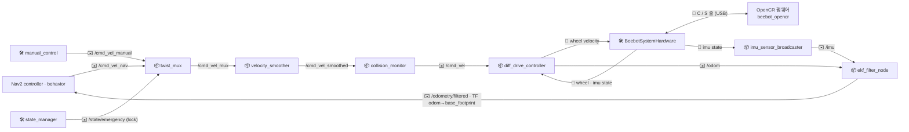

[목차](README.md) · [◀ 4 팔·MoveIt](05-arm.md) · [6 TF·QoS ▶](07-tf.md)

## 5 베이스 — OpenCR · 휠 오도메트리 · 속도 명령 체인

베이스는 TurtleBot3 Waffle Pi 바퀴 2개(다이나믹셀 ID 1·2)와 내장 IMU를 **OpenCR 하나**가 맡고, 같은 OpenCR이 팔·그리퍼 서보(ID 11~16)도 맡습니다. SBC(Jetson)는 `control/BeebotSystemHardware`(ros2_control 플러그인)로 USB 시리얼 한 줄 프로토콜만 주고받습니다. 이 문서는 바퀴·IMU·속도 명령 쪽만 다룹니다 (팔은 [05-arm.md](05-arm.md)).

체인 정의: [ros_system.launch.py](../../../lv2_module6/ros2_ws/src/ros_system/launch/ros_system.launch.py) 머리 주석 · 컨트롤러 [controllers.yaml](../../../lv2_module6/ros2_ws/src/ros_system/config/controllers.yaml) · twist_mux [twist_mux.yaml](../../../lv2_module6/ros2_ws/src/ros_system/config/twist_mux.yaml).

## BeebotSystemHardware

[beebot_system_hardware.hpp / .cpp](../../../lv2_module6/ros2_ws/src/control/src/beebot_system_hardware.cpp) — URDF의 `<ros2_control name="BeebotSystem" type="system">`([urdf.xacro](../../../lv2_module6/urdf/default/urdf.xacro))이 `control/BeebotSystemHardware`를 가리킵니다. 컨트롤러 주기 100 Hz(`update_rate`), 한 주기는 read → update → write.

| 관절·센서 | 명령 | 상태 |
| --- | --- | --- |
| wheel_left_joint · wheel_right_joint | velocity [rad/s] | position(첫 `S`부터의 누적) · velocity · effort(모터 전류 A) |
| imu (센서) | — | orientation · angular_velocity · linear_acceleration |

- URDF 하드웨어 param: `port` `/dev/opencr`(udev 고정 이름), `baud_rate` 1000000, `mock`, `mock_effort`, `twist_state`. `mock:=true`면 시리얼 없이 바퀴 속도를 적분해 위치로 돌려줍니다 (테스트베드).
- 첫 `S` 줄을 받기 전에는 활성화하지 않습니다 (펌웨어 README: 3초 안에 `S`가 없으면 활성화 실패).
- `/motor_status`([MotorStatus.msg](../../../lv2_module6/ros2_ws/src/control/msg/MotorStatus.msg))는 바뀔 때만, reliable + transient_local. 서비스 `~/reboot_motors`는 Hardware Error 난 모터만 재부팅(`R` 줄).

## 펌웨어 C/S 프로토콜

전체 표는 [firmware/README.md](../../../lv2_module6/firmware/README.md) "프로토콜" — 단위는 SI, ASCII 한 줄 = 글자 + `,` 값들 + `\n`.

| 방향 | 줄 | 내용 | 주기 |
| --- | --- | --- | --- |
| SBC → OpenCR | `C,<바퀴L rad/s>,<바퀴R rad/s>,<j1..j5 rad>,<그리퍼 m>[,<전류 A>]` | 바퀴 속도 + 팔·그리퍼 위치. 빈칸 = 유지(바퀴는 0) | 100 Hz |
| SBC → OpenCR | `T` · `R` · `B` | 토크 온/오프 · 모터 재부팅 · 부저 | 필요할 때 |
| OpenCR → SBC | `S,` 43개 | 바퀴·관절 위치·속도·전류, IMU 10, 온도 8, 배터리 V | 10 ms |
| OpenCR → SBC | `E,` 8개 | 모터별 Hardware Error | 0.5 s |

- watchdog: 마지막 유효한 `C`에서 500 ms가 지나면 바퀴 0, 팔은 자세 유지. 모터 하나라도 ping이 안 되면 `C`를 받지 않습니다.
- 서보 8개는 BulkWrite 한 패킷으로 쓰고 SyncRead 한 패킷으로 읽습니다. 한 루프에 `C`가 여러 개 쌓이면 마지막 것만 적용합니다.
- 이 변환(rad/s → rpm → Goal Velocity)은 펌웨어가 하고, 팔 영점 offset은 펌웨어가 아니라 SBC(URDF `<param name="offset">`)가 처리합니다.

## 휠 오도메트리 · IMU

[controllers.yaml](../../../lv2_module6/ros2_ws/src/ros_system/config/controllers.yaml)의 `diff_drive_controller`:

| 항목 | 값 | 비고 |
| --- | --- | --- |
| `wheel_separation` · `_multiplier` | 0.287 m · 1.056 | 실기 회전이 IMU·cuVSLAM보다 크게 나와 맞춘 값 (주석: 11-16 bag) |
| `wheel_radius` | 0.03112 m | 줄자 1.88 m 직진 2회 측정으로 보정 (공칭 0.033) |
| `base_frame_id` · `odom_frame_id` | `base_footprint` · `odom` | |
| `enable_odom_tf` | **false** | odom→base_footprint TF는 EKF 하나만 |
| 공분산 `twist` | [0.1, 0.0001, …, 0.01] | vx는 크게(cuVSLAM이 주), vy=0은 꽉(diff drive) |
| `publish_rate` | 50 Hz | `~/odom` → `/odom`, `~/cmd_vel` → `/cmd_vel`, `~/imu` → `/imu` 리매핑 |

`imu_sensor_broadcaster`: `frame_id: imu_link`, 각속도 공분산 0.03 — 실제 잡음이 아니라 EKF 비중입니다 (100 Hz라 15 Hz cuVSLAM보다 덜 믿게). `imu_link`는 `base_link` 기준 (0.0178, 0, 0.059) m.

## EKF

[ekf.yaml](../../../lv2_module6/ros2_ws/src/ros_system/config/ekf.yaml) — `robot_localization` `ekf_filter_node`, 30 Hz, `two_d_mode`, `world_frame: odom`, `base_link_frame: base_footprint`, `publish_tf: true`, `smooth_lagged_data` 켬(`history_length` 0.6 s — cuVSLAM이 0.09 s 늦게 와서).

| 입력 | 쓰는 값 |
| --- | --- |
| `/odom` (바퀴) | vx, vy (vy = 0 을 넣어 "옆으로 안 감"을 알림). yaw는 안 씀 |
| `/cuvslam/odom` | vx, yaw 속도 |
| `/imu` | yaw 각속도 |

- 출력: `/odometry/filtered` + TF `odom→base_footprint`. `ros_system.launch.py`에 `ekf_imu` 인자가 있어 `false`면 IMU 대신 바퀴 yaw 속도를 쓰는 EKF 인스턴스가 뜹니다.
- 랜드마크 보정(루프 클로저)은 EKF가 아니라 cuvslam_slam의 `map→odom`이 합니다 ([07-tf.md](07-tf.md)).

## 속도 명령 체인 · 비상정지

| 단계 | 노드 | 값 (설정 파일) |
| --- | --- | --- |
| 선택 | twist_mux | `/cmd_vel_nav` priority 10 · `/cmd_vel_manual` priority 100, 둘 다 timeout 0.5 s. `use_stamped: true`(TwistStamped 전 체인) |
| 잠금 | twist_mux `e_stop` | `/state/emergency`(Bool) priority 255 — 켜지면 모든 입력 차단 |
| 부드럽게 | velocity_smoother ([nav2_params.yaml](../../../lv2_module6/ros2_ws/src/ros_system/config/nav2_params.yaml)) | 최대 0.26 m/s · 1.82 rad/s, 가속 2.5 m/s² · 3.2 rad/s², `OPEN_LOOP`, 입력 `/cmd_vel_mux` |
| 충돌 감시 | collision_monitor | `Approach`(몸 사각형, `time_before_collision` 0.6 s) · `SlowZone`(0.7배), 입력 점구름 = body_filter 출력(`points_filtered`) + 도면 벽 점구름(`/arena/walls_cloud`), 출력 `/cmd_vel` |

- 비상정지는 `/cmd/e_stop`(Bool) → **state_manager**가 받아 `/state/emergency`(transient_local)로 낸 것만 twist_mux가 구독합니다 ([state_manager.cpp](../../../lv2_module6/ros2_ws/src/manager/src/state_manager.cpp), twist_mux.yaml 주석: "직접 구독 금지").
- 수동 조작: 운영 모드가 수동일 때만 `/cmd/manual/cmd_vel`을 `/cmd_vel_manual`로 넘기고, 모드를 벗어나면 정지합니다 ([manual_control.cpp](../../../lv2_module6/ros2_ws/src/control/src/manual_control.cpp)).
- 속도 한계: Nav2 controller_server는 DWB `max_vel_x` 0.26 m/s · `max_vel_theta` 0.91 rad/s(11-16에 절반으로 줄임), MPPI(기본) `vx_max` 0.26 · `wz_max` 1.82 rad/s, smoother 상한 0.26 m/s · 1.82 rad/s. 바퀴 최대 각속도는 URDF 관절 `limit velocity` 8.063 rad/s.
- stand_test용 launch는 `cmd_vel_relay`가 `/cmd_vel_mux`를 `/cmd_vel`로 바로 넘깁니다 ([bringup/launch/stand_test.launch.py](../../../lv2_module6/ros2_ws/src/bringup/launch/stand_test.launch.py)).

## 확인 못 한 것

- 실기 주행 정확도(odom 오차, 직진 휨)는 yaml 주석의 측정값만 옮겼고 재측정하지 않았다. 왼쪽 바퀴 반경 보정(`left_wheel_radius_multiplier`)은 주석 처리된 채 보류 상태.
- `diff_drive_controller`의 `cmd_vel_timeout`은 yaml에 없어 기본값을 쓰는 것으로 보이나 값을 확인하지 못했다.
- `S` 칸이 43개보다 적은 옛 펌웨어를 SBC가 받는 방식은 firmware README 서술만 확인, 코드 경로는 따라가지 않았다.
- e-stop이 켜졌을 때 collision_monitor·manual_control 쪽 추가 동작(`sync_collision_monitor` 등)은 읽지 않았다.
