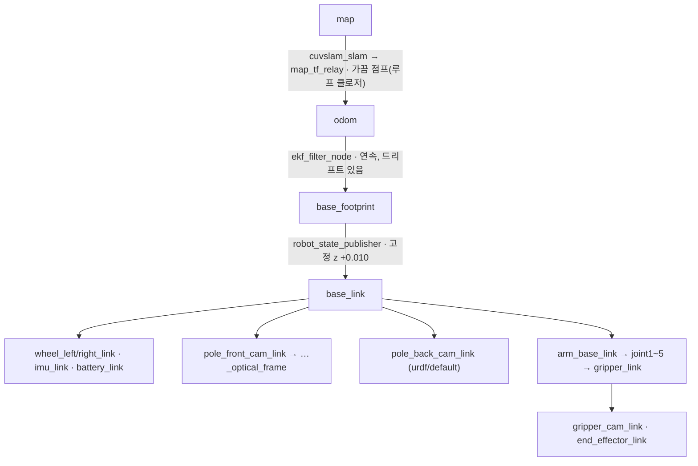

[목차](README.md) · [◀ 5 베이스](06-base.md) · [ros2_control 연결 ▶](08-ctrl.md)

## 6 TF · QoS

TF 발행자는 **map→odom(cuvslam_slam) · odom→base_footprint(EKF) · 나머지 고정·관절 변환(robot_state_publisher)** 셋으로 나뉩니다. 같은 변환을 두 노드가 내면 TF가 싸우므로, 카메라 드라이버와 diff_drive_controller는 TF를 끕니다.

> 인터페이스 명세: [TF](../../API.md#api-tf) · [QoS 규칙](../../API.md#api-qos)

## TF 트리

| 변환 | 발행자 | 성격 · 근거 |
| --- | --- | --- |
| map → odom | **cuvslam_slam**이 계산해 `/cuvslam/map_to_odom`(TransformStamped)으로 내고, **map_tf_relay**가 30 Hz로 TF에 냄 | 루프 클로저로 가끔 점프. [map_tf_relay.cpp](../../../lv2_module6/ros2_ws/src/ros_system/src/map_tf_relay.cpp) |
| odom → base_footprint | **robot_localization ekf_filter_node** (`publish_tf: true`) | 연속. diff_drive `enable_odom_tf: false`, 카메라 `publish_tf: false`. [ekf.yaml](../../../lv2_module6/ros2_ws/src/ros_system/config/ekf.yaml) |
| base_footprint → base_link → 센서·팔 | **robot_state_publisher** (URDF + `/joint_states`) | 고정 또는 관절값으로 변함. `base_joint` z = 0.010 m |
| `*_link` → `*_optical_frame` | robot_state_publisher | 고정. 카메라 depth·color optical 프레임을 URDF가 제공 (RealSense `publish_tf: false`) |
| (테스트베드) map → odom | faker `static_transform_publisher` (mock) 또는 `fake_cuvslam` | [faker.launch.py](../../../lv2_module6/ros2_ws/src/faker/launch/faker.launch.py) — 진짜 SLAM이면 끔 |

- `map:=none`(지도 없음)이면 SLAM이 꺼져 map→odom이 없습니다. perception은 이때 `map_tf_required: false`라 odom 기준 좌표를 그대로 냅니다 ([perception.yaml](../../../lv2_module6/ros2_ws/src/perception/config/perception.yaml)).
- 기준 프레임은 **base_footprint로 통일**: Nav2 `robot_base_frame`, EKF `base_link_frame`, cuvslam_slam `base_frame`, body_filter `floor_frame`이 모두 base_footprint입니다 ([nav2_params.yaml](../../../lv2_module6/ros2_ws/src/ros_system/config/nav2_params.yaml), ekf.yaml). 단, hand_relative는 학습 정책 좌표에 맞춰 `base_link`를 씁니다.
- Nav2 costmap `global_frame`은 global = map, local = odom.

### cuvslam_slam과 map_tf_relay

[cuvslam_slam.cpp](../../../lv2_module6/ros2_ws/src/ros_system/src/cuvslam_slam.cpp)는 영상마다 cuVSLAM 위치와 TF의 `odom→base_footprint`로 `map→odom`을 구하고 `/cuvslam/odom`(속도 → EKF)도 냅니다.

- 파라미터 `map_tf_relay`(기본 true)면 TF를 직접 내지 않고 토픽만 냅니다. 계산 노드가 CPU 몰림으로 1초 넘게 멈춰도 TF가 끊기지 않도록 발행을 map_tf_relay로 분리했습니다 (끊기면 Nav2 controller가 목표를 odom으로 못 옮겨 error 102 — 소스 주석).
- map_tf_relay: 마지막 값을 `now() + future_s`(0.1 s) 시각으로 `rate_hz` 30 Hz 발행. 벽시계 타이머라 시뮬 `/clock`이 잠깐 늦어도 계속 냅니다. 시작 시 `SCHED_FIFO` 50(`MAP_TF_RELAY_RT_PRIO`, 0이면 안 함) — 계정 rtprio 한도가 없으면 경고만 하고 보통 우선순위로 갑니다.
- 회전이 빠르면 보정을 멈추고, cuVSLAM 위치가 크게 튀면 보정을 잠가 바퀴+IMU로만 이어 갑니다 (`/initialpose`로 다시 맞추면 풀림 — 소스 로그 메시지).

## 주요 프레임·오프셋

URDF [urdf/default/urdf.xacro](../../../lv2_module6/urdf/default/urdf.xacro) 기준 (x 앞 · y 왼쪽 · z 위, `base_link`가 부모).

| 프레임 | 위치 [m] | 비고 |
| --- | --- | --- |
| base_link | base_footprint에서 z +0.010 | |
| wheel_left / right | (0, ±0.1439, 0.023) | 바퀴 간격 0.2878 ≈ diff_drive `wheel_separation` 0.287 |
| imu_link | (0.0178, 0, 0.059) | |
| pole_front_cam_link | (−0.1379, 0.0002, 0.4366), pitch 0.3316 rad | optical: rpy (−π/2, 0, −π/2) |
| pole_back_cam_link | (−0.281, −0.0002, 0.4366), yaw π, pitch 0.314 rad | urdf/default에만 있음 |
| arm_base_link | (0.048, −0.0002, 0.129) | 팔 장착 |
| gripper_cam_link | gripper_link 기준 (0.0817, 0, 0.0403), pitch 0.363 rad | 11/12 실측 보정 (xacro 주석) |

팔 관절 영점 offset(`joint1` 0.013 · `joint2` 0.010 · `joint3` 0.040 rad …)은 TF가 아니라 URDF `<ros2_control>` param이라 하드웨어 플러그인이 적용합니다 ([06-base.md](06-base.md)).

## QoS 정리

QoS 원칙: 센서는 최신 값만 의미 있으니 best_effort, 상태·명령은 reliable, "바뀔 때만 내는 값"은 transient_local로 늦게 붙어도 마지막 값을 받게 합니다. 전체 표는 [API.md 6장](../../API.md#api-qos). 아래는 코드에서 확인한 것입니다.

| 토픽 | QoS | 근거 (코드) |
| --- | --- | --- |
| 카메라 color · depth · points | best_effort · volatile (`SENSOR_DATA`, depth 5) | ros_system `camera()` 주석 — RealSense 기본이 reliable이라 바꿈. perception_node `sensor_qos()` best_effort · keep_last 5 |
| depth_gate · body_filter 입출력 | `SensorDataQoS` (body_filter keep_last 1) | depth_gate.cpp · body_filter.cpp |
| nvblox 입력 | `input_qos: SENSOR_DATA` | [nvblox.yaml](../../../lv2_module6/ros2_ws/src/ros_system/config/nvblox.yaml) |
| `/robot_description` | reliable + transient_local, depth 1 | body_filter 구독 |
| `/cuvslam/map_to_odom` | reliable + transient_local, depth 1 | cuvslam_slam 발행 · map_tf_relay 구독 (relay가 나중에 떠도 마지막 값) |
| `/map` | latched(transient_local) | nvblox_map (1 Hz 발행) |
| `/state/emergency` | transient_local | state_manager 발행 |
| `/mission/signal` · `/mission/qr` · `/motor_status` | reliable + transient_local, depth 1 | signal_decoder · perception_node · BeebotSystemHardware |
| `/mission/signal_status` | reliable, depth 10 | signal_decoder |
| `/tracked_objects` | reliable · depth 5 | perception_node |
| `/cmd_vel_manual` | reliable · depth 1 | manual_control |
| `/cmd/e_stop` · `/cmd/operation_mode` · `/cmd/map_mode` (구독) | reliable · depth 1 | state_manager |

> best_effort 발행자를 reliable 구독자가 받으면 연결 자체가 안 된다 — 센서 구독은 `SensorDataQoS`로 맞춥니다.

## 시간 · TF 허용 지연

- **sim time**: Isaac 시뮬 쪽은 실행 때 `use_sim_time`을 켭니다 (예: [isaac/standalone/runtime/node_params.py](../../../lv2_module6/isaac/standalone/runtime/node_params.py)). 패키지 yaml에는 `use_sim_time`이 없고, perception_node는 `use_sim_time`이면 `gripper_floor_offset_m`을 0으로 씁니다 (실물 깊이 보정은 시뮬에 불필요).
- TF 지연 허용: Nav2 `transform_tolerance` 0.5(controller·planner 일부)/0.2(costmap·collision_monitor), perception `max_tf_fallback_age_s` 0.3 s (영상 시각 TF가 없을 때 최신 TF와 허용 시각 차), cuvslam_slam `map_tf_tolerance` 1.0 s (map→odom 스탬프를 영상 시각 + 이만큼으로 냄).
- EKF `smooth_lagged_data: true`는 cuVSLAM이 0.09 s(최대 0.5 s) 늦게 와서 그 시각으로 되감아 다시 거르기 위한 설정입니다.
- map_tf_relay가 `now() + 0.1 s`로 스탬프하는 이유: 방금 들어온 depth 영상이 마지막 TF보다 새 시각이어도 "미래 외삽"으로 버려지지 않게 (소스 주석).

## 확인 못 한 것

- 오른쪽 바퀴·`arm_base_link` 이후 팔 링크 오프셋 전체, 양쪽 optical 프레임 값 일부는 표에 적은 것 외에 확인하지 않았다. URDF `beebot_mesh`는 `pole_front_cam` z·arm_mount z가 default와 몇 mm 다르다.
- 실기에서 `ros2 run tf2_tools view_frames`로 본 실제 트리는 확인하지 못함 (코드·URDF만 근거).
- Isaac 쪽에서 어떤 노드가 `/clock`을 내는지, 시뮬 `/tf` 발행자는 이 저장소 ros2_ws 코드로는 확인하지 못함.
- `/map` latched의 정확한 depth, EKF가 `/tf` 외에 `odom→base_footprint` 스탬프를 어떻게 정하는지는 읽지 않았다.
