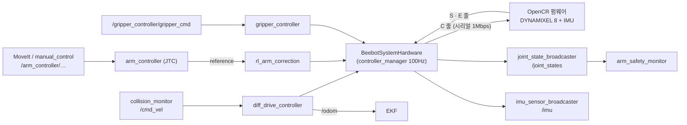

# ros2_control 연결 — controller_manager · BeebotSystemHardware

바퀴·팔·그리퍼·IMU를 ROS 2 컨트롤러로 묶는 층입니다. 하드웨어 하나(`BeebotSystemHardware`)가 OpenCR 한 개와 USB 시리얼 줄 프로토콜로 대화하고, 그 위에 컨트롤러들이 얹힙니다. 전체 그림은 [01-arch.md](01-arch.md), 팔 쪽은 [05-arm.md](05-arm.md).

근거: [controllers.yaml](../../../lv2_module6/ros2_ws/src/ros_system/config/controllers.yaml) · [urdf.xacro `<ros2_control>`](../../../lv2_module6/urdf/default/urdf.xacro) · [beebot_system_hardware.hpp](../../../lv2_module6/ros2_ws/src/control/include/control/beebot_system_hardware.hpp) · [control_plugins.xml](../../../lv2_module6/ros2_ws/src/control/control_plugins.xml) · [ros_system.launch.py](../../../lv2_module6/ros2_ws/src/ros_system/launch/ros_system.launch.py) · [control.yaml](../../../lv2_module6/ros2_ws/src/control/config/control.yaml)

## 구성

- `controller_manager`(`ros2_control_node`) `update_rate` 100 Hz. 한 주기 = `read()` → 컨트롤러 update → `write()` (hpp 머리 주석).
- URDF는 robot_state_publisher가 `/robot_description`으로 내고 controller_manager가 거기서 받습니다. xacro 인자 `mock_hardware` · `port`(기본 `/dev/opencr`) · `mock_effort` · `twist_state`가 하드웨어 `<param>`으로 들어갑니다.
- 플러그인 이름 `control/BeebotSystemHardware` (`control_plugins.xml`), baud 1000000.

## 컨트롤러 (controllers.yaml)

| 컨트롤러 | 타입 | 요점 |
| --- | --- | --- |
| joint_state_broadcaster | `JointStateBroadcaster` | `/joint_states` |
| imu_sensor_broadcaster | `IMUSensorBroadcaster` | `/imu` (`imu_link`) · 각속도 공분산 0.03 (EKF 비중용) |
| diff_drive_controller | `DiffDriveController` | 바퀴 `wheel_left_joint` · `wheel_right_joint` · 간격 0.287 × 1.056 · 반지름 0.03112 · `enable_odom_tf: false` (odom TF는 EKF 하나만) · 50 Hz |
| gripper_controller | `parallel_gripper_action_controller/GripperActionController` | 액션 `/gripper_controller/gripper_cmd` (ParallelGripperCommand) · `gripper_left_joint` (오른쪽은 URDF mimic) · `max_effort` 0.6 A · `allow_stalling: true` |
| rl_arm_correction | `ml/RlArmCorrection` | joint1~5 보정 Δ (`max_delta` 0.05) · 처짐·중력 보정 |
| arm_controller | `JointTrajectoryController` | joint1~5 · command_joints는 `rl_arm_correction/jointN` (체인) · state position·velocity |

- spawner는 한 프로세스가 `CONTROLLERS` 순서대로 켭니다: joint_state_broadcaster → imu_sensor_broadcaster → diff_drive_controller → gripper_controller → rl_arm_correction → arm_controller. 실패하기 쉬운 팔 체인을 맨 뒤에 두어, 팔이 안 떠도 바퀴·그리퍼는 뜹니다.
- spawner가 `~/cmd_vel:=/cmd_vel`, `~/odom:=/odom`, `~/imu:=/imu` 리매핑을 컨트롤러에 넘깁니다.
- `enforce_command_limits: false` — URDF 한계로 자르는 기본 기능을 끔 (관절이 한계 밖일 때 되돌리는 명령도 막혀서, 2026-11-02 기록).
- MoveIt은 `arm_controller`의 `follow_joint_trajectory`만 씁니다 (`moveit_controllers.yaml`). 그리퍼는 skills 패키지(`arm_io.cpp`)와 `manual_control`이 `/gripper_controller/gripper_cmd`를 직접 호출합니다.

## 인터페이스 (URDF `<ros2_control name="BeebotSystem">`)

| 관절·센서 | command | state |
| --- | --- | --- |
| wheel_left/right_joint | velocity | position · velocity · effort(모터 전류) |
| joint1~5 | position | position · velocity · effort |
| gripper_left_joint | position · effort(쥐는 힘 한계 A) | position · velocity · effort |
| imu (sensor) | — | orientation · angular_velocity · linear_acceleration |

팔·그리퍼는 `calib.yaml`의 영점 `offset`을 `<param name="offset">`으로 받습니다 (서보 값 = 관절값 + offset).

## 펌웨어(시리얼) 연결

OpenCR가 DYNAMIXEL 8개(바퀴 2 · joint1~5 · 그리퍼)와 내장 IMU를 맡고, 단위 변환(rad ↔ 서보)도 펌웨어가 합니다. 줄 단위 ASCII 프로토콜 ([firmware/beebot_opencr](../../../lv2_module6/firmware/beebot_opencr/)와 짝, 자세한 항목은 `firmware/README.md` "프로토콜").

| 방향 | 줄 | 내용 |
| --- | --- | --- |
| PC → OpenCR (`write`) | `C,<바퀴L>,<바퀴R>,<j1…j5>,<그리퍼>[,<전류 A>]` | 바퀴 rad/s · 관절 rad · 그리퍼 m · 9번째 칸 = 그리퍼 effort 명령이 있을 때 |
| | `B` · `T` · `R` | 부저(`/cmd/beep`) · 팔 토크 ON/OFF(`~/set_arm_torque`) · 모터 재부팅(`reboot_motors`) |
| OpenCR → PC (`read`) | `S` (43개 값) | 모터 8개 pos·vel·A + IMU 10 + 온도 8 + 배터리 V. 개수가 다르면 예전 펌웨어 |
| | `E` (0.5초) | 모터 에러 → `/motor_status` · 진단 |

- `mock_hardware:=true`면 시리얼 없이 명령을 그대로 상태로 되돌립니다 (바퀴는 속도 적분, 팔 목표 = 현재, effort는 `mock_effort`). `./start.sh mock_hardware:=true`.
- `twist_state`(기본 true): 서보 엔코더가 못 보는 joint2·3 중력 비틀림을 상태에 더해 `/joint_states`가 실제 각을 보게 하고, rl_arm_correction이 같이 빼 줍니다 (hpp 주석).
- 진단: `/diagnostics` "BeebotSystem: OpenCR 연결".

## arm_safety_monitor

[arm_safety_monitor.cpp](../../../lv2_module6/ros2_ws/src/control/src/arm_safety_monitor.cpp) (control 패키지 노드, 하드웨어 플러그인과 별개). `/joint_states`의 joint1~5 effort가 `effort_threshold` 3.0 A를 넘고 속도가 `stall_velocity` 0.10 rad/s 아래인 상태가 `hold_s` 0.3 s 이어지면 접촉으로 판단합니다. 그러면 `/arm_controller/follow_joint_trajectory/_action/cancel_goal`을 불러 진행 중 궤적을 취소하고 `/arm_safety_event`(`control/ArmSafetyEvent`, reason `overcurrent`)를 냅니다. 값은 [control.yaml](../../../lv2_module6/ros2_ws/src/control/config/control.yaml).

## 확인 못 한 것

- 시리얼 프로토콜의 항목별 순서·단위 전체 (`firmware/README.md`는 읽지 않음, hpp 요약만).
- `ml/RlArmCorrection` 내부 동작과 `arm_correction_type` launch 인자의 선택지.
- `/dev/opencr` udev 규칙(`ros2_ws/99-opencr.rules`) 내용.
- 실기에서의 실제 update 주기·지연 (코드·설정 값만 확인).
