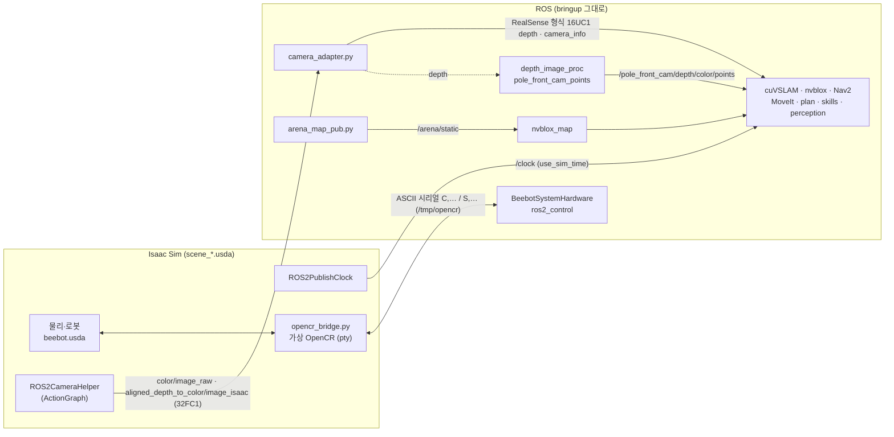

[목차](README.md) · [◀ 학습 설계](11-learn.md)

## Isaac 파이프라인

Isaac Sim은 **beebot 하드웨어(OpenCR·카메라·물리)** 만 대신하고, ROS 쪽은 실기와 같은 `bringup` 전체를 그대로 돌립니다. ros2_ws 패키지는 Isaac용으로 고치지 않고, 차이는 `isaac/standalone/runtime/`의 launch·어댑터가 메웁니다. 학습(Isaac Lab)은 같은 `isaac/` 폴더지만 ROS와 따로 돕니다([11-learn.md](11-learn.md)). 폴더 목차는 `lv2_module6/isaac/docs/README.md`.

### 폴더 구성 (`lv2_module6/isaac/`)

| 경로 | 내용 |
| --- | --- |
| `usda/` | 장면 `scene_sim` · `scene_approach` · `scene_approach_matte` · `scene_lab` · `scene_pick` · `scene_pick_bot`, 에셋 `beebot/` · `maze/` · `puck/` · `shelf/` · `sign/` · `barcode/`, 변환 `scripts/convert.py` (구조: `docs/usd.md`) |
| `standalone/` | 실행 진입점 `isaac_sim.sh` · `isaac_mission.sh`, ROS 쪽 `runtime/` (아래) |
| `mission/` | 미션 한 판 `run_mission.py`, 장면 벽 지도 `make_map.py` · `map/<장면>/`, `plan_to_map.py` · `map_to_nvblox.py`, `mission.rviz` · `rviz.sh` |
| `loops/` | pick/place/stand/approach 시험 반복 스크립트, `manipulator-launcher.sh`, 시각화 `vis/` |
| `rl/` | Isaac Lab 학습: `bee_isaac/tasks/*_env.py` · `scripts/train.py` · `policies/<skill>/vNN/` |
| `learning/` | `plan_next` 학습(가상 미션), `skills.yaml` |
| `source/` | 장면용 HDRI · 텍스처 |

### 실행 환경이 둘

- Isaac venv(기본 `~/pa-course/.venv-isaacsim`): Isaac Sim 본체, `isaac_startup.py`, `opencr_bridge.py`.
- 시스템 python + ROS Lyrical: `camera_adapter.py` · `arena_map_pub.py` · launch (numpy 1.26). 학습은 `~/pa-course/IsaacLab-6.1/.venv`.

### 미션 한 판 돌리는 법

명령은 `lv2_module6`에서 실행합니다(`isaac/standalone/README.md`, `isaac/mission/README.md`).

```bash
isaac/standalone/isaac_sim.sh [장면]     # 터미널 1: Isaac + ROS (기본 scene_sim) — 창이 뜨면 Play
python3 isaac/mission/run_mission.py     # 터미널 2: ROS 노드가 다 뜬 뒤 — /cmd/mission start, DONE/ERROR까지 단계 출력
```

- `Play`를 눌러야 `/tmp/opencr`가 생기고 그때 ROS(`isaac_system.launch.py`, 노드 약 40개)가 뜹니다. Play 전에 띄우면 `BeebotSystemHardware`가 `S`를 3초 안에 못 받아 컨트롤러가 안 뜹니다.
- Stop은 누르지 않습니다(시뮬 시계가 0으로 돌아가 TF·EKF·cuVSLAM·nvblox가 꼬임). 멈춤은 Pause, 처음 자세는 `isaac/standalone/runtime/reset.sh`.
- 실기 `start.sh`와 같은 인자로 돌리려면 `isaac/standalone/isaac_mission.sh map`(처음 한 번 매핑 → `ros2_ws/map/scene_sim/`) 후 `isaac/standalone/isaac_mission.sh`(저장 지도 위치추정). 미션 시작은 다른 터미널에서 `tools/cli/start.sh mission start`.
- `run_mission.py`: 기본 신호 `RGYRGRYGRGYR` · 바코드 `P2-01`. BARCODE·READ 단계 동안 `/mission/qr` · `/mission/signal_status`를 1초마다 넣어 줍니다(읽은 셈 치기). 나머지는 실기와 같은 노드가 합니다. 흐름: GO_OBSERVE → BARCODE → READ → SURVEY → BUILD → VERIFY → RETURN → DONE. 장면 퍽으로 풀리는 신호 조합 제한은 `isaac/mission/README.md`.
- 자주 쓰는 변수: `ISAAC_HEADLESS=1` · `ISAAC_AUTOPLAY=1` · `BEE_SIM_NOISE=0` · `OPENCR_TWIST_SCALE=0` · `BEE_BACK_CAM=false` · `ISAAC_ROS_ARGS="map:=saved …"` · `ISAAC_ROS_LAUNCH=isaac_manipulator_demo.launch.py`(팔만).

### 데이터 흐름



| 방향 | 내용 | 담당 파일 |
| --- | --- | --- |
| Isaac → ROS | 카메라 color · depth(32FC1 `…/image_isaac`), `/clock` | usda의 ActionGraph(`ROS2CameraHelper` · `ROS2PublishClock`) |
| 변환 | depth 32FC1[m] → 16UC1[mm](NaN→0), camera_info 새로 발행(영상 stamp에 맞춰 color·depth 각각), D435식 깊이 노이즈 | `standalone/runtime/camera_adapter.py` |
| 점구름 | Isaac `depth_pcl`이 Play 직후 segfault → `depth_image_proc`가 `/pole_front_cam/depth/color/points` 생성 (gripper_cam 점구름은 안 만듦) | `isaac_system.launch.py` |
| ROS ↔ Isaac | 바퀴·팔·그리퍼 명령 `C,…`, 상태 `S,<40값>`(물리 스텝마다), 모터 에러 `E,…`(0.5초) — 펌웨어와 같은 프로토콜 | `opencr_bridge.py` ↔ `BeebotSystemHardware` (`port:=/tmp/opencr`) |
| 지도 | 장면 벽 지도 `map/<장면>/map.yaml` → `/arena/static` → `nvblox_map walls_in:=/arena/static` | `arena_map_pub.py` · `node_params.py` |

- Isaac에서 `/imu`는 Isaac이 아니라 ROS의 `imu_sensor_broadcaster`가 냅니다(`opencr_bridge.py` 머리말: Isaac ActionGraph의 IMU 발행 노드는 제거해야 충돌 없음).
- 센서 사실감: 컬러 모션블러(`isaac_startup.py`) · 깊이 노이즈(`camera_adapter.py`) · IMU 노이즈, 모두 `BEE_SIM_NOISE`(기본 1, 0 = 끔). 관절 비틀림은 `OPENCR_TWIST_SCALE`(기본 1)로 실기 측정값을 흉내 내고 `rl_arm_correction`의 중력 앞먹임이 상쇄합니다.

### isaac_system.launch.py가 하는 일

`isaac/standalone/runtime/isaac_system.launch.py`는 `bringup.launch.py`를 Isaac용 인자로 포함합니다.

- `port:=/tmp/opencr` · `use_cameras:=false`(카메라는 Isaac) · `map:=slam` · `use_perception:=true` · `operation:=AUTO` · `use_pole_back_cam`(기본 true, `BEE_BACK_CAM`) + `pole_back_cam_external:=true` · `nav2_container_params`(기본 true).
- `SetParameter(use_sim_time=True)`로 모든 노드에 시뮬 시계를 줍니다.
- 같이 띄우는 프로세스: `camera_adapter.py`, `node_params.py state_manager`(파라미터 적용 순서 보정 후 재기동), `arena_map_pub.py` + `node_params.py nvblox_map walls_in:=/arena/static`(장면 지도가 있을 때), `depth_image_proc point_cloud_xyz_node`. 팔만 시연은 `isaac_manipulator_demo.launch.py`.
- `isaac_mission.sh`는 추가로 `runtime/cm_kick.py`를 띄웁니다: `controller_manager`가 `/robot_description`을 못 받고 멈추는 경우(11-16 4회 연속) 같은 URDF를 다시 발행해 살립니다.

### ROS_DOMAIN_ID · Fast DDS 프로파일

- `isaac_sim.sh`는 `source /opt/ros/lyrical/setup.bash` 후 셸의 `ROS_DOMAIN_ID`를 물려받습니다(Isaac도 같은 값). 같은 도메인에 다른 노드가 이미 있으면 노드 이름이 겹쳐 꼬이므로 멈추고 알립니다(무시: `ALLOW_OTHER_NODES=1`). 다른 터미널의 `ros2`·`run_mission.py`도 같은 도메인이어야 합니다.
- 프로파일: 터미널에 `FASTDDS_DEFAULT_PROFILES_FILE`이 있으면 그것, 없으면 `ros2_ws/fastdds_local_only.xml`(TypeLookup 끔 · SHM 32 MB · SHM만 = 한 머신 안). `fastdds.xml`(SHM+UDP)과 섞으면 서로 못 찾습니다(2026-11-06 실측). 개인 프로파일(TypeLookup 켜짐)로 띄우면 기동 후 약 2분간 controller_manager 서비스가 안 보여 spawner가 실패합니다(2026-10-30 실측).
- 시작할 때 지난 실행의 launch·고아 노드·Fast DDS 공유 메모리 찌꺼기·ros2 daemon을 정리합니다(`isaac_sim.sh`).
- 실기 쪽 기본값은 `ros2_ws/start.sh`가 `ROS_DOMAIN_ID` 기본 88을 씁니다.

### 코스 지도 생성 도구

| 도구 | 입력 → 출력 |
| --- | --- |
| `isaac/mission/make_map.py` | 장면 USD 벽·기둥(`/World/maze`)을 높이 0.02~0.47 m로 잘라 투영 → `isaac/mission/map/<장면>/map.pgm` · `map.yaml`(0.05 m/칸, 원점 = USD의 beebot 자세). 시작 박스·퍽은 넣지 않음. 장면을 고치면 다시 실행 |
| `isaac/mission/plan_to_map.py` | `plan.yaml` 실측 벽(`arena_walls`) → 실기용 Nav2 지도 (`--start x,y,yaw`로 출발 자리) |
| `isaac/mission/map_to_nvblox.py` | 2D 지도 → `nvblox.nvblx` (`map:=saved`로 바로 위치추정) |
| `tools/course/build_world.py` | 실세계 코스(`tools/cli/ros/fake/real/map/<코스>`) → `ros2_ws/src/faker/world/<코스>.pgm · .yaml`(fake_opencr 충돌 월드), 로봇 몸 외곽 → `faker/config/robot_footprint.yaml`, 기본 코스 `isaac_maze`는 `tools/cli/ros/fake/map/default/`(map.pgm · map.yaml · nvblox.nvblx `FAKESLAM1`)도 생성. `tools/.venv/bin/python tools/course/build_world.py [코스]`, 실세계 원본이 바뀔 때만 실행 후 커밋 (`isaac_maze`는 `usd-core` 필요). **Isaac이 아니라 Docker 테스트베드(faker)용** |

장면 벽과 실측 벽은 최대 약 11 cm 어긋납니다(`maze.usda`가 묶음째만 옮겨짐). 실기 저장 지도는 `plan_to_map.py`로 만들고 `map:=saved map_name:=<폴더> start_pose:=<같은 x,y,yaw>`로 띄웁니다. Isaac 시뮬 지도는 `ros2_ws/map/`(`.gitignore`)에 생겨 Jetson의 실기 지도와 섞이지 않습니다.

### 알려진 문제와 우회

| 문제 | 원인 · 조치 | 출처 |
| --- | --- | --- |
| `ROS2CameraInfoHelper` 메모리 누수 (분당 약 1 GB, 약 25분 뒤 OOM) | Lyrical + Isaac 6.1에서 Isaac 내장 Jazzy 백엔드 대신 Lyrical 라이브러리를 쓰면 이 노드만 샘. `opencr_bridge.py`의 `camera_info_off()`가 세션 레이어에서 `ROS2CameraInfoHelper`를 `inputs:enabled=False`로 끔(장면 파일은 그대로). camera_info는 `camera_adapter.py`가 대신 발행 | `opencr_bridge.py`, 커밋 `f937765e`(PR #76) |
| Isaac camera_info 값이 깨짐 | Jazzy 백엔드 위에서 float64 배열이 한 칸씩 밀려 `k[0]=fx`가 사라지고 cuVSLAM이 "Focal length must be > 0.0"로 멈춤 → `camera_adapter.py`가 고정 내부 파라미터(640×480, fx=fy=615.37)로 새로 발행 | `camera_adapter.py` 머리말 |
| depth 점구름 `depth_pcl` segfault | Play 직후 죽음 → `depth_image_proc`로 대체 | `isaac_system.launch.py` |
| 영상 구독이 안 이어짐 | Isaac 영상이 best_effort라 `qos_overrides`로 best_effort 구독 | `isaac_system.launch.py` |
| `nav2 map_server`가 기동 직후 멈춤 | 노드 40여 개일 때 lifecycle 서비스 응답이 버려짐(11-12) → `arena_map_pub.py`가 서비스 없이 transient_local로 한 번 발행 | `arena_map_pub.py` |
| `controller_manager`가 `/robot_description`을 못 받음 | 11-16 4회 연속 → `cm_kick.py`가 URDF 재발행 | `cm_kick.py` |
| `state_manager`가 `map:=slam`인데 LOCALIZATION을 읽음 | `-p use_sim_time` 때문에 파라미터 적용 순서 뒤바뀜 → `node_params.py`가 `-p`를 뒤로 | `node_params.py` |
| 창 포커스 가로채기 | Kit이 로딩 중 창을 올림 → `BEE_START_MINIMIZED=1` 또는 `ISAAC_HEADLESS=1` | `isaac_startup.py` |

### 확인 못 한 것

- Isaac을 실제로 띄워 보지 않았고(Isaac·GPU 필요), 위 내용은 스크립트·README·주석 기준입니다. 토픽 이름(`…/image_isaac` 등)은 usda와 `camera_adapter.py`에서 확인했으나 카메라별 네임스페이스는 usda의 ActionGraph 설정에 있어 전부 열어 보지 않았습니다.
- ROS 쪽 DOMAIN 값의 Isaac 기본값은 코드에 고정돼 있지 않고 셸(`~/.bashrc`)에서 옵니다. 88은 `ros2_ws/start.sh` · `tools/cli/start.sh`의 기본값입니다.
- `scene_pick` · `scene_pick_bot` · `scene_lab`의 현재 용도, `isaac/scripts/demo/pick_load_play.py`(README상 현재 안 돎).
- 학습 환경 쪽 Isaac Lab 6.1 설치·실행은 `isaac/docs/lab.md` 참고(여기서는 다루지 않음).
