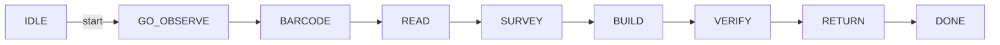

# 시나리오 — 운영자 시작부터 복귀까지

주사위 기억 미션([mission/README.md](../../mission/README.md)) 한 번을 **운영자가 하는 일 → 로봇 단계 → 화면에서 볼 것** 순서로 따라갑니다. 단계 규칙·파라미터 상세는 [03-plan.md](03-plan.md), 토픽은 [API.md](../../API.md)를 봅니다.

- 구현: [mission_manager.cpp](../../../lv2_module6/ros2_ws/src/plan/src/mission_manager.cpp) · [mission_solver.cpp](../../../lv2_module6/ros2_ws/src/plan/src/mission_solver.cpp)
- 값: [plan.yaml](../../../lv2_module6/ros2_ws/src/plan/config/plan.yaml) `mission_manager`
- 아래 값(시간·거리)은 plan.yaml 기본값이고, 현장에서 바뀔 수 있습니다.

## 1. 운영자가 하는 일

| 순서 | 운영자 | 확인할 것 |
|---|---|---|
| 1 | 로봇을 출발 관측 위치(arena 734, 950 mm)에 **−X를 보게** 놓고 켭니다 (`start_pose_arena`). 다른 자리면 launch 인자 `start_pose:=x,y,yaw` | 주변이 비어 있음 |
| 2 | 로봇에서 bringup: `./ros2_ws/start_real.sh` (또는 `start.sh`). 기본은 저장 지도 `scene_sim` + 인지 켬 | 지도 파일 없으면 시작이 거부됨 |
| 3 | `./tools/run-cli status` · `map status` · `estop status` | AUTO · LOCALIZATION · E-stop 해제 ([14-check.md](14-check.md)) |
| 4 | 적재함이 **비어 있는지** 눈으로 확인. 장부가 남았으면 `ros2 service call /coordinator/basket_clear std_srvs/srv/Trigger` | 장부가 남으면 start가 거부됨 |
| 5 | `./tools/run-cli mission start` (= `/cmd/mission start`). **이 명령부터 로봇이 움직입니다** | `/mission/state` phase가 `GO_OBSERVE`로 |
| 6 | 감시: `run-cli mission status` · TUI 미션 화면. 중지는 `mission abort`, 위험하면 `estop on` | 단계가 순서대로 넘어감 |
| 7 | `DONE`이면 로그 확인 후 bringup 터미널 `Ctrl+C` | `~/.ros/mission/<시각>/` |

실기 구간 시험은 `start:BARCODE`·`start:SURVEY`·`start:GOTO:S1,L2` 같은 변형으로 한 단계만 돌릴 수 있습니다([03-plan.md](03-plan.md) 시작·정지).

## 2. 정상 경로

| 단계 | 로봇이 하는 일 | 볼 수 있는 것 | 남는 기록 |
|---|---|---|---|
| GO_OBSERVE | 팔 stow 그대로, 출발 자리에서 이동 없이 관측 (scan 자세 없음) | `/mission/state` GO_OBSERVE | `phases.jsonl` |
| BARCODE | pole_front_cam으로 `barcode_pole_s`(3초) → 안 읽히면 `pose gaze`로 손 카메라. 신호는 같이 관측하고 확정 전엔 팔을 접고 기다림. gaze에서 3초 안 읽히면 0.06 m씩 직선 접근(최대 0.30 m) | `/tracked_objects` barcode · `/mission/qr` | `signal.json`(바코드) |
| READ | 12회 점멸이 두 사이클 같은 답이면 확정 → R·Y·G 횟수와 바코드로 L1·L2·L3 배정 | `/mission/signal` · `/mission/signal_status` | `signal.json` |
| SURVEY | 시작 박스 6곳(4·5·3·6·2·1)을 돌며 inspect → pick → `load 칸`. 끝나면 12개를 한 번에 R·Y·G에 할당. 누운 퍽은 `stand`로 세워 집음 | `/mission/markers` · 퍽 배정 보기 · `/coordinator/basket` | `allocation.json` |
| BUILD | 퍽마다 장소 상자 앞 → `location_box`로 칸 보정 → `unload 칸` → `place` → 내려다보고 10 mm 밖이거나 누우면 다시(`retries`) | 적재함 칸 · `/mission/state` 퍽 번호 | `build.json` · `photos/` |
| VERIFY | 장소마다 새로 본 퍽만으로 칸 판정 + 12개 중복·누락 (L3 → L2 → L1) | `/mission/state` results | `verify.json` |
| RETURN | 출발 구역 가운데로 → 차체 외곽이 구역 안인지 확인(밖이면 1회 보정) → `home_hold_s` 3초 정지 | 도착 후 3초 정지 | `return.json` |
| DONE | 끝 신호(OpenCR 부저, `phase_beeps`) | phase `DONE` | `phases.jsonl` · `steps.jsonl` |

- 모든 이동은 `mission_manager → coordinator` `ExecutePlan` Action(`/task/execute_plan`)으로 나갑니다. 주행 전에는 항상 `pose stow`가 맨 앞에 들어갑니다.
- 기록 폴더: `~/.ros/mission/<시작 시각>/` (`log_dir`). 파일 내용은 [03-plan.md 기록](03-plan.md#기록). `tools/plan/step_stats.py`가 `steps.jsonl`을 skill별 시도·성공률로 모읍니다. 파일 이름은 03-plan.md 기준이며, 실기 폴더에서 직접 확인한 것은 아닙니다.
- 방문 순서·접근 면은 plan.yaml `survey_order`·`build_location_order`·`start_box_sides`·`location_box_sides`가 정합니다.

## 3. 실패 갈래

| 갈래 | 이유(표시) | 로봇 동작 | 운영자 |
|---|---|---|---|
| start 거부 | 적재함 장부가 비어 있지 않음 (`/mission/state` note) · IDLE이 아님 | 움직이지 않음 | 적재함 비운 뒤 `basket_clear` |
| 바코드 못 읽음 | `barcode_missing` · `unknown_barcode:<원문>` | ERROR, coordinator 정지, 팔은 stow | 바코드 앞 자리·조명 확인 후 재시작 |
| 팔 처짐·모터 에러 | `arm_sag:<관절>`(0.25 rad 초과) · `motor_error` (`motor_error_stop`) | 즉시 정지·팔 접기 | 모터 재부팅 `/cmd/manual/reboot_motors` 후 재시작 |
| 신호 오류 | `signal_count`·`signal_unknown`·`signal_range`가 2사이클 이어짐, 또는 150초(`signal_timeout`) | ERROR (추정 금지) | 신호등이 `/tracked_objects`에 보이는지 |
| 퍽 단위 실패 | `approach_blocked` · `inspect_failed`/`inspect_partial` · `stand_still_lying` · `place_lying` · `load_failed` | `retries`번 재시도 뒤 **그 퍽만** 실패로 남기고 계속 | `build.json` 이유 확인 |
| 이동 갇힘 | `nav_no_progress` (남은 거리가 25초 동안 안 줆) · `nav_failed` · `nav_no_path_zone` | 끼임 풀기 → 다음 변 시도 → 퍽 단위 실패 | 벽 근처인지 · 충돌 감시 로그 |
| 할당 불가 | 퍽이 모자라 12개 못 채움 | 바로 RETURN (DIAG면 가진 퍽으로 부분 할당) | `allocation.json` |
| 복귀 실패 | `return_nav:<이유>` · 구역에서 1.0 m 넘게 멈 | ERROR | 수동으로 옮김 |
| 사람·안전 정지 | `interrupted: estop*·manual*·explore*·cancelled·preempted` | ERROR, 재시도 안 함 | 상태 확인 → 장부 확인 → 다시 `start` |
| 중지 | `/cmd/mission abort` | ERROR(`aborted`) | — |

- 현장 진단 실행(`start:DIAG`)은 관측 실패도 기록만 하고 RETURN까지 갑니다. 치명 이유(`estop`·`collision`·`overcurrent`·`motor_error`·`arm_sag`·`nav_no_progress`가 3번 이어짐 등)는 바로 멈춥니다.
- 실패 이유는 모두 `error.json`과 `/mission/state` note에 남습니다.

## 4. 실제로 막혔던 자리 (시험 기록 근거)

[test-results.csv](../../../project2/results/test-results.csv)에서 시나리오 단계와 이어지는 것만 옮깁니다. 원본 로그·영상은 없고 PR 본문 기록입니다.

| 단계 | 시험 | 결과 | 뒤 조치 |
|---|---|---|---|
| BARCODE | T-07 (11-13) | `barcode_missing` 7회, SURVEY를 한 번도 못 넘음 | PR #202 진단 모드, PR #204 신호 먼저 확정 뒤 gaze |
| SURVEY | T-08 (11-13) | `approach_blocked` 11회, BUILD 실행 못 함 | PR #203 인지 기반 도킹 |
| 이동 | T-09 (11-15) | collision_monitor approach 51번 · slowdown 27번 → `nav_no_progress` | PR #243 감시 구역 조정 |
| 이동 | T-10 (11-15) | 출발 약 2초 만에 `nav_failed` (TF 끊김) | PR #252 `map_tf_tolerance` 0.5 → 1.0 |
| 도킹 | T-11·T-12 (11-15) | 경유점 지도·문 경유점 넣은 뒤 도킹 성공 | PR #260 · #235 |

## 아직 확인 안 된 것

- 처음부터 끝까지(DONE) 한 번에 성공한 **실기** 기록은 test-results.csv에 없습니다. 위 정상 경로는 코드·문서 기준입니다.
- BUILD·VERIFY·RETURN을 실기에서 이어서 돌린 시험 기록은 없다. 모의(도커)에서 한 판 돌린 T-27은 퍽 0개(박스 접근 6곳 모두 실패)라 BUILD·VERIFY가 실행되지 않았고 RETURN만 확인됐다 ([sim-run](../../../project2/results/sim-run/README.md)).
