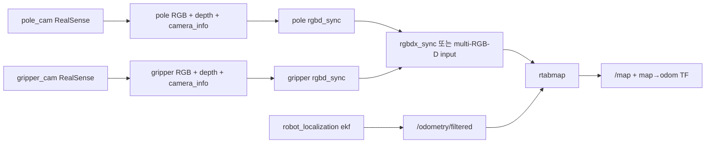

# RTAB-Map 2대 RGB-D 카메라 지원 제안

## 목적

현재 `feature/jetson` 브랜치의 RTAB-Map은 `pole_cam` 1대의 RGB-D만 사용한다. 이 문서는 `pole_cam`과 `gripper_cam` 2대를 RTAB-Map multi-RGB-D SLAM에 사용하는 방안과 검증 계획을 제안한다.

> 이 문서는 구현 완료가 아닌 proposal이다. 기존 `pole_cam` 단독 SLAM을 기본 fallback으로 유지하고, 2대 카메라 구성은 검증 후 선택적으로 활성화한다.

관련 문서: [`ros_system.launch.py`](../../lv2_module6/ros2_ws/src/ros_system/launch/ros_system.launch.py), [`02-sense.md`](../ros2-design/02-sense.md), [`04-nav.md`](../ros2-design/04-nav.md), [`07-tf.md`](../ros2-design/07-tf.md)

## 현재 구현 상태

현재 [`ros_system.launch.py`](../../lv2_module6/ros2_ws/src/ros_system/launch/ros_system.launch.py)의 RTAB-Map 입력은 다음과 같다.

```python
'rgb_topic': '/pole_cam/color/image_raw',
'depth_topic': '/pole_cam/aligned_depth_to_color/image_raw',
'camera_info_topic': '/pole_cam/color/camera_info',
'odom_topic': '/odometry/filtered',
'visual_odometry': 'false',
'approx_sync': 'true',
'localization': LaunchConfiguration('localization'),
'rtabmap_args': '--Reg/Force3DoF true --Grid/Sensor 1',
```

```text
/pole_cam/color/image_raw
/pole_cam/aligned_depth_to_color/image_raw
/pole_cam/color/camera_info
             │
             ├──> rtabmap ──> /map, map→odom TF
             │
/odometry/filtered
```

`/odometry/filtered`는 `/odom`과 `/imu`를 `robot_localization` EKF가 융합한 결과이며, 카메라 융합 결과가 아니다.

| 카메라 | 현재 역할 | 현재 RTAB-Map 입력 |
|---|---|---:|
| `pole_cam` | RGB-D SLAM/localization, 장애물, perception | 예 |
| `gripper_cam` | 팔 끝 근접 인지, grasp scoring용 PointCloud | 아니오 |

두 RealSense 드라이버는 각각 실행되며 다음 토픽을 낸다.

```text
/pole_cam/color/image_raw
/pole_cam/color/camera_info
/pole_cam/aligned_depth_to_color/image_raw
/pole_cam/depth/color/points

/gripper_cam/color/image_raw
/gripper_cam/color/camera_info
/gripper_cam/aligned_depth_to_color/image_raw
/gripper_cam/depth/color/points
```

`perception`은 설계상 두 카메라의 컬러·aligned depth·camera_info를 모두 구독한다. 목적은 두 카메라의 물체 검출 결과를 depth/TF로 `map`에 변환하고 association/tracking하여 `/tracked_objects`로 발행하는 것이다. 그러나 현재 실제 depth projection, TF 변환, association, tracking은 TODO/골격 상태이며 `/tracked_objects`는 더미 데이터다.

정리하면:

```text
카메라 2대 드라이버       구현됨
perception 두 카메라 구독  골격 구현
object fusion            미구현/TODO
RTAB-Map 2대 입력         미구현
```

## 목표 아키텍처



목표 흐름:

```text
pole RGB + depth + camera_info
        │
        └─ pole_rgbd_sync ──> /pole_rgbd_image

gripper RGB + depth + camera_info
        │
        └─ gripper_rgbd_sync ──> /gripper_rgbd_image

/pole_rgbd_image
/gripper_rgbd_image
/odometry/filtered
        │
        └─> rtabmap ──> /map, map→odom TF
```

## 구현 후보

### 후보 A: `rgbd_sync` 2개 + `rgbd_cameras:=2`

카메라별 `rtabmap_sync/rgbd_sync`를 실행한 후 RTAB-Map에 두 RGB-D 입력을 직접 연결한다.

```text
pole RGB/depth/info ──> pole_rgbd_sync ──> /pole_rgbd_image

gripper RGB/depth/info ─> gripper_rgbd_sync ─> /gripper_rgbd_image

/pole_rgbd_image
/gripper_rgbd_image
        │
        └─> rtabmap
```

예상 파라미터:

```text
subscribe_rgb: false
subscribe_depth: false
subscribe_rgbd: true
rgbd_cameras: 2
rgbd_image0: /pole_rgbd_image
rgbd_image1: /gripper_rgbd_image
odom_topic: /odometry/filtered
visual_odometry: false
```

전제조건:

- Jetson에 설치된 RTAB-Map이 `rgbd_cameras:=2`와 `rgbd_image0/1`을 지원해야 한다.
- multi-RGB-D 지원 빌드 옵션이 활성화되어야 할 수 있다.
- 카메라별 frame ID, TF, timestamp가 정확해야 한다.
- publisher/subscriber QoS가 호환되어야 한다.

### 후보 B: `rgbd_sync` 2개 + `rgbdx_sync`

직접 multi-RGB-D subscription이 제한된 경우 중간에서 여러 RGB-D 스트림을 묶는다.

```text
pole_rgbd_sync ─────┐
                    ├─> rgbdx_sync ─> /rgbd_images ─> rtabmap
gripper_rgbd_sync ──┘
```

전제조건:

- Jetson 환경에 `rgbdx_sync` 실행 파일과 필요한 메시지 타입이 있어야 한다.
- output 메시지가 각 카메라의 frame과 timestamp를 보존하는지 확인해야 한다.
- RTAB-Map의 multi-RGB-D 입력 방식과 정확히 맞춰야 한다.

| 항목 | 후보 A | 후보 B |
|---|---|---|
| 연결 | RTAB-Map에 RGB-D 2개 직접 연결 | 중간 메시지로 묶은 뒤 연결 |
| 진단 | 카메라별 입력 확인이 쉬움 | 중간 sync 확인 필요 |
| 의존성 | multi-RGB-D 지원 빌드 확인 | `rgbdx_sync` 지원 여부 확인 |
| 우선 검토 | 지원이 확인된 환경 | 직접 입력이 제한된 환경 |

Jetson에서 먼저 확인한다.

```bash
ros2 pkg prefix rtabmap_sync
ros2 pkg prefix rtabmap_slam
ros2 run rtabmap_sync rgbd_sync --help
ros2 run rtabmap_sync rgbdx_sync --help
ros2 param describe /rtabmap rgbd_cameras
```

## TF 요구사항

목표 TF 트리:

```text
map
 └─ odom
     └─ base_footprint
         └─ base_link
             ├─ pole_cam_link → pole_cam optical frame
             └─ arm joints → gripper_link → gripper_cam_link
                                      └─ gripper_cam optical frame
```

`pole_cam`은 base에 고정되어 있으므로 URDF/`robot_state_publisher`로 고정 TF를 제공한다.

`gripper_cam`은 팔 끝에 장착되어 움직이는 카메라다. `/joint_states`와 `robot_state_publisher`로 동적 TF가 제공되어야 하며, 단순 고정 `base_link → gripper_cam_link`로 처리하면 안 된다.

센서 메시지의 촬영 시각을 기준으로 TF를 조회한다.

```cpp
lookupTransform(
    "map" 또는 "base_footprint",
    camera_optical_frame,
    image.header.stamp
);
```

현재 시각의 TF를 사용하면 팔 이동 중 camera pose가 어긋나 object/feature 위치가 틀어진다.

```bash
ros2 run tf2_ros tf2_echo base_link pole_cam_link
ros2 run tf2_ros tf2_echo base_link gripper_cam_link
ros2 run tf2_ros tf2_echo map gripper_cam_color_optical_frame
ros2 run tf2_tools view_frames
```

추가로 검증할 것:

- color/depth optical frame 방향(`z` 전방, `x` 오른쪽, `y` 아래)
- color/depth alignment
- 카메라 intrinsic(`fx`, `fy`, `cx`, `cy`, distortion)
- base와 gripper의 camera extrinsic
- joint state timestamp와 센서 timestamp 차이

## 동기화 및 QoS

두 RealSense는 서로 다른 장치이므로 두 카메라의 timestamp가 완전히 같지 않을 수 있다.

필요한 처리:

- 각 카메라 내부 RGB/depth/camera_info 동기화
- `approx_sync:=true` 검토
- 허용 timestamp 차이 설정
- 오래된 frame 삭제
- sensor `header.stamp` 유지
- gripper 움직임에 대응할 TF buffer 확보

초기 프로파일은 다음을 유지한다.

```text
pole_cam: 640x480 @ 30 Hz
gripper_cam: 640x480 @ 15 Hz
```

QoS 확인:

```bash
ros2 topic info /pole_cam/color/image_raw -v
ros2 topic info /pole_cam/aligned_depth_to_color/image_raw -v
ros2 topic info /gripper_cam/color/image_raw -v
ros2 topic info /gripper_cam/aligned_depth_to_color/image_raw -v
ros2 node info /rtabmap
```

RealSense sensor topic의 best-effort/sensor-data QoS와 sync/RTAB-Map subscriber의 QoS가 호환되지 않으면 topic name이 보여도 실제 연결되지 않을 수 있다.

## 움직이는 gripper camera의 위험

`gripper_cam`을 SLAM에 사용하면 다음 위험이 있다.

- 팔 동작으로 카메라 baseline이 변한다.
- 관절 TF가 지연되면 잘못된 camera pose를 사용한다.
- 그리퍼와 팔이 feature로 인식될 수 있다.
- 가까운 grasp 대상이 화면 대부분을 차지할 수 있다.
- 움직이는 물체와 로봇 부품이 map에 반영될 수 있다.
- 파지 중 depth 최소 측정거리 문제로 빈 depth가 생길 수 있다.
- 두 RealSense의 USB bandwidth와 Jetson CPU/GPU 사용량이 증가한다.

따라서 초기 운영 정책은 다음을 권장한다.

```text
주행/일반 매핑: pole_cam 중심 또는 multi-camera 실험 모드
팔 이동/파지:   pole_cam 단독 SLAM fallback
gripper_cam:    perception/grasp_scorer 우선 사용
```

## PointCloud 처리

현재 저장소에는 실기용 독립 PointCloud filter node가 없다.

```text
/pole_cam/depth/color/points
        ├─ Nav2 costmap
        ├─ MoveIt OctoMap
        └─ collision_monitor

/gripper_cam/depth/color/points
        └─ grasp_scorer
```

시뮬레이터 `fake_camera`에는 `depth == 0` 제거와 `cloud_step` 기반 downsample이 있지만, 이는 별도 실기 filter node가 아니다. Nav2 `voxel_layer`/STVL의 높이 제한과 voxelization도 원본 PointCloud2를 재발행하는 독립 filter와는 구분해야 한다.

필요하면 주행/충돌용 filter chain을 별도로 추가한다.

```text
RealSense PointCloud2
        │
        └─ pointcloud_filter
             ├─ NaN 제거
             ├─ PassThrough: 거리 제한
             ├─ CropBox: robot/arm 영역 제거
             ├─ VoxelGrid: downsample
             ├─ 높이 제한
             └─ optional outlier removal
                    │
                    └─ /pole_cam/points_filtered
                         ├─ Nav2 costmap
                         ├─ collision_monitor
                         └─ MoveIt OctoMap
```

RGB-D image를 사용하는 SLAM 입력과 PointCloud를 사용하는 Nav2/MoveIt/collision 입력은 목적이 다르므로 filter chain을 분리할 수 있다.

## 안전한 운영 모드

launch에 다음과 같은 선택 파라미터를 추가하는 방안을 제안한다.

```text
use_multi_camera_slam:=false
```

### 기본 모드

```text
pole_cam → RTAB-Map
gripper_cam → perception/grasp_scorer
```

### 실험 모드

```text
pole_cam + gripper_cam → RGB-D sync → RTAB-Map
```

### fallback 정책

```text
팔 이동/파지 중          pole_cam 단독
gripper frame stale      pole_cam 단독
TF lookup 실패           pole_cam 단독
multi-camera 검증 실패   기존 단일 카메라 구성
```

기존 단일 카메라 동작을 깨지 않기 위해 기본값은 `false`로 둔다.

## 단계별 구현 및 검증 계획

### 1. 단일 카메라 기준선

```bash
ros2 node list | grep -E 'rtab|realsense|ekf'
ros2 node info /rtabmap
ros2 topic echo /odometry/filtered --once
```

`pole_cam` RGB/depth/camera_info, `/odometry/filtered`, `/map`, `map→odom`을 확인한다.

### 2. 카메라별 RGB-D sync

```bash
ros2 run rtabmap_sync rgbd_sync --help
```

`/pole_rgbd_image`, `/gripper_rgbd_image`의 발행과 timestamp를 확인한다.

### 3. TF 검증

팔을 움직이면서 `gripper_cam_link` TF가 변화하는지 확인하고 센서 timestamp에 대한 lookup 성공률을 기록한다.

### 4. multi-RGB-D 테스트

후보 A 또는 B를 적용하고 RTAB-Map이 두 입력을 실제로 구독하는지 `ros2 node info /rtabmap`으로 확인한다.

### 5. mapping

`localization:=false`로 새 DB에 기록한다. 팔을 고정한 조건과 팔을 움직이는 조건을 분리해 map 안정성을 비교한다.

### 6. localization

`localization:=true`로 재기동하고 `/map`, `map→odom`, 초기 위치 추정, pose 안정성을 확인한다.

### 7. 자원 측정

Jetson에서 CPU/GPU/메모리/USB bandwidth와 RTAB-Map 처리 주기를 기록한다.

## 완료 조건

- [ ] 두 RealSense가 독립 실행된다.
- [ ] RGB/depth/camera_info가 카메라별로 동기화된다.
- [ ] 두 optical frame이 올바른 TF tree에 연결된다.
- [ ] gripper camera의 동적 TF가 joint state에 따라 갱신된다.
- [ ] sensor `header.stamp` 기준 TF lookup이 성공한다.
- [ ] multi-RGB-D input이 발행된다.
- [ ] RTAB-Map이 두 RGB-D 입력을 구독한다.
- [ ] `/odometry/filtered`가 정상 입력된다.
- [ ] `/map`과 `map→odom`이 정상 발행된다.
- [ ] mapping/localization이 성공한다.
- [ ] gripper 이동 중 map이 심하게 흔들리지 않는다.
- [ ] stale/TF 오류 시 pole_cam 단독 fallback이 가능하다.
- [ ] Jetson resource 사용량을 기록한다.
- [ ] 기존 pole_cam 단독 SLAM이 유지된다.

## 예상 후속 변경 파일

```text
lv2_module6/ros2_ws/src/ros_system/launch/ros_system.launch.py
lv2_module6/ros2_ws/src/ros_system/launch/multi_rgbd.launch.py
lv2_module6/ros2_ws/src/ros_system/config/rtabmap_multi_camera.yaml
lv2_module6/ros2_ws/src/ros_system/config/pointcloud_filter.yaml
lv2_module6/ros2_ws/src/ros_system/package.xml
lv2_module6/ros2_ws/src/ros_system/CMakeLists.txt
documents/ros2-design/04-nav.md
documents/ros2-design/04b-mapping.md
documents/ros2-design/07-tf.md
documents/API.md
```

이번 PR에서는 proposal 문서만 추가하고 launch/config/노드 구현은 후속 PR로 분리한다.

## 결론

현재 RTAB-Map은 `pole_cam` 단독이다. 2대 카메라를 사용하려면 카메라별 RGB-D synchronization, multi-RGB-D input, 정확한 static/dynamic TF, timestamp 기준 변환, QoS 호환성 및 Jetson resource 검증이 필요하다.

기술적으로는 다음 구성이 가능하다.

```text
pole_cam RGB-D ───────┐
                      ├─> RGB-D synchronization ─> RTAB-Map
 gripper_cam RGB-D ───┘
```

그러나 `gripper_cam`은 팔 끝에서 움직이는 카메라다. 따라서 **기존 pole_cam 단독 SLAM을 깨뜨리지 않는 것을 최우선으로 하고, `use_multi_camera_slam:=false`를 기본값으로 하는 실험적 multi-camera 지원을 후속 구현한다.**
