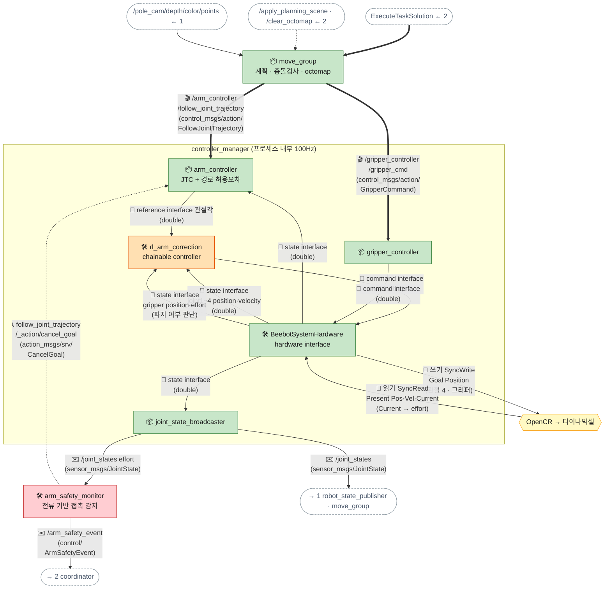

[목차](README.md) · [◀ 3-1 지도 맵핑 실습](04b-mapping.md) · [5 베이스 ▶](06-base.md)

## 4. 팔: MoveIt 2 + MTC + ros2_control

pick·place는 MoveIt Task Constructor(MTC) 태스크로 짭니다. 접근(직선) → 그리퍼 열기 → 파지 → **퍽 attach** → 들어올리기(직선) → 후퇴를 한 번에 계획하고, move_group이 `arm_controller`(JointTrajectoryController)에 궤적을 넘깁니다. controller_manager 안쪽은 토픽이 아니라 같은 프로세스의 메모리로 연결됩니다.

> 인터페이스 명세: [토픽](../API.md#api-topics) · [액션](../API.md#api-actions) · [서비스](../API.md#api-services)



**순서** — 단계별로는 문서 아래 **▶ 흐름 따라가기**에서 볼 수 있다.

- coordinator가 MTC 태스크 실행 요청 (장면 갱신은 그 전에 2장 pick 단계에서 끝남)
- MTC 단계마다 팔 궤적(JTC) 또는 그리퍼 명령 중 하나를 보낸다. 접근 → 그리퍼 열기 → 파지 → … 순서로 번갈아
- controller_manager 100Hz 한 주기 (read → update → write)
  - read: 다이나믹셀에서 위치·속도·전류를 읽는다
  - 읽은 값이 state interface로 각 컨트롤러에 보인다 (같은 메모리)
  - update: joint_state_broadcaster가 /joint_states 발행
  - update: JTC가 이번 주기 목표 관절각을 rl_arm_correction의 reference로 넘긴다
  - update: rl_arm_correction(목표각 + Δ)과 gripper_controller가 command를 쓴다
  - write: 다이나믹셀로 보내고 다음 주기 read로
- 이상 시에만: arm_safety_monitor가 /joint_states의 전류를 보고 접촉을 찾으면 궤적 취소 → coordinator에 보고

| 이름 | 종류 | 메시지 타입 | 보내는 쪽 → 받는 쪽 | 주기 |
| --- | --- | --- | --- | --- |
| /arm_controller/follow_joint_trajectory | 액션 | control_msgs/action/FollowJointTrajectory | move_group → arm_controller | 궤적마다 |
| /gripper_controller/gripper_cmd | 액션 | control_msgs/action/GripperCommand | move_group(MTC) → gripper_controller | 잡기·놓기 |
| rl_arm_correction/jointN/position | reference 인터페이스 | double | arm_controller → rl_arm_correction | 100Hz |
| jointN/position (command·state) | 하드웨어 인터페이스 | double | 컨트롤러 ↔ hardware interface | 100Hz |
| /joint_states | 토픽 | sensor_msgs/JointState | joint_state_broadcaster → robot_state_publisher, move_group, arm_safety_monitor | 100Hz |

### 4-1. 파지 계획에서 꼭 챙길 것

- **4축 팔의 한계:** OM-X는 4자유도라 임의의 6D 자세를 못 만든다. grasp 후보는 IK로 도달 가능한 것만 남기고, IK 솔버는 위치 위주(pick_ik 등)를 쓴다. "옆에서 수평" 파지는 팔 평면 안에 퍽이 있어야 가능하므로, coordinator가 베이스를 퍽 방향으로 정렬해 세운다.
- **octomap 속 목표퍽:** pole_cam 포인트클라우드에는 목표퍽도 voxel로 들어간다. 그대로면 그리퍼 접근이 충돌로 거부된다. pick 직전 /clear_octomap → 퍽·장애물을 CollisionObject로 등록 → MTC에서 그리퍼와 퍽의 충돌을 허용(ACM)한다.
- **잡은 뒤 attach:** 퍽을 AttachedCollisionObject로 gripper_link에 붙여야 들고 움직이는 궤적에서 퍽이 고려된다. place 후 detach.
- **베이스가 움직였으면 장면 초기화:** octomap은 map 기준으로 쌓이므로 이동 뒤 낡은 voxel이 남는다. 매 pick 전에 지운다.

### 4-2. 팔 충돌 처리 — 세 겹

MoveIt은 궤적을 만들 때 한 번 검사합니다. 실행 중 끼어든 물체, 등록 안 된 물체, rl_arm_correction의 Δ는 계획 검사로 못 잡으므로 실행·하드웨어 층으로 보강합니다.

| 층 | 수단 | 검사 시점 | 잡는 것 | 구현 |
| --- | --- | --- | --- | --- |
| 1. 계획 | planning scene + octomap | 궤적 생성 시 | 퍽·장애물·자기 충돌, 보이는 미등록 물체 | move_group 설정 |
| 2a. 실행 (추종) | JTC `constraints` 경로·목표 허용오차 | 매 주기 | 추종 오차가 커진 상황 (막힘·끼임) | JTC YAML — 넘으면 JTC가 스스로 abort |
| 2b. 실행 (전류) | arm_safety_monitor | 100Hz | 사람 손처럼 실행 중 생긴 접촉 | 직접 작성 |
| 3. 하드웨어 | 속도·가속도 스케일 0.3~0.5, 다이나믹셀 전류 한계 | 항상 | 부딪혔을 때 충격 크기 | 설정 |

**arm_safety_monitor 동작**

1. **입력:** /joint_states의 effort(= 다이나믹셀 Present Current). 하드웨어 인터페이스가 effort state interface를 내보내도록 설정해야 실린다.
2. **판단:** 관절별 기준 전류 대비 임계치 초과가 0.1초 이상 이어지면 접촉. 퍽을 든 상태를 포함해 정상 동작 전류를 먼저 기록하고 그보다 충분히 높게 잡는다.
3. **정지:** `/arm_controller/follow_joint_trajectory/_action/cancel_goal`로 진행 중 goal 전체를 취소 → JTC가 현재 자세 유지.
4. **보고:** /arm_safety_event → coordinator가 단계 실패로 처리.

```yaml
# arm_controller (JTC) — 추종 오차 감지는 직접 짜지 않고 내장 기능으로
arm_controller:
  ros__parameters:
    joints: [joint1, joint2, joint3, joint4]
    command_joints:            # 체인: 하드웨어 대신 rl_arm_correction의 reference에 쓴다
      - rl_arm_correction/joint1
      - rl_arm_correction/joint2
      - rl_arm_correction/joint3
      - rl_arm_correction/joint4
    command_interfaces: [position]
    state_interfaces: [position, velocity]
    constraints:
      stopped_velocity_tolerance: 0.02
      goal_time: 0.5
      joint2: { trajectory: 0.10, goal: 0.03 }   # 경로 중 0.1rad 넘게 벗어나면 abort
```
---

## ▶ 흐름 따라가기

도식의 화살표를 단계별로 따라간 설명입니다. (원본 페이지에서는 단계마다 해당 화살표가 강조됩니다.)

### 집기 한 번

1. **준비 — 장면** — 2장 pick 단계에서 octomap을 지우고 퍽·장애물을 등록해 둡니다. octomap은 pole_cam 점구름으로 다시 쌓입니다.  
   <sub>화살표: /apply_planning_scene · /clear_octomap ← 2 → move_group · /pole_cam/depth/color/points ← 1 → move_group</sub>
2. **실행 요청** — coordinator가 ExecuteTaskSolution (MTC: 접근 → 열기 → 파지 → attach → 들어올리기 → 후퇴).  
   <sub>화살표: ExecuteTaskSolution ← 2 → move_group</sub>
3. **팔 궤적** — 🎬 follow_joint_trajectory. MTC 단계마다 팔 궤적 또는 그리퍼 명령을 번갈아 보냅니다.  
   <sub>화살표: move_group → arm_controller</sub>
4. **read** — 다이나믹셀에서 위치·속도·전류(→ effort)를 읽습니다. 여기서부터 controller_manager 100Hz 한 주기.  
   <sub>화살표: OpenCR → 다이나믹셀 → BeebotSystemHardware</sub>
5. **state interface** — 읽은 값이 같은 메모리로 각 컨트롤러에 보입니다. 토픽이 아닙니다.  
   <sub>화살표: BeebotSystemHardware → arm_controller · BeebotSystemHardware → rl_arm_correction · BeebotSystemHardware → rl_arm_correction (#2) · BeebotSystemHardware → joint_state_broadcaster</sub>
6. **/joint_states** — robot_state_publisher(TF)·move_group, 그리고 arm_safety_monitor(전류 감시)로.  
   <sub>화살표: joint_state_broadcaster → 1 robot_state_publisher · move_group · joint_state_broadcaster → arm_safety_monitor</sub>
7. **JTC 목표 → reference** — 이번 주기 목표 관절각 [0.00, 0.62, −0.31, 1.10]을 rl_arm_correction에 넘깁니다.  
   <sub>화살표: arm_controller → rl_arm_correction</sub>
8. **보정 → command** — 중력 처짐 보상 Δ[0, +0.03, −0.01, 0]을 더해 씁니다 (±0.05rad 클리핑).  
   <sub>화살표: rl_arm_correction → BeebotSystemHardware</sub>
9. **write** — 다이나믹셀로 보내고 다음 주기 read로.  
   <sub>화살표: BeebotSystemHardware → OpenCR → 다이나믹셀</sub>
10. **그리퍼 단계** — MTC가 열기·닫기 단계에선 🎬 gripper_cmd → gripper_controller가 보정 단계와 같은 update에서 command를 씁니다.  
   <sub>화살표: move_group → gripper_controller · gripper_controller → BeebotSystemHardware</sub>

### 접촉 감지로 멈출 때

1. **전류 감시** — /joint_states의 effort가 기준보다 높은 상태가 0.1초 넘게 이어지면 접촉으로 판단.  
   <sub>화살표: joint_state_broadcaster → arm_safety_monitor</sub>
2. **궤적 취소** — 📞 follow_joint_trajectory/_action/cancel_goal → JTC가 현재 자세를 유지합니다.  
   <sub>화살표: arm_safety_monitor → arm_controller</sub>
3. **coordinator에 보고** — /arm_safety_event → 단계 실패로 처리 (2장 재시도 규칙).  
   <sub>화살표: arm_safety_monitor → 2 coordinator</sub>


---

[목차](README.md) · [◀ 3-1 지도 맵핑 실습](04b-mapping.md) · [5 베이스 ▶](06-base.md) · [원본 페이지](https://dooboostore.github.io/ros2?concept=design&sec=arm)
