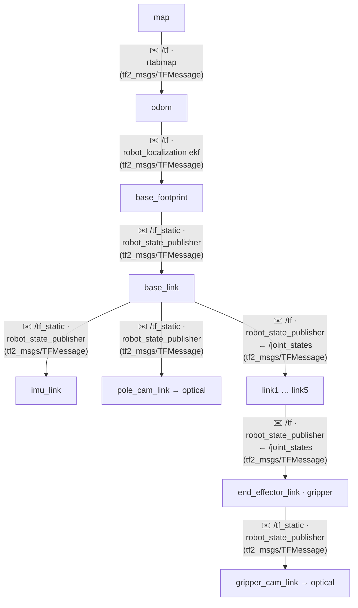

[목차](README.md) · [◀ 5 베이스](06-base.md) · [ros2_control 연결 ▶](08-ctrl.md)

## 6. TF 트리

모든 좌표가 나무 하나로 이어져야 perception의 퍽 위치를 Nav2와 MoveIt이 같은 좌표로 씁니다.

> 인터페이스 명세: [TF](../API.md#api-tf) · [QoS](../API.md#api-qos)

| 변환 | 발행자 | 성격 |
| --- | --- | --- |
| map → odom | rtabmap (매핑·위치추정 모드 모두) | 가끔 점프 (루프 클로저·재위치 추정) |
| odom → base_footprint | robot_localization ekf | 연속, 드리프트 있음 |
| base_footprint → base_link → 센서·팔 | robot_state_publisher (URDF) | 고정 또는 /joint_states로 변함 |
| *_link → *_optical_frame | robot_state_publisher | 고정 (카메라 광학 좌표: z 앞, x 오른쪽, y 아래) |

- Nav2 `robot_base_frame`, ekf `base_link_frame`, MoveIt 가상 조인트의 부모를 **모두 base_footprint**로 통일한다 (TurtleBot3 관례).
- MoveIt planning frame은 base_footprint. 퍽·장애물은 map 기준으로 받지만, 베이스가 멈춘 뒤 등록하므로 rtabmap 루프 클로저 점프 영향을 안 받는다.

## QoS 정리

| 데이터 | Reliability | Durability | Depth | 이유 |
| --- | --- | --- | --- | --- |
| 카메라·점구름·IMU | best_effort | volatile | 1~5 | 최신 값만 의미 있음, 재전송이 지연만 키움 |
| /cmd_vel 체인 | reliable | volatile | 1 | 명령 유실 방지, 오래된 명령은 버림 |
| /map, /tf_static | reliable | transient_local | 1 | 늦게 붙는 노드도 받아야 함 |
| /sub_goals, /task_status | reliable | transient_local | 10 | 재시작한 coordinator·UI도 마지막 계획을 받음 |
| /tracked_objects | reliable | volatile | 5 | 매 주기 갱신, 누락 시 다음 값으로 충분 |

> best_effort 발행자를 reliable 구독자가 받으면 **연결 자체가 안 된다.** 센서 토픽 구독은 `rclcpp::SensorDataQoS()` / `qos_profile_sensor_data`를 쓴다.

---

[목차](README.md) · [◀ 5 베이스](06-base.md) · [ros2_control 연결 ▶](08-ctrl.md) · [원본 페이지](https://dooboostore.github.io/ros2?concept=design&sec=tf)
