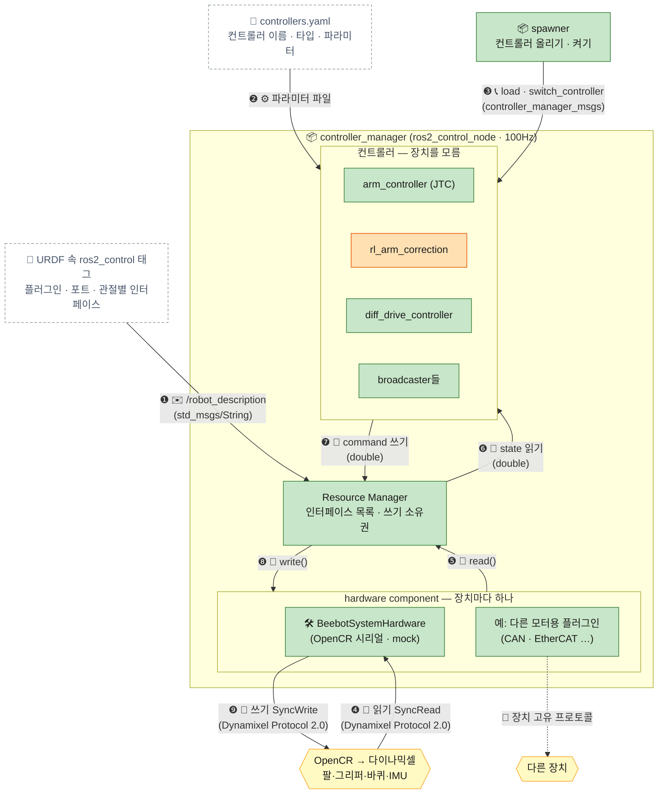

[목차](README.md) · [◀ 6 TF·QoS](07-tf.md) · [직접작성·제공 ▶](09-nodes.md)

## ros2_control 연결 — 이 로봇 요약

controller_manager는 장치를 모릅니다. 장치별 연결·전송은 **하드웨어 플러그인**이 맡고, controller_manager는 그 플러그인과 컨트롤러 플러그인을 정해진 순서로 불러 쓰기만 합니다 — "인터페이스만 맞춰라, 내가 불러다 쓸게." 개념·한 주기 흐름·플러그인 만들기·연결 5단계는 **ros2_control 탭**에 따로 정리했습니다.

[📘 ros2_control 탭 — 개념부터 보기 →](https://dooboostore.github.io/ros2?concept=ros2control&cs=concept) · [▶ 한 주기 흐름 스텝퍼](https://dooboostore.github.io/ros2?concept=ros2control&cs=flow) · [🔧 연결 5단계](https://dooboostore.github.io/ros2?concept=ros2control&cs=connect) · [🤖 이 로봇 적용](https://dooboostore.github.io/ros2?concept=ros2control&cs=robot)

**화살표 순서 (❶~❾)**

- ❶~❸ 시작할 때 1회: URDF로 하드웨어 플러그인을 올리고 → 컨트롤러 파라미터를 읽고 → spawner가 컨트롤러를 올려 켠다
- ❹~❾ 100Hz 반복 (read → update → write)
  - ❹~❺ read: 장치에서 읽은 값을 hardware component가 state interface에 채운다
  - ❻~❼ update: 컨트롤러가 state를 읽고 command를 쓴다
  - ❽~❾ write: command를 장치로 보내고 다음 주기 ❹로
- 다른 장치용 플러그인(점선)은 예시라 번호가 없다.

### 이 로봇에서 연결하는 것

| 항목 | 값 |
| --- | --- |
| 하드웨어 플러그인 | control/BeebotSystemHardware (직접 작성) — OpenCR 펌웨어 beebot_opencr와 USB 시리얼 ASCII 프로토콜 |
| URDF param | mock (테스트베드) · mock_effort · port /dev/ttyACM0 |
| 관절·센서 | wheel_left/right_joint · joint1~5 · gripper_left_joint(오른쪽은 mimic) · imu |
| 컨트롤러 | joint_state_broadcaster · imu_sensor_broadcaster · diff_drive_controller · rl_arm_correction(chainable) · arm_controller(JTC, 체인) · gripper_controller(parallel_gripper) |
| spawner 순서 | … → **rl_arm_correction → arm_controller** → gripper_controller (체인은 뒤에서부터) |

> 손목 roll 축을 더해 ROBOTIS 공식 turtlebot3_manipulation 플러그인·펌웨어(4축)는 쓰지 않는다. OpenCR 펌웨어와 하드웨어 플러그인을 직접 작성했고, 펌웨어가 서보 전류를 effort로 보내 arm_safety_monitor·rl_arm_correction이 쓴다.

### 수치 변환 (다이나믹셀 XM430)

| 변환 | 계산 | 결과 |
| --- | --- | --- |
| 관절 0.65rad → 틱 | 2048 + 0.65 × 4096 / 2π | 약 2472 |
| 틱 2468 → rad | (2468 − 2048) × 2π / 4096 | 약 0.644rad |
| 바퀴 2.72rad/s → 속도 단위 | 2.72 × 60 / 2π = 26.0rpm, ÷ 0.229 | 약 113 |

---

[목차](README.md) · [◀ 6 TF·QoS](07-tf.md) · [직접작성·제공 ▶](09-nodes.md) · [원본 페이지](https://dooboostore.github.io/ros2?concept=design&sec=ctrl)
