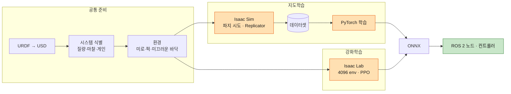

[목차](README.md) · [◀ 학습 설계](11-learn.md) · [시나리오 ▶](13-scenario.md)

## Isaac Sim / Isaac Lab 학습 파이프라인

Isaac Sim은 물리 시뮬레이터, Isaac Lab은 그 위에서 환경 수천 개를 병렬로 돌려 강화학습을 하는 프레임워크입니다. 지도학습은 Isaac Sim이 데이터를 만들고 학습은 밖에서, 강화학습은 Isaac Lab이 학습 내내 함께 돕니다.



### 공통 준비

1. **로봇 가져오기:** TB3 + OM-X URDF를 USD로 변환. 바퀴·관절 drive 게인 설정.
2. **물리 맞추기 (시스템 식별):** 실기와 시뮬에 같은 명령을 주고 반응을 비교해 질량, 관절 마찰, 바퀴 마찰, 모터 게인, 지연을 맞춘다. 실기 rosbag을 기준 데이터로 쓴다.
3. **환경 만들기:** 목표 구역,퍽, 장애물, 미끄러운 바닥 구간.

### 지도학습 흐름 (grasp_scorer)

1. 장면마다 퍽 모양·크기·위치·회전·마찰을 무작위로.
2. 퍽 주변에 파지 후보를 수십 개 만들고 **OM-X IK로 도달 불가능한 것은 버린다.**
3. 후보마다 그리퍼를 닫고 10cm 들어올리고 살짝 흔든다.
4. 유지 1, 낙하 0으로 (포인트클라우드, 자세, 라벨) 저장.
5. 병렬로 수만~수십만 개를 모은 뒤 Isaac을 끄고 PyTorch로 분류 모델 학습.
6. ONNX로 내보내 grasp_scorer에서 사용.

perception도 같은 틀입니다. Replicator로 조명·배경·질감을 바꿔 찍으면 박스·마스크 정답이 자동으로 붙고, 실사진 수백 장을 섞으면 현실 성능이 크게 오릅니다.

### 강화학습 흐름 (rl_nav_correction)

1. **환경 정의:** 장면, 기본 제어기, 관측, 행동, 보상을 Isaac Lab 파이썬으로.
2. **기본 제어기 대체:** 병렬 환경에서 Nav2를 돌릴 수 없으므로 pure pursuit를 넣고, **게인을 랜덤화**해 DWB와의 차이에 덜 민감하게 한다. velocity_smoother의 가속 제한도 환경에 넣는다.
3. **랜덤화 이벤트:** 에피소드마다 마찰, 바퀴 반경, 질량, 지연, 노이즈.
4. **학습:** headless로 4096개 환경, PPO. 보상 곡선이 평평해지면 수렴.
5. **확인:** play 모드로 미끄러운 바닥에서 경로 이탈이 줄어드는지.
6. **배포:** ONNX → ROS 2 노드가 **같은 순서·단위·정규화·주기**로 관측을 만든다.

```bash
# 스크립트 경로·옵션은 Isaac Lab 버전마다 다르다 — 사용하는 버전 문서를 따른다
python scripts/reinforcement_learning/rsl_rl/train.py --task Beebot-NavResidual-v0 --num_envs 4096 --headless
```

- **rl_nav_tuner를 RL로 학습하기 어렵다:** 프리셋 효과는 DWB 동작에 달려 있는데, Isaac Lab 병렬 환경에는 DWB가 없다. 규칙 기반으로 시작하고, RL이 필요하면 Gazebo + 실제 Nav2로 소수 환경 학습을 하거나 DWB 근사 모델을 만든다.

### Isaac에서 쓸 수 있는 학습 종류

| 종류 | 도구 | 이 시스템의 용도 |
| --- | --- | --- |
| 강화학습 | Isaac Lab + PPO (rsl_rl, rl_games, skrl) | 뒷단 보정 2개, (rl_nav_tuner) |
| 합성 데이터 지도학습 | Replicator, 스크립트 데이터 수집 | perception, grasp_scorer |
| 모방학습 | Isaac Lab 원격조종, Isaac Lab Mimic, robomimic | 나중에 pick/place 동작 자체를 학습할 때 |

공통 기법: 도메인 랜덤화, 쉬운 환경부터 어려운 환경으로 가는 커리큘럼, 시뮬 정답으로 학습한 선생 정책을 실제 센서만 쓰는 학생 정책이 따라 하는 teacher–student.

---

[목차](README.md) · [◀ 학습 설계](11-learn.md) · [시나리오 ▶](13-scenario.md) · [원본 페이지](https://dooboostore.github.io/ros2?concept=design&sec=isaac)
