[목차](README.md) · [◀ 시나리오](13-scenario.md) · [검토 반영 ▶](15-changes.md)

## 안전·검증·sim-to-real 체크리스트

가장 흔한 실패는 **관측 벡터의 순서·단위가 학습 때와 달라지는 것**입니다.

### 배포 전

- [ ] 관측의 순서·단위·정규화가 Isaac Lab과 ROS 2 노드에서 완전히 같다 (단위 테스트로 같은 입력 → 같은 출력 확인)
- [ ] 정책 실행 주기가 학습 때와 같다 (학습 50Hz면 노드도 50Hz)
- [ ] Δ 클리핑(선 ±0.05, 각 ±0.10, 관절 ±0.05)과 **보정 후 상한 재클리핑**이 걸려 있다
- [ ] velocity_smoother·collision_monitor가 rl_nav_correction보다 뒤에 있고, behavior_server 출력도 같은 체인을 지난다
- [ ] 센서 값이 0.2초 넘게 끊기면 Δ=0
- [ ] TwistStamped로 체인 전체가 통일돼 있다
- [ ] odom TF 발행자가 하나다 (ekf만)

### 하드웨어 첫 구동

- [ ] 틱↔rad 변환과 중앙값 2048을 관절마다 확인
- [ ] 토크를 낮춘 상태에서 관절을 하나씩 움직여봄
- [ ] 버스가 100Hz를 맞춘다 (SyncRead/SyncWrite, baud rate)
- [ ] 비상 정지 방법이 정해져 있다 (하드웨어 스위치 + `/cmd_vel` 0 + 컨트롤러 deactivate)
- [ ] 팔이 목표 구역 높이에 닿는다 (MoveIt에서 목표 자세 IK 확인)
- [ ] RealSense 2대가 serial_no로 구분돼 동시에 30fps(또는 설정 fps)를 유지한다 (`ros2 topic hz`)
- [ ] rtabmap 위치추정 모드에서 시작 위치를 찾은 뒤에만 Nav2 목표를 보낸다

### 팔 안전

- [ ] planning scene에 octomap(pole_cam 포인트클라우드)이 들어오고, pick 전 clear가 된다
- [ ] /joint_states에 effort가 실린다
- [ ] 정상 동작 전류를 기록하고 접촉 기준값을 정했다
- [ ] 팔을 손으로 막았을 때 0.2초 안에 궤적이 멈춘다 (JTC 허용오차 또는 arm_safety_monitor)
- [ ] MoveIt 속도·가속도 스케일과 다이나믹셀 전류 한계가 설정돼 있다
- [ ] 베이스 이동 중 팔 동작이 coordinator에서 막힌다

### 효과 검증

- [ ] 같은 경로를 보정 끔/켬(EKF는 둘 다 켬)으로 각 10회 이상 주행해 경로 이탈·도착 시간 비교
- [ ] 같은 퍽 배치에서 grasp_scorer vs 규칙 기반 성공률 기록
- [ ] coordinator가 VLM 출력의 형식, 허용 동작, 대상 존재를 검사
- [ ] 재시도 한도(2회)와 운영자에게 알리는 동작이 있다

## 개발 로드맵

확정 노드만으로 끝까지 되게 만든 뒤, 효과가 크고 쉬운 학습 노드부터 하나씩 붙입니다. 각 단계는 앞 단계가 **실기에서 동작해야** 시작합니다.

```mermaid
flowchart LR
    A["1 기반<br/>URDF·SLAM·Nav2·MoveIt"] --> B["2 coordinator<br/>+ perception"]
    B --> C["3 vlm_task_planner"]
    C --> D["4 오차 측정"]
    D --> E["5 rl_nav_correction"]
    E --> F["6 grasp_scorer"]
    F --> G["7 rl_arm_correction"]
    G --> H["8 rl_nav_tuner (RL)"]
    classDef std fill:#c8e6c9,stroke:#2e7d32,color:#1b1b1b;
    classDef rl fill:#ffe0b2,stroke:#e65100,color:#1b1b1b;
    classDef ai fill:#d1c4e9,stroke:#4527a0,color:#1b1b1b;
    classDef hw fill:#fff9c4,stroke:#f9a825,color:#1b1b1b;
    classDef safe fill:#ffcdd2,stroke:#c62828,color:#1b1b1b;
    classDef ext fill:#ffffff,stroke:#8A97A0,stroke-dasharray:4 3,color:#475569;
    class A,B,C,D std;
    class E,F,G,H rl;
```

1. **기반:** URDF에 RealSense 2대·ros2_control 태그, RTAB-Map 지도, Nav2(+behavior_server, ekf)·MoveIt(+MTC) 설정, 텔레옵으로 이동·집기, 팔을 막으면 멈추는지 확인
2. **coordinator + perception:** 규칙 기반 파지(옆에서)와 규칙 프리셋으로 퍽 가져오기를 끝까지
3. **vlm_task_planner:** 자연어 명령과 재계획 연결
4. **오차 측정:** 학습 없이 반복해 오차가 어디서 나는지 rosbag으로 기록 (이게 Isaac 시스템 식별 데이터)
5. **rl_nav_correction:** RL 중 가장 쉽고 효과 확인이 빠름
6. **grasp_scorer:** 규칙 기반 대비 성공률이 오르는지
7. **rl_arm_correction:** chainable controller로 구현
8. **rl_nav_tuner RL화:** 규칙 프리셋으로 부족할 때만

---

[목차](README.md) · [◀ 시나리오](13-scenario.md) · [검토 반영 ▶](15-changes.md) · [원본 페이지](https://dooboostore.github.io/ros2?concept=design&sec=check)
