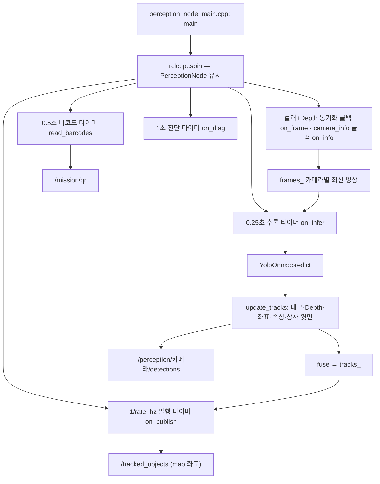

# Perception 패키지: 개념·구조·실행 안내

> 기준: `develop` 커밋 `48cc6b2b` (2026-11-17)의 코드·설정. 아래 값·토픽·명령은 이 커밋의 소스에서 확인했다 (근거 `파일:줄`).
> 이 문서의 명령을 Jetson에서 다시 실행한 기록은 **아직 없다**. 이 문서는 구조·실행 안내이며 시험 성공 증빙이 아니다. 시험 기록은 [VALIDATION_GUIDE.md](VALIDATION_GUIDE.md)와 [project2/results/test-results.csv](../../../../project2/results/test-results.csv)에 둔다.

## 1. 무엇을 담당하나?

로봇은 카메라 사진만으로 물체가 지도 어디에 있는지 모른다. 이 패키지가 그 일을 한다.

1. RGB 사진에서 **무엇인지** 찾는다 (YOLO).
2. 정렬된 Depth와 카메라 내부 파라미터로 **얼마나 떨어져 있는지** 잰다.
3. TF로 **로봇·지도 좌표**로 바꾼다.
4. 여러 프레임을 합쳐 **어떤 물체가 어디 있었는지** 기억한다 (추적).

결과는 `/tracked_objects`로 나가고, 미션 판단(`mission_manager`)·조작(`coordinator`, skill)이 쓴다. 신호등 12회 점멸은 `signal_decoder`가 읽어 `/mission/signal`로 낸다.

용어:

- **YOLO**: 사진 → 물체 네모(클래스·점수). C++ 노드는 `.onnx`만 읽는다 (`perception_node.cpp:352`). TensorRT 엔진이 있으면 그걸로 돌린다.
- **Confidence**: 검출 점수 하한. `0.4` 이상이어도 "맞다"는 보장은 아니다.
- **NMS / IoU**: 겹친 네모를 하나만 남기는 후처리. 클래스별 IoU 0.7 (`include/perception/yolo_onnx.hpp` 머리말).
- **Depth**: `16UC1`은 mm → m로 바꾼다 (`perception_node.cpp:449-454`). 중심 픽셀 `(u,v)`와 깊이 `z`로 `X=(u-cx)z/fx`, `Y=(v-cy)z/fy`, `Z=z` (`perception_node.cpp:683`).
- **TF**: 카메라 좌표 → `odom`(추적) → `map`(발행). 영상 시각의 TF가 없으면 최신 TF를 0.3초 차이까지만 쓴다 (`max_tf_fallback_age_s`, `perception_node.cpp:233`, `1319-1351`).
- **추적/기억**: 같은 종류·가까운 위치의 관측을 칼만 필터로 한 트랙에 합친다. 어느 카메라에도 **2초** 안 보이면 지운다 (`TRACK_TIMEOUT_S`, `include/perception/perception_core.hpp:23`).
- **ROS 2 노드/토픽**: 구독·발행은 한 번 부르고 끝이 아니다. `rclcpp::spin()`이 콜백과 타이머를 계속 돌린다.

## 2. 실제 C++ 실행 흐름



- 타이머 4개: 발행 `1/rate_hz`, 추론 0.25초, 진단 1초, 바코드 0.5초 (`perception_node.cpp:424-427`).
- 0.25초는 타이머 간격이다. 카메라마다 늘 초당 4장이 나온다는 뜻은 아니다. 처리 시간과 주행 중 절전에 따라 줄어든다.
- **주행 중 절전**: 전체 bringup은 `navigation_throttle:=true`, `navigation_infer_hz:=2.0`, `navigation_full_near_m:=1.0`을 넘긴다 (`bringup/launch/bringup.launch.py:347-349, 376-381`). 그래서 주행 중에는 YOLO·태그·상자 계산을 2 Hz로 줄이고, 도착 1 m 안에서는 평소대로 돈다. 패키지 단독 launch에는 이 설정이 없다 (기본 꺼짐, `perception_node.cpp:217`).
- 다른 노드 (같은 패키지, 별도 실행 파일):
  - `signal_decoder`: `/tracked_objects`의 신호등 상태 → 12회 점멸 해독 → `/mission/signal`, `/mission/signal_status`.
  - `body_filter`: 점구름에서 로봇 자기 몸(팔·차체)을 뺀다 → Nav2·충돌 감시 입력.
  - `hand_relative`: 손 카메라 검출 → 손 기준 상대값 → 팔 보정 정책 입력.
  - `depth_gate`, `static_esdf_slice`: 실행 파일과 컴포넌트로 등록돼 있다. 띄우는 쪽은 `ros_system` launch다 (`src/components.cpp`).
- 자세한 함수 설명: [FUNCTION_GUIDE.md](FUNCTION_GUIDE.md).

## 3. 주요 입력·출력 (perception_node)

| 구분 | 토픽 | 의미 · 근거 |
|---|---|---|
| 입력 | `/pole_front_cam/color/image_raw`, `/gripper_cam/color/image_raw` | 컬러 (`perception_node.cpp:404`) |
| 입력 | `/<cam>/aligned_depth_to_color/image_raw` | 컬러에 맞춘 Depth. 컬러와 0.05초 안 쌍만 씀 (`:405-411`) |
| 입력 | `/<cam>/color/camera_info` | 내부 파라미터 fx·fy·cx·cy (`:416`, `:443-447`) |
| 입력 | `/cmd/mission` | `start`·`start:BARCODE`·`start:DIAG…`면 바코드를 다시 읽기 시작, `abort`면 멈춤 (`:390-400`) |
| 입력 | `/mission/capture_dice` | 주사위 칸 사진 요청 (`:386`) |
| 입력 (bringup만) | `/skills/navigate/_action/status`, `/navigate_to_pose/_action/feedback` | 주행 중 절전 판단 (`:221-229`) |
| 출력 | `/tracked_objects` | `perception/msg/TrackedObjectArray`, frame `map` (`:421`, `:1354-1392`) |
| 출력 | `/perception/<cam>/detections` | 카메라별 이번 프레임 검출 (`:418`, `:821`) |
| 출력 | `/perception/<cam>/debug_image` | 구독자가 있을 때만 그림 (`:419`, `:822`) |
| 출력 | `/mission/qr` | 바코드 원문 (`:388`) |
| 출력 | `/mission/dice_image`, `/mission/dice_image_raw` | 주사위 칸 사진 (`:384-385`) |
| 출력 | `/diagnostics` | 상태·처리 시간 (`:422`, `:1459-1529`) |
| signal_decoder | `/mission/signal` (reliable·transient_local), `/mission/signal_status` (reliable) | `src/signal_decoder.cpp:143-144` |
| body_filter | `/pole_front_cam/depth/color/points_filtered`, `/pole_front_cam/depth/color/points_no_floor` | `config/perception.yaml` `body_filter` 절, `include/perception/body_filter.hpp` 머리말 |

`TrackedObject.msg` 필드: `id`, `class_name`, `confidence`, `pose`(공분산 포함), `size`, `last_seen`, `cameras`, `px`, `color`, `details`.
`details` 키 (`perception_node.cpp:1291-1315`):

- 퍽: `posture`, `shape`(box | cyl), `tag`(0~11), `yaw_period`, `distance`
- 신호등: `state`
- 바코드: `content`
- 상자(`start_box`·`location_box`): `face_dist_m`, `cut`, `corners`, `faces`, 장소 상자는 `tag`(12~14)

자세한 뜻은 [msg/TrackedObject.msg](msg/TrackedObject.msg)와 [documents/API.md](../../../../documents/API.md).

## 4. 중요 설정 읽는 법

설정 파일: [config/perception.yaml](config/perception.yaml) · 단독 실행: [launch/perception.launch.py](launch/perception.launch.py)

| 설정 | yaml 값 | 코드 기본값 | 뜻 |
|---|---|---|---|
| `model_path` | `bee_yolo11n_v6.onnx` | `''` | YOLO 파일. 이름만 쓰면 `share/perception/model/`에서 찾음 |
| `confidence` | `0.4` | `0.4` | 검출 점수 하한 |
| `rate_hz` | `10.0` | `10.0` | `/tracked_objects` 발행 주기 |
| `imgsz` | `640` | `416` | `.onnx`는 만들 때 크기로 고정이라 무시됨 (yaml 주석) |
| `sync_slop` | `0.05` | `0.05` | 컬러·Depth 시각 차 허용 [s] |
| `cpu_threads` / `cv_threads` | `2` / `2` | `2` / `0` | 추론·OpenCV 스레드 수 |
| `track_frame` | `odom` | `odom` | 추적 좌표계. 발행 때 `map`으로 바꿈 |
| `tensorrt` / `tensorrt_cuda_graph` | `true` / `true` | `true` / `true` | 엔진 파일 `~/.cache/beebot/trt/<모델>_fp16.engine`이 있어야 실제로 씀 |
| `tag_backend` | `auto` | `auto` | GPU AprilTag(cuAprilTags)로 빌드됐으면 GPU, 아니면 OpenCV |
| `tag_roi` / `box_roi_yolo` | `true` / `true` | `false` / `false` | 태그·상자를 YOLO 네모 안에서만 찾기. **yaml이 켜 둠** (코드 기본은 끔, `perception_node.cpp:314`, `:330`). GPU 태그일 때 `tag_roi`는 안 씀 (`:560`) |
| `puck_colors` | `["red", "green"]` | 같음 | 퍽으로 받아들이는 색 |
| `gripper_floor_offset_m` | `0.012` | `0.0` | 실물 손 카메라가 바닥을 12 mm 높게 보는 보정. 시뮬 시간이면 0 (`:334`) |

**설정이 true라고 실제로 가속되는 건 아니다.**

- TensorRT는 헤더·라이브러리(`libnvinfer-dev`)와 CUDA가 있어야 빌드된다 (`CMakeLists.txt:143-154`). 엔진 파일까지 맞아야 쓴다.
- 안 되면 ONNX Runtime(CUDA 또는 CPU)로 돈다.
- 실제로 쓰는 장치는 시작 로그 `YOLO 모델 로드: … (TensorRT …)`와 `/diagnostics`의 `YOLO` 값으로 확인한다 (`perception_node.cpp:361`, `:1507`).

## 5. 빌드·실행 (패키지만)

아래 명령은 저장소 파일 기준이다. Jetson에서 이 문서로 다시 실행해 본 기록은 없다.

```bash
# lv2_module6/ros2_ws 에서, ROS 2 환경을 불러온 터미널
cd lv2_module6/ros2_ws
colcon build --symlink-install --packages-select perception
source install/setup.bash

# 카메라 드라이버·TF가 이미 떠 있을 때 (perception_node · body_filter · signal_decoder · hand_relative 4개가 뜬다)
ros2 launch perception perception.launch.py

# CPU로 강제 (문제 나눠 볼 때)
ros2 launch perception perception.launch.py device:=cpu model_path:=bee_yolo11n_v6.onnx
```

launch 인자: `model_path`(기본 `bee_yolo11n_v6.onnx`), `device`(기본 `cuda`), `rate_hz`(기본 `10.0`), `hand_relative_py`(기본 `false`) (`launch/perception.launch.py`).

빌드 의존성 (`CMakeLists.txt`):

- 필수: ROS 2 메시지·tf2·message_filters·OpenCV, ONNX Runtime(`/opt/onnxruntime` 또는 `onnxruntime_vendor`) (`:13-48`)
- 선택 — 없으면 그 기능만 빠진다:
  - 바코드 `zxing-cpp` (`libzxing-dev`): 없으면 바코드를 못 읽음. 빌드 때 경고, 진단에 "없음" (`:51`, `:155-160`)
  - TensorRT (`libnvinfer-dev` + CUDA): 없으면 ONNX Runtime만 (`:143-154`)
  - GPU AprilTag (`~/isaac_ros_ws`의 `cuapriltags_vendor` + CUDA): 없으면 OpenCV aruco만 (`:122-141`). 그래서 Jetson에서는 `~/isaac_ros_ws/install/setup.bash`를 먼저 불러온 셸에서 빌드한다.
- 모델 파일은 `lv2_module6/models/yolo/*.pt · *.onnx` → `share/perception/model/`에 설치된다 (`:182-187`). 파일이 없으면 노드는 빈 목록만 발행한다 (`perception_node.cpp:365-371`).

**전체 로봇은 이 launch가 아니라 `lv2_module6/ros2_ws/start.sh` → `bringup.launch.py`로 띄운다.** 둘을 같이 켜면 인지 노드가 두 개 뜨니 같이 켜지 않는다. bringup에서는 `perception:=auto`(기본)면 매핑(`map:=slam`) 중에는 인지를 끈다 (`bringup.launch.py:227-236`).

## 6. 실행 상태 확인

```bash
ros2 node list | grep -E 'perception|signal_decoder|body_filter|hand_relative'
ros2 node info /perception
ros2 topic hz /tracked_objects
ros2 topic echo /tracked_objects --once
ros2 topic echo /mission/signal_status --once
ros2 topic echo /diagnostics --once
ros2 param get /perception model_path
ros2 param get /perception tensorrt
# 끄기: 실행한 터미널에서 Ctrl+C
```

- `--once`는 메시지가 와야 끝난다. 신호등이 안 보이면 `/mission/signal_status`는 안 온다.
- 발행 주기만 보고 "인식 성공"이라 하면 안 된다. 내용(`class_name`·`details`)과 실제 장면을 같이 본다.
- `/diagnostics`의 `처리 시간 ms 평균/최대 <카메라>`에 YOLO·AprilTag·상자·전체 시간이 나온다 (`perception_node.cpp:1515-1524`).

## 7. 다음 문서

- [FUNCTION_GUIDE.md](FUNCTION_GUIDE.md): 함수별 역할·입력·출력·계산
- [VALIDATION_GUIDE.md](VALIDATION_GUIDE.md): 무엇을 어떻게 시험하고 어떤 증빙을 남기나
- [project2/docs/architecture.md](../../../../project2/docs/architecture.md): 시스템 설계 (미션 단계)
- [project2/results/test-results.csv](../../../../project2/results/test-results.csv): 기능별 시험 기록
- [project2/docs/contributions.md](../../../../project2/docs/contributions.md): 개인 기여 근거
