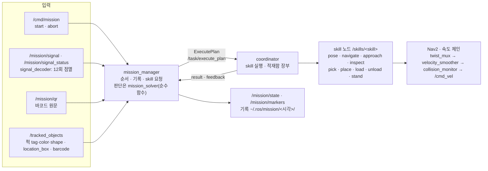
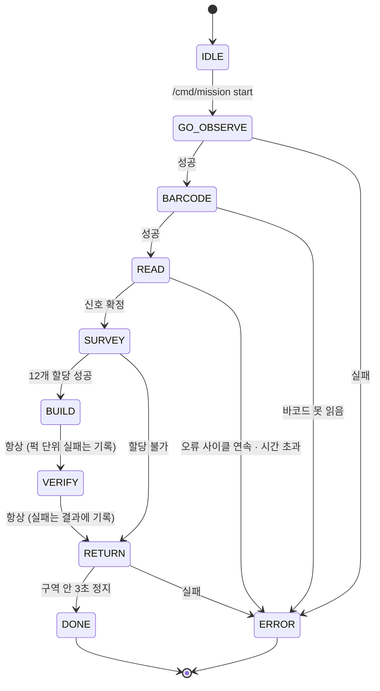

# 시스템 설계

> 이 문서는 **코드 기준 설계**다 (`mission_solver.cpp`의 `next_phase`, `mission_manager.hpp`, `plan.yaml`, `nav2_params.yaml`, `twist_mux.yaml`을 읽고 정리). 실물 시험으로 확인한 사실이 아니며, 실제 동작 확인은 [results/test-results.csv](../results/test-results.csv)에 기록한다.
> TODO: 팀원 1명 이상이 이 문서를 코드와 대조해 맞는지 확인하고 이 줄을 지운다 — **만드는 법:** 아래 표의 파라미터 값을 `plan.yaml`과 비교하고, 상태도의 전이를 `mission_solver.cpp`의 `next_phase`와 비교한다. 다르면 코드를 기준으로 이 문서를 고친다.

## 이미 있는 문서
- ROS 2 노드·토픽·메시지, 전체 구조: [lv2_module6/README.md — 전체 아키텍처](../../lv2_module6/README.md#전체-아키텍처) · [documents/project/ros](../../documents/project/ros/README.md)
- 미션 한 번의 흐름: [lv2_module6/README.md — 미션 한 번의 흐름](../../lv2_module6/README.md#미션-한-번의-흐름) · [documents/project/ros/03-plan.md](../../documents/project/ros/03-plan.md)
- 수동 조작·비상정지: [lv2_module6/README.md — 수동 조작 · 비상정지](../../lv2_module6/README.md#수동-조작--비상정지)

## 노드 · 토픽 (미션 경로)

- 단계마다 mission_manager가 coordinator에 `ExecutePlan` Action으로 skill 계획을 보내고, 결과를 받아 다음 단계로 간다.
- 적재함 장부(칸 → 퍽 tag)는 coordinator 하나만 쓴다 (`/coordinator/basket`). mission_manager는 읽기만 한다.

## 좌표계
| 좌표계 | 기준 | 단위 | 비고 |
| --- | --- | --- | --- |
| arena (도면) | 왼쪽 아래 기둥 중심 = 원점, +X 오른쪽, +Y 위쪽, 바닥 Z=0 | 도면 mm · 설정 파일 m | `plan.yaml`의 `arena_walls`, 박스·장소 좌표 |
| map | 로봇을 **켠 자리**가 원점 | m | `plan.yaml`의 `start_pose_arena`(출발 자리와 −X 방향)로 arena → map 변환 (`mission_solver`의 `arena_to_map`) |
| odom | 바퀴·IMU 적분 (EKF) | m | `map → odom`은 cuVSLAM이 낸다 |
| base_footprint | 로봇 기준점 (앞 바퀴축 쪽) | m | 몸이 뒤로 길다: 앞 0.069 · 뒤 −0.245 · 옆 ±0.151 (`nav2_params.yaml`의 footprint) |
| 카메라 | `pole_front_cam`(폴 위, 전방 하향) · `gripper_cam`(손목) | — | 손목 카메라 pitch 22° 실측 보정 (커밋 `3f2fb65`) |

- 높이: 퍽 바닥 Z=70 mm, 윗면 Z=130 mm (70 mm 박스 위). mm와 m을 섞지 않도록 도면 값은 mm, 코드·설정은 m.
- 로봇은 출발 관측 위치 (734, 950)에서 **−X**를 보고 켠다. 다른 자리에서 켰으면 launch 인자 `start_pose:=[x, y, yaw]`로 알린다.

## 실행 순서
1. **관측 준비** — 팔은 stow(접은 자세) 그대로 두고, 바코드·신호등이 보이는 자리로 옮겨야 하면 이동한다. 출발 자리에서 그대로 보면 이동 없이 통과한다 (`GO_OBSERVE`).
2. **바코드** — 이번에 새로 본 바코드만 쓴다. 읽을 때의 팔 자세는 파라미터 `barcode_arm_pose`(기본 `gaze`) (`BARCODE`).
3. **신호** — 관측 자리(−X)에서 12회 점멸의 색·순서·횟수를 읽는다 (`READ`).
4. **조사·할당** — 시작 박스 6곳을 돌며 퍽을 확인·집어 적재함에 싣고, 12개를 한 번에 R·Y·G 그룹에 할당한다 (`SURVEY`).
5. **배치** — 퍽마다 장소 앞으로 가서 주사위 칸에 놓고 내려다보고 확인한다 (`BUILD`).
6. **재검증·복귀** — 새 관측으로 칸별 판정과 12개 중복·누락을 확인하고(`VERIFY`), 출발 구역으로 돌아와 3초 정지한다 (`RETURN`).

## 상태도

전이는 `mission_solver.cpp`의 `next_phase`를 그대로 옮겼다. 다만 **현장 진단 시험 모드**(`diag`)에서는 `GO_OBSERVE`·`BARCODE`·`READ`가 실패해도 다음으로 간다 — 공식 경기가 아니라 시험용이고, 이 모드로 낸 결과는 공식 점수와 섞지 않는다.

## 단계별 완료 조건 · 실패 시
| 단계 | 완료 조건 | 실패하면 | 관련 값 (`plan.yaml`) |
| --- | --- | --- | --- |
| GO_OBSERVE | 팔 stow 그대로, 관측 자리로 옮겨야 하면 도착 (옮길 필요 없으면 바로 성공) | `ERROR` (`observe_nav_failed`) | `step_timeout_s` navigate 120 s |
| BARCODE | 이 단계 시작 **뒤에** 본 바코드(`/tracked_objects`의 barcode 또는 `/mission/qr`) | `ERROR` (`barcode_missing`) | `barcode_timeout_s` 20 s |
| READ | `signal_status`가 ok(두 사이클이 같은 답)이면 확정 · 아니면 대기 | 오류(count·unknown·range)가 `signal_error_cycles`회 이어지면 `ERROR` · 시간 초과 `ERROR`(`signal_timeout`) | `signal_error_cycles` 2 · `signal_timeout_s` 150 s |
| SURVEY | 시작 박스 6곳 조사 후 12개를 중복·누락 없이 R·Y·G에 할당 | 할당 불가면 쌓을 게 없으니 `RETURN` | `step_timeout_s` inspect 60 · pick 90 · load 90 · `retries` 2 |
| BUILD | 퍽마다 장소 앞 → 칸 위치 보정 → 놓기 → 내려다보고 10 mm 안인지 확인 | 그 퍽만 실패로 기록하고 다음으로 (끝나면 `VERIFY`) | `step_timeout_s` place 90 · unload 90 · `retries` 2 |
| VERIFY | 장소마다 **이번에 새로 본 퍽만**으로 칸별 판정 + 12개 중복·누락 | 결과에 남기고 `RETURN` | — |
| RETURN | 출발 구역 안(차체 외곽 전체)에서 3초 정지, 밖이면 한 번 보정 | `ERROR` | `home_hold_s` 3 s |

주행은 위 단계 안에서 `navigate`(Nav2)와 `approach`(저속 직선 도킹)로 한다. 박스에 다가갈 때는 변 바깥 `standoff`(0.25 m)까지 Nav2로 가고, `approach`로 붙는다. 실패하면 다음 변으로 간다 (`approach_tries` 3, `approach` 60 s).

## 안전 정지 · 오류 처리
| 상황 | 감지 | 처리 |
| --- | --- | --- |
| 신호·바코드 오류 (소등 혼동, 누락, 미등록 바코드) | `signal_status` 오류 · 바코드 시간 초과 | `ERROR`로 **안전 정지**. 추정으로 이어가지 않는다 (발제 규칙) |
| 주행이 안 풀림 | Nav2 오류 · `navigate_skill`의 진척 감시(남은 거리가 25 s 동안 0.10 m도 안 줄면 `nav_no_progress`) | Nav2 복구(후진·회전·대기) 뒤 재계획, 다음 접근 면으로 |
| skill이 응답 없이 멈춤 | `step_timeout_s` | skill 취소 후 `<skill>_timeout` |
| 집기·놓기·inspect 실패 | skill 결과 | `retries`(2)회 다시, 그래도 실패하면 그 퍽만 실패로 기록 |
| 장애물·벽 접근 | `collision_monitor`(속도 체인의 마지막 안전장치, AUTO에서도 켜 둠) | 속도 방향별 영역(`velocity_polygon`)으로 감속·정지: 전진은 몸 앞 반원, 후진은 몸 뒤 반원, 제자리 회전은 몸 크기 원에 점이 닿았을 때만 막는다 (`nav2_params.yaml`) |
| 비상정지 | `/cmd/e_stop` → `/state/emergency` | `twist_mux`의 e-stop 잠금(우선순위 255)이 바퀴 명령을 차단, coordinator도 계획 취소 |
| 미션 중단 | `/cmd/mission abort` | mission_manager가 `ExecutePlan` 취소 요청 |

- 관측(신호·바코드) 오류와 복귀 실패만 `ERROR`로 전체를 멈추고, 퍽 단위 실패는 기록하고 이어간다 (그때까지의 점수는 유효하므로 끝까지 간다).
- 실패 후 같은 회차를 수동으로 보정해 이어가지 않는다 (발제 규칙).
- TODO: 위 표의 동작을 실제로 시험해 `results/test-results.csv`에 근거를 남긴다 — **만드는 법:** 신호 소등 혼동·미등록 바코드·통신 끊김·비상정지 시험을 각각 한 번씩 하고, 기대 결과(안전 정지)와 실제 결과를 시험 ID로 적는다. 시험하지 않은 항목은 이 표에 "설계"라고만 둔다.
