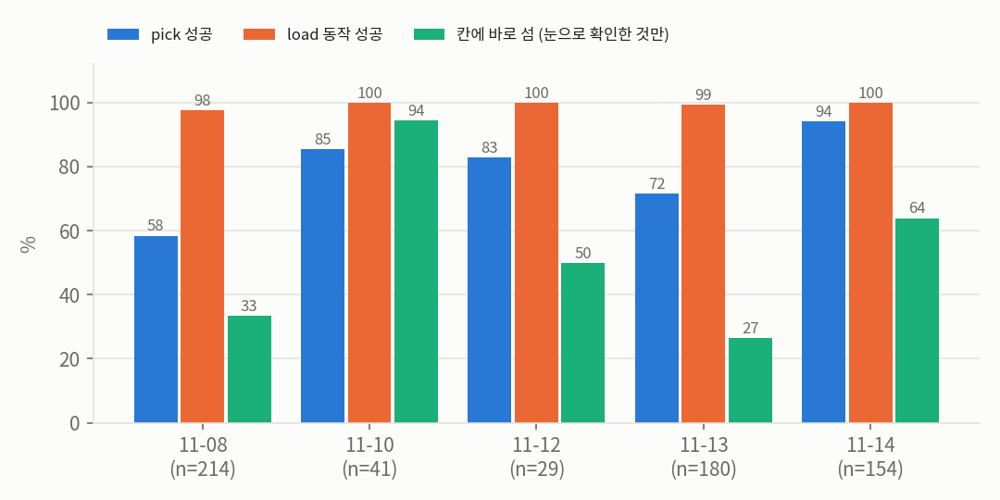
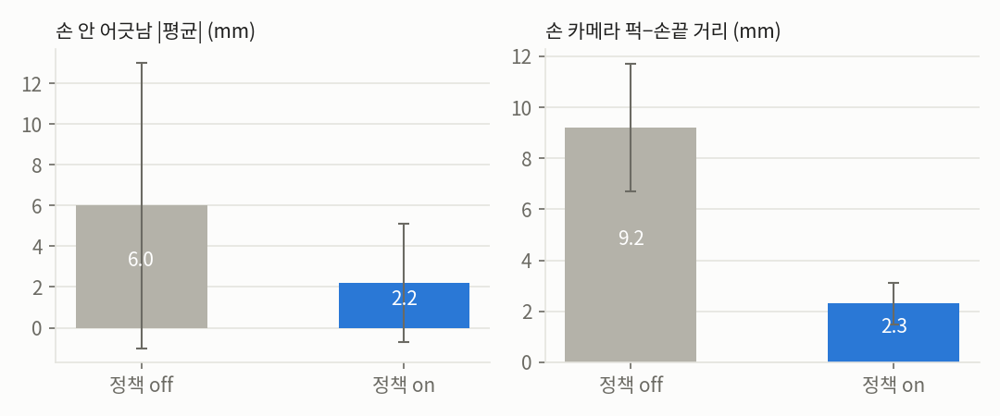
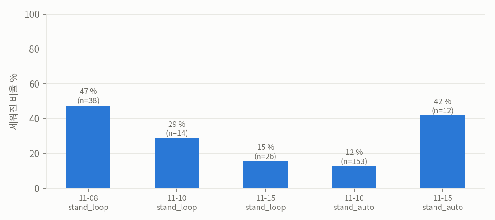
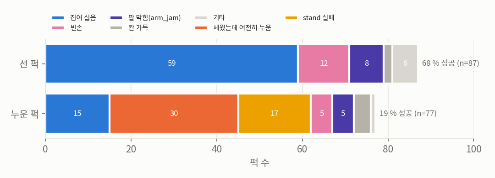
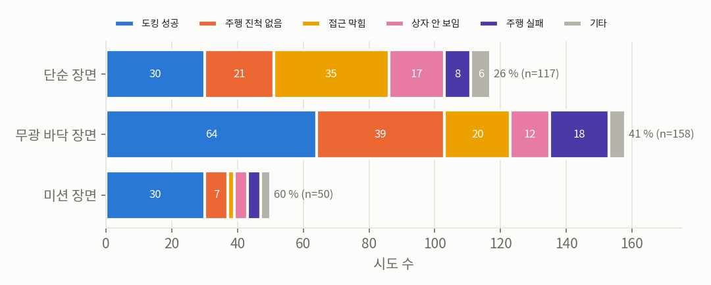
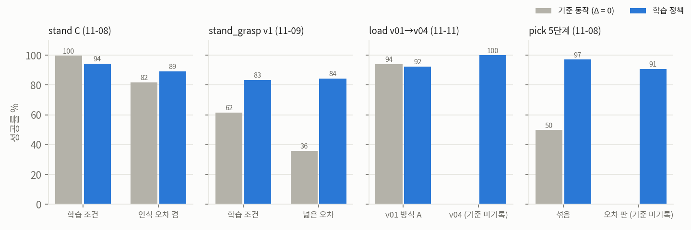

# 팔 skill 반복 시험 · RL 학습 평가 (송정혁)

2026-11-08 ~ 11-16에 돌린 팔 skill 반복 시험(실기·Isaac)과 Isaac Lab 잔차 RL 평가 결과를 수치로 줄인 것이다. 원본 로그(CSV · rosbag · 깊이 영상, 약 35 GB)는 저장소에 넣지 않았고, [summary.csv](summary.csv)와 아래 도표만 올렸다. 도표와 summary.csv는 [make_figures.py](make_figures.py)로 원본 로그에서 다시 만들 수 있다.

- 장비 구분: rosbag 시작 시각이 Isaac 시계(10⁻⁶ 초 단위로 작은 값)이면 **모의**, 아니면 **실물**로 나눴다. 11-09 pick_loop는 전부 Isaac이라 실물 집계에서 뺐다.
- 날짜별 수치는 그날 **모든 반복의 누적**이다. 같은 날 안에서도 파라미터·정책을 바꿔 가며 돌렸으므로, 한 설정의 성능이 아니라 그날 시험 전체의 결과로 읽는다.
- 시험 ID는 [test-results.csv](../test-results.csv)의 T-28 ~ T-35다.

## 1. 실기 pick → load 반복 (`pick_loop`, T-28)

| 날짜 | pick 성공 | load 동작 성공 | 칸에 바로 섬 (확인한 것) | 퍽 1개 주기 중앙값 | 손 카메라 퍽−손끝 중앙값 | 주된 pick 실패 |
| --- | --- | --- | --- | --- | --- | --- |
| 11-08 | 125/214 (58 %) | 85/87 | 4/12 | 20.7 s | 4.4 mm | 빈손 38 · 파지 후보 전부 실패 36 |
| 11-10 | 35/41 (85 %) | 35/35 | 17/18 | 12.4 s | 4.1 mm | 팔이 안 닿음 5 |
| 11-12 | 24/29 (83 %) | 21/21 | 5/10 | 19.4 s | 2.4 mm | 파지 후보 전부 실패 4 |
| 11-13 | 129/180 (72 %) | 128/129 | 13/49 | 12.9 s | 2.8 mm | 파지 후보 전부 실패 50 |
| 11-14 | 145/154 (94 %) | 145/145 | 46/72 | 13.6 s | 3.7 mm | 파지 후보 전부 실패 7 |

- pick 성공률은 11-08 58 % → 11-14 94 %로 올랐다. 11-14는 재학습한 pick v02 · load v04 정책을 올린 날이다.
- load **동작**은 거의 늘 성공(417번 중 414번)했지만, 퍽이 칸에 **똑바로 섰는지**는 별개다. 눈으로 확인한 161번 중 85번(53 %)만 섰다. 11-13(13/49)이 특히 낮았고 11-14는 46/72(64 %)였다.
- 퍽 1개 주기(pick → load)는 11-08 20.7 s에서 11-10 이후 12~14 s로 줄었다 (11-12만 19.4 s).

## 2. 실기 pick 정책 끔 · 켬 비교 (11-08, T-29)

| 지표 | 정책 끔 | 정책 켬 | 변화 |
| --- | --- | --- | --- |
| pick 성공 | 7/7 | 8/8 | — |
| 손 안 어긋남 \|평균\| (자로 잼) | 6.0 ± 7.0 mm (n=7) | 2.2 ± 2.9 mm (n=7) | −63 % (Welch p = 0.015) |
| 손 카메라 퍽−손끝 거리 | 9.2 ± 2.5 mm (n=7) | 2.3 ± 0.8 mm (n=8) | −75 % (Welch p = 0.0002) |

- 같은 날 같은 설정에서 정책 보정만 켜고 끈 비교다. 집기 성공률 차이는 없었고, 정책이 **쥔 뒤 퍽이 손 가운데에 오는 정도**를 개선했다.
- 표본이 라운드 7~8개라 작다. 이 표는 그날 분석한 수치를 그대로 옮겼다 (도표의 오차 막대는 표준편차).

## 3. 실기 누운 퍽 세우기 (`stand_loop` · `stand_auto`, T-30)

| 날짜 · 시험 | 세워짐 | 판정 방법 | 주된 실패 |
| --- | --- | --- | --- |
| 11-08 stand_loop | 18/38 (47 %) | 사람이 보고 y/n | 동작은 끝났지만 누운 채 17 |
| 11-10 stand_loop | 4/14 (29 %) | 사람 | 누운 채 9 |
| 11-10 stand_auto | 19/153 (12 %) | 손 카메라 높이 | 누운 채 86 · 팔이 안 닿음 23 · 퍽 사라짐 13 |
| 11-15 stand_loop | 4/26 (15 %) | 사람 | 누운 채 22 |
| 11-15 stand_auto | 5/12 (42 %) | 손 카메라 높이 | 누운 채 5 |

- 실기에서 누운 퍽 세우기는 **가장 약한 단계**다. 동작 자체는 대부분 끝까지 갔지만(`SUCCEEDED`) 퍽이 다시 눕는 경우가 많았다.
- 11-15 원인 분석: 누운 퍽의 축 방향을 깊이 영상이 번진 점들로 계산해 90° 틀리게 읽고 있었다. 같은 날 윗면 점만 쓰도록 고쳤다.

## 4. 실기 놓기 (`place_loop`, T-31)

| 날짜 | 놓기 성공 | 실패 |
| --- | --- | --- |
| 11-08 | 44/44 | — |
| 11-10 | 9/11 | place_failed 2 |

- 자로 잰 위치 오차는 기록하지 않아 정확도는 모른다. 성공은 skill 결과 기준이다.

## 5. 실기 coordinator 경유 상자 비우기 (`pick_coord`, T-32)

미션과 같은 경로(coordinator → skill)로 상자 위 퍽을 한 개씩 집어 적재함에 싣는다. 누운 퍽은 세운 뒤 집는다.

| 퍽 상태 | 실음 | 주된 실패 |
| --- | --- | --- |
| 선 퍽 | 59/87 (68 %) | 빈손 12 · 팔 막힘(`arm_jam`) 8 |
| 누운 퍽 | 15/77 (19 %) | 세웠는데 여전히 누움 30 · stand 실패 17 |

- 11-14 ~ 15, 실행 기록 89개. 단독 pick_loop(11-14 94 %)보다 선 퍽 성공률이 낮은데, 상자 위 퍽 여러 개 사이에서 고르고 load 실패를 되돌리는 경로가 함께 돌기 때문이다.
- 누운 퍽 실패 62건 중 47건이 세우기 단계에서 났다 (3절과 같은 문제).

## 6. Isaac 반복 시험 (T-33 · T-34)

### 6-1. Isaac pick (11-09, T-33)
- Isaac + 실기와 같은 ROS 스택으로 pick_loop 49번: 성공 26 (53 %). 실패는 파지 후보 전부 실패 12 · 세우기 쥐기 시간 초과 10. 시뮬 설정을 실기에 맞추는 중에 돌린 것이다.

### 6-2. Isaac 상자 도킹 (`approach`, 11-12 ~ 16, T-34)

| 장면 | 도킹 성공 | 주된 실패 |
| --- | --- | --- |
| 단순 장면 | 30/117 (26 %) | 접근 막힘 35 · 주행 진척 없음 21 · 상자 안 보임 17 |
| 무광 바닥 장면 | 64/158 (41 %) | 주행 진척 없음 39 · 접근 막힘 20 · 주행 실패 18 |
| 미션 장면 | 30/50 (60 %) | 주행 진척 없음 7 |

- 장면 순서가 곧 시간 순서다. 무광 바닥 장면, 미션 장면으로 옮기면서 성공률이 26 → 41 → 60 %로 올랐다.
- 남은 실패는 대부분 주행(`nav_no_progress` · `nav_failed`) 쪽이다. 실기 미션이 SURVEY의 박스 접근을 못 넘은 것(T-08)과 같은 구간이다.

## 7. Isaac Lab 잔차 RL 평가 (T-35)

각 칸은 평가 1024판의 성공률이다. 회색은 정책 보정 없이 기준 동작만(Δ = 0), 파랑은 학습 정책이다.

| 정책 | 조건 | 기준 동작 | 정책 | 판정 |
| --- | --- | --- | --- | --- |
| stand 방식 C (11-08) | 학습 조건 | 99.6 % | 94.2 % | 합격선 97 % 미달, 기준 동작보다 낮음 |
| | 인식 오차 켬 | 81.7 % | 89.2 % | +7.4 %p |
| stand_grasp v1 (11-09) | 학습 조건 | 61.6 % | 83.4 % | +21.8 %p |
| | 넓은 인식 오차 | 35.8 % | 84.4 % | +48.5 %p |
| pick 5단계 (11-08) | 섞음 | 49.8 % | 97.0 % | 오차 판 90.7 % |
| load v01 (11-03) | 11-10 방식 A 조건 | 94.0 % | 92.3 % | 기준 동작보다 낮음 → 재학습 |
| load v04 (11-11) | seed 7 | 기록 없음 | 99.9 % | Δ 상한 도달 5.3 % · 실기 배포 |
| pick v02 (11-10) | seed 7 | 기록 없음 | 100.0 % | 중심 오차 p90 3.3 mm · 실기 배포 |

- 정책이 확실히 이긴 것은 **인식 오차가 클 때**다 (stand_grasp 넓은 오차 +48.5 %p, stand C 인식 오차 +7.4 %p). 오차가 없으면 사람이 짠 기준 동작이 이미 좋아서 정책이 이득이 적거나 오히려 낮았다.
- 시뮬 성능이 실기로 그대로 오지는 않았다. 11-08 새벽 정책들은 시뮬에서 90 % 이상이었지만 실기에서 서보 오차와 Δ 상한 고착 때문에 쓰지 못해 되돌렸다. 시뮬을 실기 처짐에 맞춰 재학습한 pick v02 · load v04가 11-14 실기 94 % pick(1절)에 쓰였다.
- stand_grasp는 시뮬에서만 확인했다. 실기 세우기 성공률(3절)은 여전히 낮다.
