# 인지 실물 시험 증빙 — 2026-11-17 (전승혜)

- **장비**: 실물 로봇 (Jetson · RealSense 2대 `pole_front_cam` · `gripper_cam`). 시뮬레이션 아님.
- **실행한 코드**: 젯슨 팀 폴더 `~/Lv2_bee_Assignment` (브랜치 `feat/arena-corr-boxes-wall-keep` `700cec1f`, perception 빌드 2026-11-16 05:12). 모델 `bee_yolo11n_v6.onnx` · TensorRT.
- **방법**: 미션은 돌리지 않음. 수동 모드에서 로봇을 놓고, 인지 노드가 내는 값만 기록. 바코드 찾기는 `/cmd/mission start:BARCODE`로만 열었음 (로봇은 안 움직임).
- **원본**: rosbag `bag_obs` (16:11~17:13, `/tracked_objects` · `/mission/signal(_status)` · `/mission/qr` · `/diagnostics` · 카메라별 detections), 카메라 영상(mp4), 1초마다 저장한 사진 + `tracked.json`. 319 MB라 저장소에 안 올림 — 전승혜 노트북 `~/Downloads/evidence_1117/`.
- 아래 사진은 원본에서 고른 것. 인지 화면(debug_image)은 검출 네모·종류·속성을 그려 둔 화면.

## 결과 요약

| 시험 | 정답 | 인지 결과 | 판정 |
|---|---|---|---|
| 신호 12회 (폴 카메라) | G G Y Y R G R Y R R Y Y (R4·Y5·G3) | 사이클 31번 중 30번 정답과 같음 · 1번(16:26:32)은 6번째 G를 R로 읽음 (다음 사이클 16:27:01에 다시 정답) | 부분 성공 |
| 바코드 4종 | P2-01 · P2-02 · P2-03 · P2-04 | 4종 모두 같은 값 | 성공 4/4 |
| 퍽 ID (태그 0~11) | 퍽 12개 (사용자가 스티커로 확인) | 12개 모두 맞는 번호 · 색·모양도 맞음 | 성공 12/12 |
| 장소 ID (태그 12~14) | L 상자 3개 (태그 12·13·14) | `location_box` tag=12·13·14 확인 · 14는 손 카메라 look 자세 | 성공 3/3 |
| 사람 · 장애물 | 시험 중 사람이 지나가고 장애물을 놓음 | 사람 0.62~2.75 m · 장애물 0.86~1.61 m에서 검출 | 성공 (정답 개수 기록 없음) |
| 거리별 퍽·상자 | 25 cm씩 다가감 | 1.37 → 1.13 → 0.87 → 0.62 m, 한 걸음마다 0.24~0.26 m 줄어듦 | 성공 (줄자 기준 없음) |
| 처리 부하 | — | 인지 노드 CPU 평균 42.6 % (최대 48.6 % · top, 코어 1개 = 100 %, 젯슨 6코어) · 처리 시간 평균 YOLO 5 ms · 프레임 전체 폴 41 ms / 손 63 ms (`/diagnostics`, 17:01~17:04) | 기록 |

## 사진 목록

| 파일 | 무엇을 보여주나 | 시각 | 원본 |
|---|---|---|---|
| `signal_red.jpg` | 폴 카메라 인지 화면 `traffic_light red` | 16:13:34 | `161113_obs_P2-01_pole_front_cam_debug.mp4` |
| `signal_yellow.jpg` | `traffic_light yellow` | 16:13:13 | 같은 영상 |
| `signal_green.jpg` | `traffic_light green` (팔을 뻗은 뒤) | 16:12:52 | 같은 영상 |
| `signal_off.jpg` | `traffic_light off` | 16:12:43 | 같은 영상 |
| `barcode_P2-02.jpg` | 손 카메라에 보인 P2-02 (16:12:41 `/mission/qr` = P2-02) | 16:12:42 | `161114_obs_P2-01_gripper_cam_raw.mp4` (파일 이름은 P2-01이지만 실제 붙인 것은 P2-02) |
| `barcode_P2-01.jpg` | P2-01 (16:16:41 읽음) | 16:17:02 | `161533_obs_R2_gripper_cam_debug.mp4` |
| `barcode_P2-03.jpg` | P2-03 (16:24:49 읽음) | 16:25:00 | `162456_obs_R4_gripper_cam_debug.mp4` |
| `barcode_P2-04.jpg` | P2-04 (16:28:57 읽음) | 16:29:05 | `162902_obs_R5_gripper_cam_debug.mp4` |
| `puck_tag_5_11.jpg` | 빨강 사각 서 있음 tag 5 · 빨강 원기둥 서 있음 tag 11 | 16:39:59 | `163956_look_tags2/` |
| `puck_tag_7_0.jpg` | 초록 원기둥 서 있음 tag 7 · 초록 사각 **누움** tag 0 | 16:44:55 | `164455_look_tags/` |
| `puck_tag_2_1.jpg` | 초록 사각 **누움** tag 2 · 초록 사각 서 있음 tag 1 | 16:50:33 | `165033_look_tags/` |
| `puck_tag_10_6.jpg` | 빨강 원기둥 tag 10 · 초록 원기둥 tag 6 | 16:53:17 | `165317_look_tags/` |
| `puck_tag_8_9.jpg` | 초록 원기둥 tag 8 · 빨강 원기둥 tag 9 | 16:56:53 | `165653_look_tags/` (손 카메라 사진만 — 같은 때 폴 카메라의 초록 테이프 오검출은 뺌) |
| `puck_tag_4_3.jpg` | 빨강 사각 **누움** tag 4 · 빨강 사각 서 있음 tag 3 | 16:59:52 | `165952_look_tags/` |
| `dist_1_37m.jpg` · `dist_1_13m.jpg` · `dist_0_87m.jpg` · `dist_0_62m.jpg` | 같은 상자로 25 cm씩 다가가며 본 퍽·상자 | 16:41:48~16:42:49 | `164148_dist_step0` ~ `164249_dist_step3` |
| `person.jpg` | 사람 검출 (0.82 · 1.25 · 1.50 m) | 16:52:18 | `165218_dist_step1/` |
| `obstacle_person.jpg` | 장애물 1.61 m · 사람 2.05 / 2.75 m | 16:55:22 | `165522_dist_step0/` |
| `location_box_tag13.jpg` | 장소 상자 `location_box` tag 13 (0.60 m) | 17:09:56 | `170956_place_box2/` (모터 전원 꺼진 뒤 손으로 밀어 둠) |
| `limit_far_edge_standing_as_lying.jpg` | **한계**: 상자 먼 끝에 **서 있는** 퍽을 `puck_lying`으로 봄 | 17:02:44 | `170244_pickfar_before/` |

## 거리별 값 (`tracked.json` `details.distance` · 로봇 중심 → 물체 바닥, 수평 거리)

| 걸음 | 퍽 (초록) | 시작 상자 가운데 | 로봇 앞면 → 상자 면 (`face_dist_m`) | 본 카메라 |
|---|---|---|---|---|
| 0 | 1.369 m | 1.335 m | 1.143 m | 폴 |
| 1 | 1.130 m | 1.066 m | 0.888 m | 폴 |
| 2 | 0.874 m | 0.853 m | 0.651 m | 폴 |
| 3 | 0.621 m (원기둥으로 모양 나옴) | 0.577 m | 0.466 m | 폴 + 손 |

로봇이 한 번에 0.25 m(0.05 m/s × 5 s 명령) 갔고, 퍽 거리는 0.239 · 0.256 · 0.253 m 줄었음. 줄자로 잰 실제 거리는 없음 — 이동량과 맞는지만 확인.

## 한계 (오늘 본 것)

- **상자 먼 끝의 서 있는 퍽을 누움으로 봄** — 사각(tag 3)·원기둥(tag 6) 2/2. 손 카메라가 비스듬히 봐서 옆면이 넓게 보일 때. 같은 상자 가까운 쪽 서 있는 퍽은 모두 맞음.
- **장소 상자가 태그를 놓치면 `start_box`로 돌아감** — 처음 2초는 `location_box` tag 13, 이후 태그를 못 읽은 프레임에서 같은 상자가 `start_box`로 나옴 (`perception_node.cpp` 741~790 · 1194~1205: 깊이로 찾은 상자는 기본 `start_box`, 태그를 읽은 프레임에서만 `location_box`). 미션은 장소를 `plan.yaml` 도면 좌표로 정해서 동작 영향은 작음.
- **멀리서 상자 하나를 2~3개로 잡음** (1.1~1.5 m).
- **초록 테이프를 초록 사각 퍽으로 오검출** (0.6 m 근처). 해당 장면은 증빙에서 뺌.
- **신호 1사이클 오독** (31 중 1, 6번째 G → R). 확정 신호(`/mission/signal`)도 그 순간 한 번 틀린 값으로 나갔다가 다음 사이클에 정답으로 바뀜 (`confirm: 1`이라 한 사이클로 확정).
- **바코드는 폴 카메라로 못 읽음** — 4종 모두 팔을 뻗어 손 카메라로 읽음 (P2-02는 폴 카메라로 1분 동안 못 읽음).
- 신호 순서는 1가지만 시험. 장소 태그는 추가 시험에서 12·13·14 모두 확인.
- 발행 주기: rosbag 기준 `/tracked_objects` 평균 **9.4 Hz** (설정 10 Hz). 시험 중 `ros2 topic hz`로 한 번 21 Hz가 나왔지만 rosbag에서는 재현되지 않음.

## 제외한 것

- 바코드 R3 (P2-03 첫 시도): 붙인 위치 문제 — 사용자 결정으로 제외.
- 바코드 R3b: 시작 명령이 인지 노드에 안 닿아 바코드 찾기가 꺼져 있었음 — 무효.
- 초록 테이프 오검출 장면.
- 17:00:52 이후 모터 전원 꺼짐 — 그 뒤 팔·바퀴 동작은 시험으로 쓰지 않음 (장소 태그 사진은 카메라·인지만 씀).

## 사진 (실물 · 2026-11-17)

### 신호등 — 폴 카메라 인지 화면 (색마다 1장)
| 빨강 | 노랑 | 초록 | 꺼짐 |
|---|---|---|---|
| 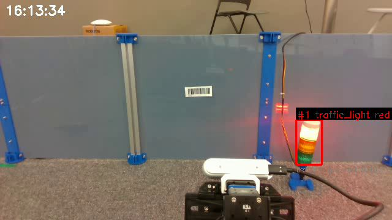 | 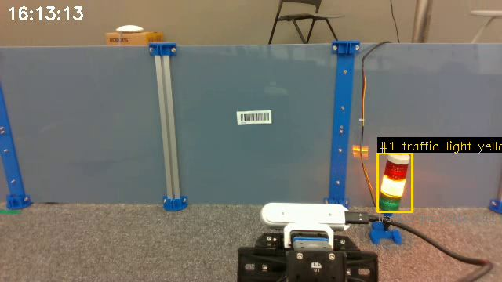 | 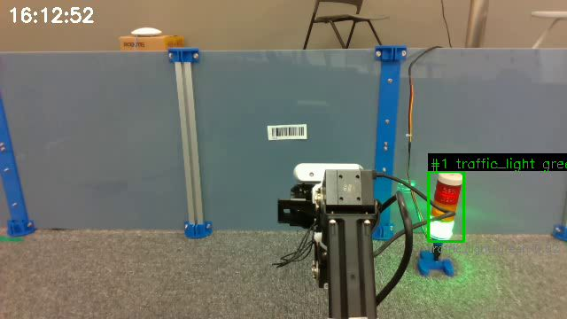 | 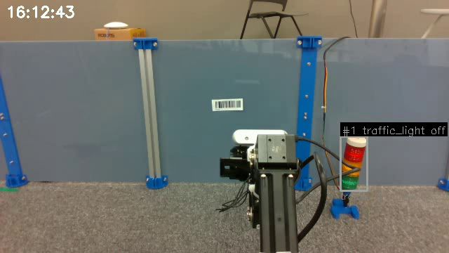 |

### 바코드 4종 — 손 카메라 (읽힌 직후)
| P2-01 | P2-02 | P2-03 | P2-04 |
|---|---|---|---|
| 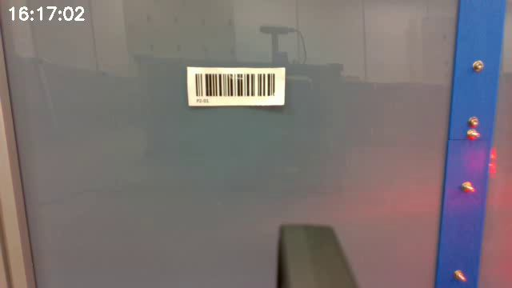 | 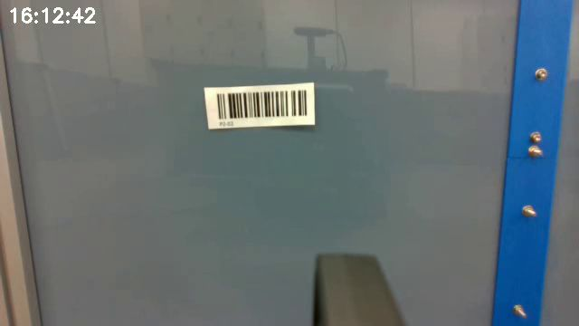 | 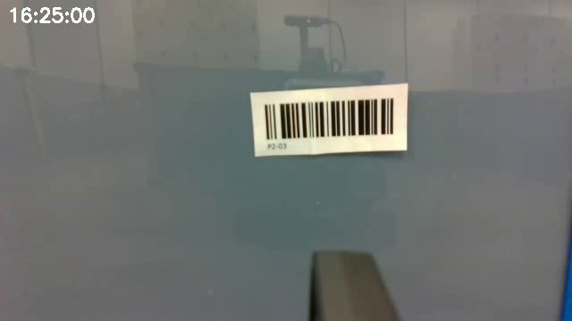 | 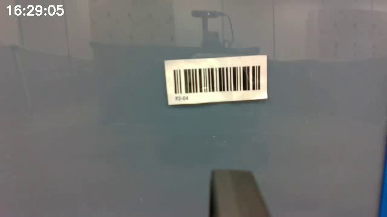 |

### 퍽 ID 0~11 — 손 카메라 look 자세 (태그·색·모양·자세)
| tag 5 · 11 | tag 7 · 0 | tag 2 · 1 |
|---|---|---|
| 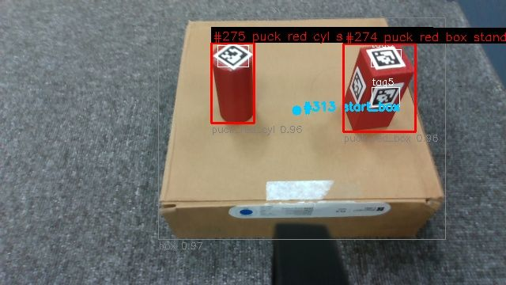 | 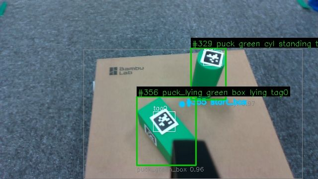 | 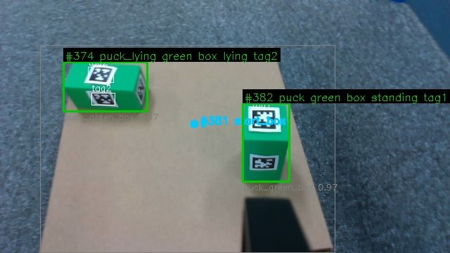 |

| tag 10 · 6 | tag 8 · 9 | tag 4 · 3 |
|---|---|---|
| 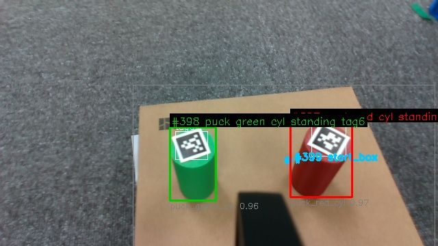 | 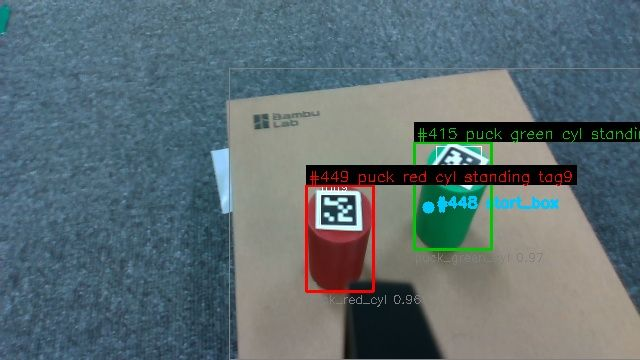 | 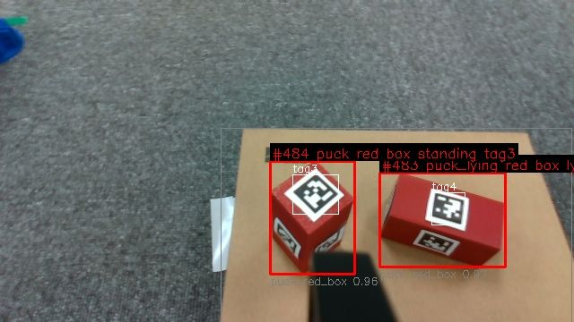 |

### 거리별 퍽·상자 인지 — 폴 카메라 (25 cm씩 다가감)
| 1.37 m | 1.13 m | 0.87 m | 0.62 m |
|---|---|---|---|
| 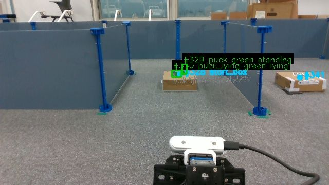 | 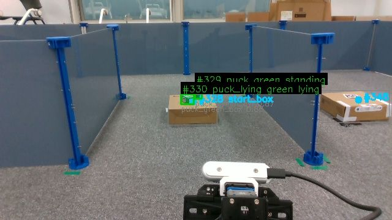 | 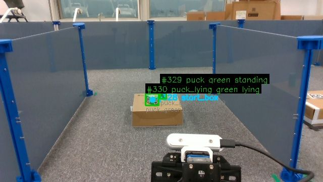 | 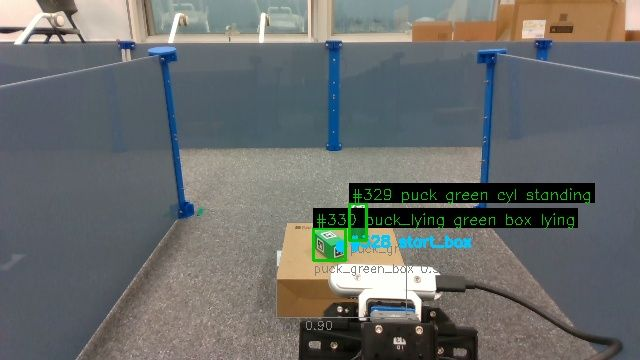 |

### 사람 · 장애물 · 장소 상자
| 사람 | 장애물 + 사람 | 장소 상자 tag 13 |
|---|---|---|
| 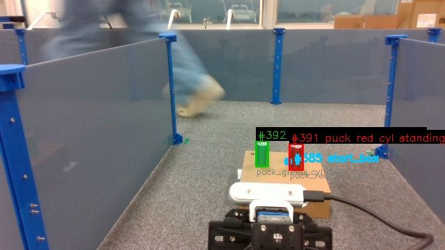 | 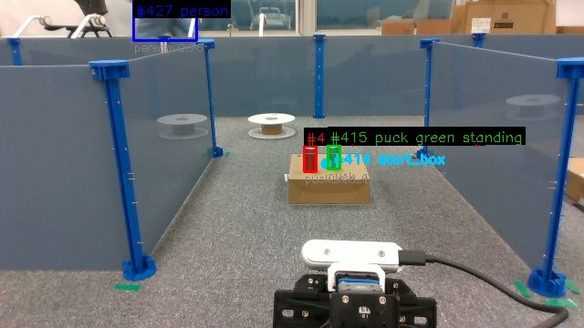 | 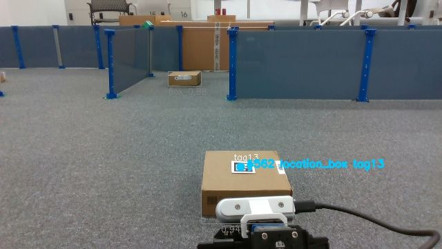 |

### 한계 — 상자 먼 끝에 선 퍽을 `puck_lying`으로 봄
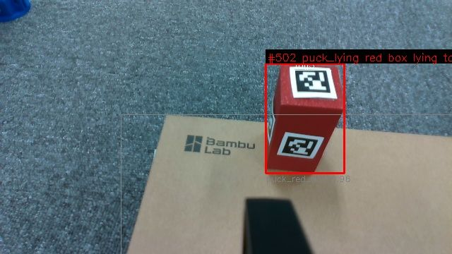

## 실물 신호 관측 기록 (`signal_real.json`)
- 발제 STEP 3 `signal.json`(로봇이 실제로 관측한 순서·횟수·종료 판단)에 해당하는 **실물** 기록 — rosbag `/mission/signal_status` · `/mission/signal`에서 뽑음.
- 사이클 31번 중 30번이 정답 `G G Y Y R G R Y R R Y Y`(R4·Y5·G3)와 같음. 16:26:32 한 사이클은 6번째 G를 R로 읽어 `/mission/signal`로 한 번 나갔고, 16:27:01에 정답으로 돌아옴.
- `project2/results/signal.json`은 팀 공용 파일(모의 결과로 대체됨)이라 고치지 않음 — 실물 기록은 이 파일로 따로 둠.

## 추가 성공 시험

- 장소 ID 12·14를 추가 판독하여 12·13·14 **3/3 확인**. 원본 `place12_tracked.json`, `place14_tracked.json`.
- [미등록 바코드 거부·오류 종료·정지 명령 확인](unknown_barcode/README.md) — T-44. 정상 코드 4종 판독 시험과 별도.

| 장소 태그 12 | 장소 태그 14 (손 카메라 look) |
| --- | --- |
| 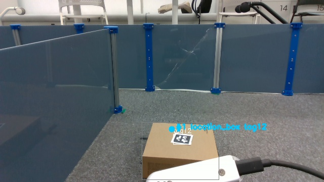 | 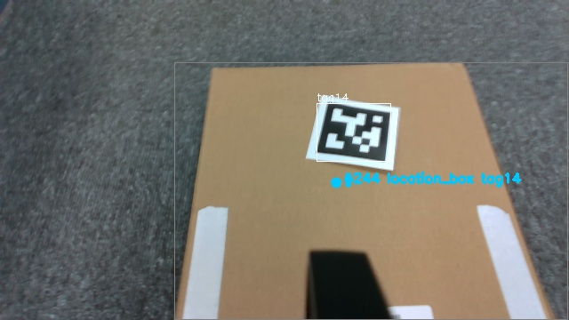 |
