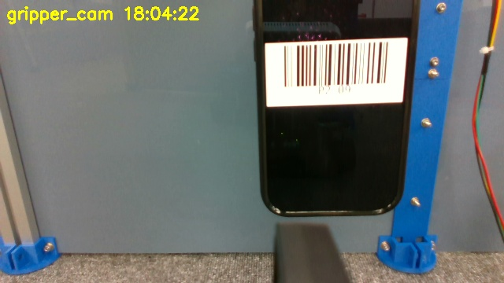

# 미등록 바코드 오류 처리 — 실물 검증 성공

2026-11-17, Jetson · 손 카메라 · 자동 모드에서 `start:BARCODE` 단계만 실행. 인식 토픽에 값을 주입하지 않고 휴대폰의 Code 128 P2-09를 관측했다.

| 확인 항목 | 실제 관측 | 판정 |
| --- | --- | --- |
| 미등록 문자열 판독·발행 | 18:04:21 P2-09 판독 및 `/mission/qr` 발행 (별도 판독 회차) | 성공 |
| 미등록 값 거부 | 자동 모드 회차 18:08:23에 미등록 문자열 경고, 정상 barcode 필드는 빈 값 유지 | 성공 |
| 오류 종료 | 18:10:15 `phase: ERROR`, `unknown_barcode` 원인 기록 | 성공 |
| 종료 후 정지 명령 | 18:10:16 `/cmd_vel`의 선속도·각속도 모든 축 0 | 성공 |

자동 모드 회차에서는 화면의 P2-09를 `"2#09`로 판독했다. 따라서 이 회차는 **미등록 문자열의 거부·오류 종료 검증**이며 P2-09 정확 판독 성공률 시험으로 사용하지 않는다. 오류 상태 ERROR는 이 시험의 기대 결과다. 팔 stow 완료는 미션 steps 원본에서 확인했다. 속도 0은 정지 명령 확인이며 제동거리 측정은 하지 않았다.

- 증빙: `badcode5_state.txt`, `badcode5_qr.txt`, `bringup_excerpt.log`, `error.json`, `stop_cmd_vel.txt`.
- 영상 원본: 노트북 `~/Downloads/evidence_1117/badcode5/180808_badcode5_gripper_cam_{raw,debug}.mp4` (raw 3033프레임, debug 601프레임).
- 수동 모드로 중단된 준비 회차는 이 성공 판정의 근거에 포함하지 않는다.

